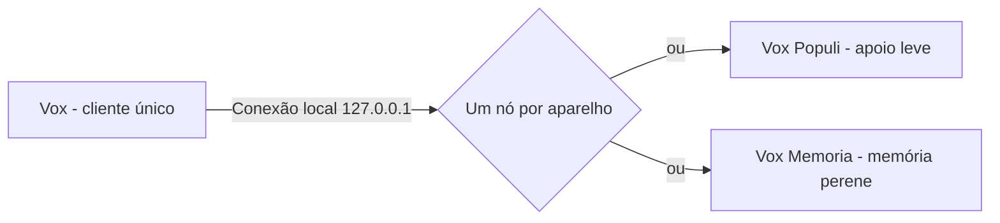
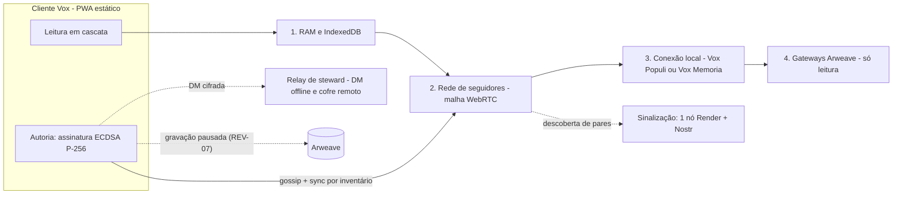

# 📣 Vox — Rede Cívica Local-First de Participação Popular

[](./client)
[](./client/js/identity/local-account.js)
[](./docs/adr/019-esquecer-por-padrao-e-memoria-civica.md)
[](./LICENSE)
[](./docs/TESTES.md)
[](./client/sw.js)

**Vox** é um PWA cívico *local-first* — sem bundler, sem servidor central de login e sem leilão de alcance — para ampliar a participação popular e a autonomia das comunidades. Conta, chaves e dados nascem no aparelho; o conteúdo circula pela **rede de seguidores** (você replica o que segue).

A ambição é ser um **bem comum aberto**: transparente, copiável, modificável e maior que qualquer fundador, mantenedor, empresa ou plataforma. Hoje o controle administrativo ainda está concentrado em uma pessoa — e nenhuma funcionalidade planejada é anunciada como pronta.

## 🚨 Estado atual (nov/2026)

> [!IMPORTANT]
> - **Laboratório:** o piloto humano (V-P09) não começou e a rede não está aberta ao público (faltam parecer jurídico, resposta a conteúdo grave e *bus factor* ≥ 2).
> - **Sem gravação no Arweave** (`arweaveUpload: false`, REV-07): a preservação passa pela rede de seguidores e pelo nó opcional **Vox Memoria**.
> - **Sinalização frágil:** 1 nó Render mais o caminho Nostr em paralelo; sem TURN.
> - **Infra extra adiada** até passar de 50 usuários ativos (INF-01…04).
> - **`main` atrás de `develop`:** a `main` pública está no release #262; o trabalho recente vive em `develop`.
>
> Detalhes em [ROADMAP.md](./docs/ROADMAP.md) e no [retrato do repositório](./docs/strategy/analise-repositorio-vox-2026-11.md).

## 🧭 Navegação rápida

- **Usar o app:** [yurikayel.github.io/vox](https://yurikayel.github.io/vox/) · [guia de testes](https://yurikayel.github.io/vox/#/ajuda/teste)
- **Baixar:** [Downloads](https://yurikayel.github.io/vox/download) · [matriz de plataformas](#-downloads-e-plataformas)
- **Documentação:** [índice docs/README.md](./docs/README.md) · [GLOSSARIO.md](./docs/GLOSSARIO.md) · [SECURITY.md](./SECURITY.md)
- **Roadmap:** [ROADMAP.md](./docs/ROADMAP.md) — único plano vivo ([ADR-017](./docs/adr/017-consolidacao-roadmap-unico.md))
- **Features:** [FEATURES.md](./docs/FEATURES.md) — o que existe de fato, com rotas, módulos e testes
- **Changelog:** [CHANGELOG.md](./CHANGELOG.md)
- **Retrato do repositório:** [análise nov/2026](./docs/strategy/analise-repositorio-vox-2026-11.md) · [auditoria nov/2026](./docs/audits/auditoria-features-arquitetura-2026-11.md)
- **MVP técnico:** [spec do MVP técnico](./docs/strategy/mvp-tecnico-vox-2026-11.md)

## 🧩 Um app, dois nós opcionais

Todo mundo usa **o mesmo cliente, `Vox`**. Quem quiser sustentar a rede escolhe **um** nó local, com painel simples só em loopback (`127.0.0.1`) — [ADR-011](./docs/adr/011-taxonomia-tripartite-produtos-vox.md):



| Papel | Produto | Para quem | O que faz |
|---|---|---|---|
| **Só usar** | **`Vox`** (cliente) | Qualquer pessoa | PWA, `Vox.exe` ou `vox.apk`: feed, comunidades, enquetes, votações, Feira, diretório e DMs cifradas de ponta a ponta — sem configurar servidor. |
| **Apoiar** | **`Vox Populi`** (nó de apoio) | Quem apoia no dia a dia | Serviço leve em segundo plano: cache SHA-256, relay cego local (`blind_relay.py`) e painel simples (ligar/pausar, só Wi-Fi, cota leve). |
| **Manter memória** | **`Vox Memoria`** (nó de memória) | Quem mantém a rede | Cede CPU, disco e banda à memória perene (`relay/central_memory.py`): log de escrita (WAL) `< 0,2 ms`, snapshot a cada 2 s, sincronização incremental e painel de cotas. |

- **Conexão local (*Usando seu nó*):** com `Vox Populi` ou `Vox Memoria` rodando na mesma máquina, o `Vox` se conecta sozinho em `127.0.0.1:3920` / `:3921`.
- **Nó local único:** só um nó roda por vez. Abrir um com o outro ativo oferece encerramento limpo (grava WAL e snapshot) e troca sem conflito de portas.
- **Kit steward não é um 4º produto:** [`packaging/steward-kit-*`](./packaging/) e [`relay/deploy/`](./relay/deploy/) implantam o **`Vox Memoria` em VPS** para coletivos (HTTPS/WSS com Caddy e cotas — [steward-relay-kit.md](./docs/operations/steward-relay-kit.md)).

## 📥 Downloads e plataformas

> [!NOTE]
> `.exe` e `.apk` não ficam no git: são compilados no GitHub Actions ([`release-binarios.yml`](./.github/workflows/release-binarios.yml)) a cada tag `v*`, com `SHA256SUMS` e atestação de proveniência (`actions/attest-build-provenance`). A última Release é a **`v7.40` (09/11/2026)**; os binários não acompanham cada versão do PWA.

| Plataforma | `Vox` | `Vox Populi` | `Vox Memoria` | Como funciona |
|---|---|---|---|---|
| 🪟 **Windows** 10/11 | [`Vox.exe`](https://github.com/yurikayel/vox/releases/latest/download/Vox.exe) | [`VoxPopuli.exe`](https://github.com/yurikayel/vox/releases/latest/download/VoxPopuli.exe) | [`build.ps1`](./packaging/zero-central-memory-windows/) (build local, fora da Release) | WebView2 nativo (~40 MB de RAM); nós na bandeja do sistema. |
| 🤖 **Android** 7.0+ | [`vox.apk`](https://github.com/yurikayel/vox/releases/latest/download/vox.apk) | [`vox-populi.apk`](https://github.com/yurikayel/vox/releases/latest/download/vox-populi.apk) | — (desktop, placa ou VPS) | APKs `< 100 KiB`; o nó roda como serviço em primeiro plano no Wi-Fi. |
| 🐧 **Linux e Raspberry Pi** | [guia WebKitGTK](./packaging/desktop-linux/) | [guia `systemd`](./vox-populi/) | `relay/server.py` + [Kit steward](./docs/operations/steward-relay-kit.md) | Serviço leve (~15 MB de RAM em repouso) para Pi e servidor doméstico. |
| 🍎 **iOS e macOS** | [PWA no Safari](https://yurikayel.github.io/vox/) (espelho opcional: [vox-9df.pages.dev](https://vox-9df.pages.dev/)) | [guia `launchd`](./packaging/node-macos/) | `relay/server.py` | No iOS, *Compartilhar → Tela de Início* evita a limpeza de 7 dias do Safari (ITP). |

## 🚀 Começando

**Requisitos:** Node.js ≥ 22 (`engines` do `package.json`) e Python 3.11+ (o CI roda 3.11, 3.12 e 3.15). O cliente não tem build.

```bash
# 1. Cliente PWA (ES Modules exigem HTTP, não file://)
cd client
python -m http.server 8080        # abra http://127.0.0.1:8080/

# 2. Dependências de desenvolvimento e testes
npm ci
npm test                          # suíte JS (node:test) + relay Python (unittest)

# 3. Antes de abrir PR (sempre para develop)
npm run validate                  # lint + lint:relay + complexidade + docs + camadas + testes
```

Opcional — sinalização, relay e nós locais:

```bash
npm start                         # sinalização WebRTC (relay/signaling.py, :3921)
cd relay && python server.py      # relay completo (:3920): cache, inbox, espelho, memória, OAuth
```

O `Vox Memoria` para Windows compila com `packaging/zero-central-memory-windows/build.ps1` e usa apenas loopback (`127.0.0.1:3920`/`:3921`). O `Vox Populi` para Linux está em [`vox-populi/`](./vox-populi/). Endpoints em [relay-api.md](./docs/specs/relay-api.md); tiers e CI em [TESTES.md](./docs/TESTES.md); fluxo de contribuição em [CONTRIBUTING.md](./CONTRIBUTING.md).

## 🛠️ O que já funciona

Legenda: ✅ no ar · 🧪 laboratório (escrito, fora das telas ou atrás de flag) · 🚧 parcial · ⏸️ pausado. Lista canônica, com rotas, módulos e testes, em [FEATURES.md](./docs/FEATURES.md).

- **Praça e comunidades:** ✅ feeds Social e Cívico, comunidades, fórum, Canal, enquetes, hashtags, modo eleitoral e moderação local · 🧪 Pol.is não plugado e moderador natural atrás de flag (`vox.lab.moderador`).
- **Identidade e recuperação:** ✅ conta ECDSA P-256, cofre v2, frase de 12 palavras, cofre na malha, `.voxid` e apagar dados locais · 🚧 Guardiões Shamir · 🧪 perfil coletivo M-de-N.
- **Mensagens:** ✅ DMs cifradas de ponta a ponta e caixa de saída com reenvio por 7 dias · 🚧 entrega offline depende de relay de steward; "Esconder meu IP" depende de TURN.
- **Mídia e distribuição:** ✅ áudio e vídeo ≤ 320p, deduplicação SHA-256, sync por inventário, Notas de Perfil, republicar e `EXPLODE!` (POSSE) · ⏸️ gravação no Arweave · 🧪 Webxdc + CRDT (`client/js/labs/parado/`, 21 módulos fora do precache).
- **Economia local e rede:** ✅ Feira, Pix Zaps, Voxels locais, diretório e Bluesky · 🚧 outras redes exigem `/oauth/exchange` · ⏸️ Cartório Cívico (só hash local) · 🧪 AI Social Dungeon.

Recuperação soberana: [ADR-025](./docs/adr/025-cofre-v2-so-a-senha-abre.md) (cofre v2), [ADR-032](./docs/adr/032-login-perene-a-conta-nasce-com-saida.md) (frase e guardiões) e [ADR-037](./docs/adr/037-cofre-na-malha.md) (cofre na malha). Laboratórios: [ADR-005](./docs/adr/005-collective-profile-m-of-n.md) (M-de-N), [ADR-012](./docs/adr/012-soberania-digital-cintura-fina-cartuchos-webxdc.md) (Webxdc) e [ADR-033](./docs/adr/033-ia-so-no-rpg-local-primeiro.md) (RPG local).

## 🆕 Novidades de novembro/2026

- **Assinatura v2 vira padrão em 24/11/2026** (`SIGV2_FROM`, PM-85): `sigv: 2` cobre campos aninhados.
- **Recuperação soberana:** frase de recuperação, guardiões e cofre na malha ([ADR-032](./docs/adr/032-login-perene-a-conta-nasce-com-saida.md), [ADR-037](./docs/adr/037-cofre-na-malha.md)).
- **Cofre v2 e chaves em repouso** (PM-90, PM-93): Google e Meta não abrem cofre; abas sincronizam com segurança (`identity/tab-sync.js`).
- **Relay mais estrito** (PM-94, PM-95, #281): autorização por dono e origem ([ADR-027](./docs/adr/027-autorizacao-no-relay-dono-e-origem.md)) e snapshot do relay cego em modo `compat` ([RFC 0002](./docs/rfc/0002-snapshot-autenticado-do-relay-cego.md)).
- **Malha mais barata:** sync por inventário (≈157 KB → ≈7 KB, PM-80) e caixa de saída de DMs (PM-78).
- **Um app, dois nós:** taxonomia `Vox` / `Vox Populi` / `Vox Memoria` ([ADR-011](./docs/adr/011-taxonomia-tripartite-produtos-vox.md)).

<details>
<summary>Lista completa de novembro/2026</summary>

Histórico integral em [CHANGELOG.md](./CHANGELOG.md) e [client/DEV.md §42–§44](./client/DEV.md#42-postar-em-etapas--social-ou-cívico).

- **Experiência e produto:** design system *Sovereign Agora* ([ADR-016](./docs/adr/016-design-system-sovereign-agora-e-democracia-direta.md)); feeds Social e Cívico; fluxos em etapas (entrada, compositor, proposta, comunidade, Feira); assistentes (`#/settings/network/guia`, `#/backup`, `#/wallet/guia`); modo Canal (PM-81); modo eleitoral automático (REV-24); contas vinculadas Bluesky e OAuth via `/oauth/exchange` quando configurado.
- **Identidade, recuperação e segurança:** cofre v2 e chaves em repouso; frase de 12/24 palavras, guardiões e cofre na malha; assinatura v2 e integridade de mídia; relay autorizado por dono e origem; snapshot `compat`; CodeQL, Dependabot e catraca de camadas ([revisão DevSecOps](./docs/audits/revisao-devsecops-2026-11-10.md), [ADR-035](./docs/adr/035-camadas-e-contextos.md)).
- **Malha e resiliência:** sync por inventário (PM-80); caixa de saída de DMs com reenvio por 7 dias (PM-78); denúncia assinada arquivada até a revisão de 48 h (PM-69); quarentena de chave nova com prova de trabalho de 14 bits (LAN-14); nó leve (100 MB) ou de apoio (512 MB a 1 GB no Wi-Fi); mensagens de erro honestas (LAN-21); convite com vínculo assinado (PM-82) e moderador natural em laboratório (PM-83).
- **Taxonomia:** um cliente (`Vox`) e dois nós opcionais, um por aparelho (`Vox Populi` ou `Vox Memoria`), com Kit steward como implantação do `Vox Memoria` em VPS (ADR-011, #289).

</details>

## ⚙️ Arquitetura



Camadas do cliente (`app` → `render` → `base`, mais `labs`) e portas de identidade e cofre em [docs/ARCHITECTURE.md](./docs/ARCHITECTURE.md) e [ADR-035](./docs/adr/035-camadas-e-contextos.md). Protocolo e tags em [ARCHITECTURE.md](./ARCHITECTURE.md).

<details>
<summary>Esquema de tags e dados públicos</summary>

Nem todo estado é transação pública: parte vive em IndexedDB e no armazenamento local, e não há banco SQL global. **Denúncias (`report.js`, LAN-12) nunca são públicas:** ficam no aparelho e seguem por DM cifrada à moderação.

| Ação | Tag `Type` | Campos e tags-chave | Finalidade |
|---|---|---|---|
| **Comunidade** | `community` | `Community-Id`, `Title`, `Description`, `Category` | Funda espaço de debate |
| **Adesão** | `membership` | `Community-Id` | Registra vínculo no perfil |
| **Tópico / Resposta** | `topic` / `reply` | `Community-Id`, `Topic-Title`, `Reply-To` | Fórum e árvore de respostas |
| **Moderação** | `mod-action` | `Community-Id`, `Action` (`hide`/`ban`), `Target` | Filtro interpretado no cliente |
| **Chave DM / Handle** | `profile-key` / `handle` | `Dm-Pub` (JWK P-256), `Handle`, `Owner-Addr` | DMs cifradas e `@slug` sem cartório central |
| **Governança / Feira** | `governance-proposal` / `listing` | `Community-Id`, `Proposal-Id`, `Diff` | Propostas com diff e classificados assinados |
| **Update / Posicionamento** | `community_update` / `civic-vote` | foto, título, descrição (PM-09) · voto cívico | Só dono ou moderação altera a comunidade; 1 voto por conta |

</details>

## 🔎 Transparência técnica

O que o diagrama não desenha:

- **Sinalização em dois caminhos:** 1 nó Render (`wss://vox-sentinel.onrender.com`) e **Nostr efêmero cifrado** (`kind 25050`, reconexão com backoff; REV-09, PM-17), ainda sem medição de campo. Sem TURN e sem 2º nó abaixo de 50 usuários ativos (INF-01).
- **Malha:** troca de `WANT`/`HAVE`/`BLOB` entre aparelhos; sem relay completo público (REV-04) e com Deno Deploy pausado.
- **Nós locais só em loopback:** `Vox Populi` e `Vox Memoria` escutam apenas em `127.0.0.1`; descoberta automática na rede local e semeadura WebTorrent não estão implementadas.
- **Leitura multi-gateway:** 4 gateways com timeout de 8 s; 3 servem de testemunha GraphQL ([ADR-009](./docs/adr/009-multi-gateway-graphql-corroboration.md), `proposed`).
- **Grafo de convites visível na malha** ([THREAT-MODEL T19](./docs/THREAT-MODEL.md)).

## 🎯 Visão e compromissos

### A voz do povo

**Vox populi** — *a voz do povo* — é o propósito: comunidades constroem e mantêm os espaços digitais que usam. O nó de apoio herdou o nome porque é o jeito mais direto de uma pessoa sustentar a rede com o próprio aparelho. O Vox não fala em nome do povo, não substitui organização humana e não trata plataformas centralizadas ou o Fediverso como inferiores ([LESSONS.md](./docs/process/LESSONS.md) · [POSITIONING.md](./docs/product/POSITIONING.md)).

### Três lógicas de rede

| Modelo | Como opera | Trade-off | Foco do Vox |
|---|---|---|---|
| **Centralizado** | Uma empresa controla serviço, identidade e alcance. | Conveniência vs concentração de poder e dados. | Reduzir dependência central; formatos públicos auditáveis. |
| **Federado** | Instâncias independentes interoperam por protocolo. | Distribui poder, mas exige administrar servidores. | Aprender e interoperar sem competir com o Fediverso. |
| **Local-first** | Chaves, dados e operação começam no aparelho. | Depende de pares, implementação e manutenção real. | Uso local, portabilidade e infraestrutura substituível. |

### Compromissos de transparência

Auditados na [revisão de copy de 23/10](./docs/audits/honest-copy-audit-2026-10-23.md):

1. **Sem alcance comprado:** sem venda de visibilidade nem ranking opaco.
2. **Sem falsa prova de identidade humana:** uma chave `vx_…` identifica uma conta, não prova "uma pessoa, um voto".
3. **Sem P2P mágico:** descoberta e sync ainda dependem de sinalização WebRTC/Nostr e de nós voluntários.
4. **Sem imunidade judicial:** o que já foi gravado no Arweave é permanente, e o que circula na rede de seguidores pode ser replicado por outros aparelhos. Hoje o cliente não grava no Arweave. Marco Civil da Internet e LGPD aplicam-se integralmente ([COMPLIANCE-BR.md](./docs/legal/COMPLIANCE-BR.md)).
5. **Sem publicação automática:** POSSE só gera rascunhos e intents; quem publica é sempre a pessoa.
6. **Repositório ≠ comunidades:** o código não governa comunidades; votos em comunidades valem localmente e não alteram o código canônico.

### Ecossistema cívico (exploratório)

Há um estudo inicial de interoperabilidade aberta com o *Tramitado*, sem integração nem parceria formalizada ([brainstorm](./docs/brainstorms/brainstorm-sinergia-tramitado-vox-2026-11.md)).

## 📊 Releases e validação

| Campo | Valor |
|---|---|
| **Commit SHA** | `dbc39fa` |
| **Suíte de Testes** | **2301** (`1981` JS + `320` Python) |
| **Service Worker** | `vox-pwa-v7.143-real-network-audio-video-upload` |

*Tabela regenerada por `npm run release-line` (grava [docs/release-metadata.json](./docs/release-metadata.json)). Nenhum outro documento deve repetir esses números.*

*Medido em `develop`. A `main` pública está no release #262 (`bda1dd4`) e não inclui os PRs posteriores (#281 em diante); o README na `main` atualiza no próximo release. O total **2301** inclui **9** testes pulados (8 JS + 1 Python) e **13** `todo` (JS) — testes que efetivamente passam: **2279** (1960 JS + 319 Python). Última Release de binários no GitHub: `v7.40` (09/11/2026), anterior ao Service Worker atual.*

O Service Worker pode manter a versão anterior em cache: depois de uma atualização, recarregue ou use `Ctrl+Shift+R`. Antes de tratar um build como validado, confira os checks do CI no commit exato.

## 📁 Estrutura do repositório

```text
vox/
├── client/       PWA (JS puro sem build): app/, render/, identity/, vault/, labs/, sw.js
├── relay/        Backend Python stdlib: signaling.py, server.py, blind_relay.py, deploy/
├── workers/      Cloudflare Workers (ex.: credenciais TURN)
├── android/      APKs Android (vox.apk e vox-populi.apk)
├── vox-populi/   Serviço systemd para Linux / Raspberry Pi
├── vox-bridge/   Extensão de navegador MV3 (esboço)
├── packaging/    Instaladores desktop, Vox Memoria para Windows e kits de steward
├── tools/        Utilitários (posse-cli, userscript auto-explode, media-bench)
├── scripts/      Qualidade e CI: release-line, complexidade, camadas, docs-audit, e2e-mesh
├── tests/        Suíte do cliente (node:test); testes do relay em relay/test_*.py
├── docs/         Documentação canônica — índice único em docs/README.md
└── .github/      CI, CodeQL, builds de binários e templates
```

## 📚 Documentação

| Documento | Finalidade |
|---|---|
| **[docs/README.md](./docs/README.md)** · **[GLOSSARIO.md](./docs/GLOSSARIO.md)** | Índice mestre · termos da interface em português claro |
| **[ROADMAP.md](./docs/ROADMAP.md)** · **[FEATURES.md](./docs/FEATURES.md)** | Único checklist vivo `[ ]` ([ADR-017](./docs/adr/017-consolidacao-roadmap-unico.md)) · catálogo real |
| **[MVP técnico](./docs/strategy/mvp-tecnico-vox-2026-11.md)** · **[análise](./docs/strategy/analise-repositorio-vox-2026-11.md)** · **[auditoria](./docs/audits/auditoria-features-arquitetura-2026-11.md)** | Spec do MVP técnico · retrato do repositório · auditoria empírica de nov/2026 |
| **[ARCHITECTURE.md](./ARCHITECTURE.md)** · **[docs/IDENTITY.md](./docs/IDENTITY.md)** | Protocolo e tags, camadas do cliente ([docs/ARCHITECTURE.md](./docs/ARCHITECTURE.md)) e WebCrypto |
| **[HARDENING.md](./docs/HARDENING.md)** · **[TESTES.md](./docs/TESTES.md)** | Métricas de qualidade (LLOC, complexidade, aninhamento) · suíte e CI |
| **[THREAT-MODEL.md](./docs/THREAT-MODEL.md)** · **[DEPENDENCIAS.md](./docs/DEPENDENCIAS.md)** | Modelo de ameaças (LAN-15) · cadeia de suprimentos (LAN-20) |
| **[INFRA-CUSTOS.md](./docs/INFRA-CUSTOS.md)** · **[steward-relay-kit.md](./docs/operations/steward-relay-kit.md)** | Planos gratuitos e pontos únicos de falha · `Vox Memoria` em VPS |
| **[CONTRIBUTING.md](./CONTRIBUTING.md)** · **[CONTRIBUTING-DOCS.md](./docs/CONTRIBUTING-DOCS.md)** | Fluxo de PR para `develop`, testes e mutex de docs |
| **[GOVERNANCE.md](./GOVERNANCE.md)** · **[COMPLIANCE-BR.md](./docs/legal/COMPLIANCE-BR.md)** | Regras de comunidades · Marco Civil e LGPD |

**ADRs (39 decisões — índice e status em [docs/adr/README.md](./docs/adr/README.md)):** destaques em [ADR-011](./docs/adr/011-taxonomia-tripartite-produtos-vox.md) (`Vox` / `Vox Populi` / `Vox Memoria`), [ADR-017](./docs/adr/017-consolidacao-roadmap-unico.md) (ROADMAP único), [ADR-019](./docs/adr/019-esquecer-por-padrao-e-memoria-civica.md) (rede de seguidores), [ADR-025](./docs/adr/025-cofre-v2-so-a-senha-abre.md) (cofre v2), [ADR-035](./docs/adr/035-camadas-e-contextos.md) (camadas e contextos) e [ADR-037](./docs/adr/037-cofre-na-malha.md) (cofre na malha). Decisões institucionais numa página: [docs/DECISOES.md](./docs/DECISOES.md).

## 🤝 Participação, licença e governança

- **Licença:** **GNU AGPL-3.0-or-later** ([`LICENSE`](./LICENSE)) — fecha a brecha de SaaS e nuvem privada (Seção 13; [ADR-015](./docs/adr/015-licenciamento-agplv3-e-governanca-de-bem-comum.md) · [licenca-e-contribuicoes.md](./docs/legal/licenca-e-contribuicoes.md)).
- **Contribuição e segurança:** [`AUTHORS.md`](./AUTHORS.md) · [`CONTRIBUTORS.md`](./CONTRIBUTORS.md) (DCO) · [`SECURITY.md`](./SECURITY.md) (divulgação responsável) · PRs sempre para **`develop`** ([CONTRIBUTING.md](./CONTRIBUTING.md)).
- **Estado real da governança:** a revisão e o controle administrativo estão concentrados em uma pessoa, e proposta pública não garante merge. Para deixar de depender de uma só pessoa (*bus factor* 1):
  1. ~~Publicar licença livre (AGPL-3.0-or-later) + `AUTHORS.md`, `CONTRIBUTORS.md`, `SECURITY.md` e ADR-015.~~ **Concluído.**
  2. Definir critérios públicos para adicionar, remover e substituir mantenedores (com sucessão).
  3. Distribuir custódia do repositório, releases, domínios e credenciais entre ≥ 2 pessoas confiáveis.
  4. Manter builds, protocolos e dados portáveis para continuidade via fork.
  5. Separar governança de código de decisões das comunidades, publicando conflitos de interesse.

---

*Vox — Soberania de dados, bem comum digital e comunicação comunitária livre.*
