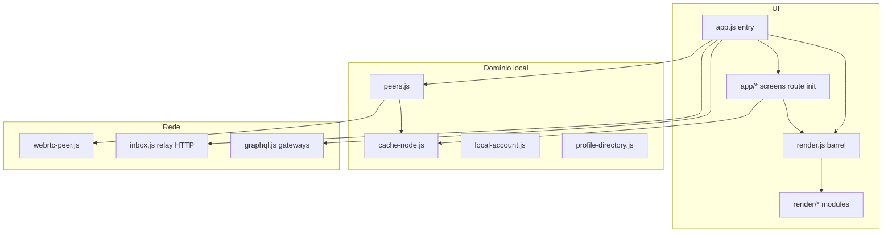

# Arquitetura — cliente Vox PWA

Cliente estático (ES modules) + relay Python opcional. Identidade local `vx_*`; gossip P2P; permaweb via gateways.

## Camadas

## Entry e rotas

- [`client/js/app.js`](../client/js/app.js) — entry fino (~13 linhas): wire route, listeners, demo seed.
- [`client/js/app/route.js`](../client/js/app/route.js) — `route()` dispatch por tela.
- [`client/js/app/route-parse.js`](../client/js/app/route-parse.js) — `parseRoute()` puro (sem DOM).
- [`client/js/app/init.js`](../client/js/app/init.js) — gossip, social, DM listeners globais.
- `app/screens-*.js` — home, community, profile, people, network, dm, compose.
- [`client/js/app/navigation.js`](../client/js/app/navigation.js) — `setRoute` / defer `route()` (evita ciclos).
- Hash `#/c/:id`, `#/people`, `#/connect/:vx`, `#/settings/network`, etc.

## Malha (gossip) e Sinalização Multi-Nó

- [peers.js](../client/js/peers.js) — BroadcastChannel + WebRTC; GOSSIP / UPDATE / DELETE / WANT / BLOB / PROFILE_CARD_HELLO.
- [peers-gossip-profile.js](../client/js/peers-gossip-profile.js) — PROFILE_CARD (sem feed, integrado ao diretório).
- [peers-cache-manifest.js](../client/js/peers-cache-manifest.js) — manifestos de cache assinados.
- [webrtc-peer.js](../client/js/webrtc-peer.js) — gerenciamento de ciclo de vida RTCDataChannel, rotação automática entre nós sentinela e timeout de negociação de 15s.
- **Tríade Sentinela de Sinalização:** nós de sinalização independentes com fallback automático:
  1. Hugging Face Spaces (wss://yurikayel-vox.hf.space)
  2. Render Cloud (wss://vox-sentinel.onrender.com)
  3. Deno Deploy Edge Global (wss://vox-2.vox.deno.net)
- Posts/listings: cache-node.saveLocalPost com invalidação reativa de cache indexado (getReplyCountsMap) + dispatchGossipPost.

## Identidade e perfil

- [local-account.js](../client/js/local-account.js) — ECDSA P-256, signPayload / erifyPayload.
- [oauth-profile.js](../client/js/oauth-profile.js) — GIS/Meta client-only (ADR-002).
- [profile-card.js](../client/js/profile-card.js) + [mesh-profile.js](../client/js/mesh-profile.js) — descoberta opt-in (ADR-003).
- [profile-directory.js](../client/js/profile-directory.js) — cache persistente de cartões de perfil P2P conhecidos.

## DM E2E

- [crypto-dm.js](../client/js/crypto-dm.js) — ECDH + AES-GCM ponta-a-ponta via RTCDataChannel prioritário.
- Relay [
elay/inbox.py](../relay/inbox.py) — caixa cega TTL 72h quando peer offline.

## Relay HTTP e Nós de Sinalização

- [
elay/server.py](../relay/server.py) — cache/tx espelho Arweave.
- [
elay/signaling.py](../relay/signaling.py) — WebRTC signaling Python RFC 6455 com teto de frames (1 MB) e headers seguros.
- [
elay/deno-signaling.js](../relay/deno-signaling.js) — Sinalização WebRTC serverless em Deno Deploy via BroadcastChannel.

## ADRs

- [001 Contribution attestation export](adr/001-contribution-attestation-export.md)
- [002 OAuth client-only](adr/002-oauth-profile-enrich-client.md)
- [003 Profile card gossip](adr/003-profile-card-gossip.md)
- [004 Gateway honest fallback](adr/004-gateway-honest-fallback.md)
- [005 Perfil coletivo M-of-N](adr/005-collective-profile-m-of-n.md)
- [006 Hardening P2P, WebRTC e Cache](adr/006-p2p-profile-identity-gossip-hardening.md)

## Testes

- 	ests/*.test.js — Node test runner + mocks em 	ests/setup.js (568 testes unitários/integração JS).
- 
elay/test_*.py — unittest Python para espelho, inbox e sinalização (33 testes).
- 	ools/lint_relay.py — linter estático e AST para nós relay.
- 	ools/complexity-audit.mjs — auditoria contínua de complexidade ciclomática e LLOC.

## Offline

- [client/sw.js](../client/sw.js) — SHELL_ASSETS lista módulos cacheados com chave inviolável ox-pwa-v7.16-real-network-audio-video-upload.
