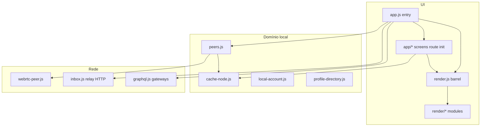

# Arquitetura — cliente Vox PWA

> **Status:** canônico (camadas do cliente) · **Owner:** mantenedor / revisor · **Revisado:** 2026-11-12

Cliente estático (ES modules) + relay Python opcional. Identidade local `vx_*`; gossip P2P; permaweb via gateways.

> Este arquivo cobre as **camadas do cliente**. Protocolo, tags e dados: [../ARCHITECTURE.md](../ARCHITECTURE.md). API do relay: [relay-api.md](./specs/relay-api.md). Decisões: [adr/README.md](./adr/README.md).

## Camadas

## Entry e rotas

- [`client/js/app.js`](../client/js/app.js) — entry sem lógica própria: só importa e liga rota, listeners globais e as inicializações (chaves em repouso, DM, gossip, migração do cofre, limpeza do seed de demonstração).
- [`client/js/app/route.js`](../client/js/app/route.js) — `route()` dispatch por tela.
- [`client/js/app/route-parse.js`](../client/js/app/route-parse.js) — `parseRoute()` puro (sem DOM).
- [`client/js/app/init.js`](../client/js/app/init.js) — gossip, social, DM listeners globais.
- `app/screens-*.js` — home, community, profile, people, network, dm, compose.
- [`client/js/app/navigation.js`](../client/js/app/navigation.js) — `setRoute` / defer `route()` (evita ciclos).
- Hash `#/c/:id`, `#/people`, `#/connect/:vx`, `#/settings/network`, etc.

## Malha (gossip) e Sinalização Multi-Nó

- [peers.js](../client/js/peers.js) — BroadcastChannel + WebRTC; GOSSIP / UPDATE / DELETE / WANT / BLOB / PROFILE_CARD_HELLO.
- [peers-gossip-profile.js](../client/js/peers-gossip-profile.js) — PROFILE_CARD (sem feed, integrado ao diretório).
- [peers-cache-manifest.js](../client/js/peers-cache-manifest.js) — manifestos de cache assinados.
- [webrtc-peer.js](../client/js/webrtc-peer.js) — gerenciamento de ciclo de vida RTCDataChannel, rotação automática entre nós sentinela e timeout de negociação de 15s.
- **Sinalização (lista real em [`client/config/signaling.json`](../client/config/signaling.json)):** fallback automático entre as URLs configuradas:
  1. Render Cloud (`wss://vox-sentinel.onrender.com`) — único nó público ativo, mantido acordado por `sentinel-keepalive.yml`.
  2. Nó local (`ws://127.0.0.1:3921`).
  - **Em paralelo ao WebSocket, sinalização por Nostr** (evento efêmero kind 25050, cifrado entre pares): [nostr-transport.js](../client/js/nostr-transport.js), [nostr-event.js](../client/js/nostr-event.js) e [nostr-signaling.js](../client/js/nostr-signaling.js); relays em `nostrRelays` e chave de desligar em `nostrSignaling.enabled`. Ainda não medida em campo entre dois navegadores ([FEATURES.md](./FEATURES.md) §5).
  - O Hugging Face Space (`deploy-relay-hf.yml`) é opcional e só existe se `HF_TOKEN`/`HF_SPACE` estiverem configurados; ~~Deno Deploy~~ pausado em 2026-11 (ver `relay/deno-signaling.js`). Riscos: [INFRA-CUSTOS.md](./INFRA-CUSTOS.md).
- Posts/listings: cache-node.saveLocalPost com invalidação reativa de cache indexado (getReplyCountsMap) + dispatchGossipPost.

## Identidade e perfil

- [local-account.js](../client/js/local-account.js) — ECDSA P-256, signPayload / verifyPayload.
- [oauth-profile.js](../client/js/oauth-profile.js) — GIS/Meta client-only (ADR-002).
- [profile-card.js](../client/js/profile-card.js) + [mesh-profile.js](../client/js/mesh-profile.js) — descoberta opt-in (ADR-003).
- [profile-directory.js](../client/js/profile-directory.js) — cache persistente de cartões de perfil P2P conhecidos.

## DM E2E

- [crypto-dm.js](../client/js/crypto-dm.js) — ECDH + AES-GCM ponta-a-ponta via RTCDataChannel prioritário.
- Relay [`relay/inbox.py`](../relay/inbox.py) — caixa cega TTL 72h quando peer offline.

## Relay HTTP e Nós de Sinalização

- [`relay/server.py`](../relay/server.py) — cache/tx espelho Arweave.
- [`relay/signaling.py`](../relay/signaling.py) — WebRTC signaling Python RFC 6455 com teto de frames (1 MB) e headers seguros.
- [`relay/deno-signaling.js`](../relay/deno-signaling.js) — Sinalização WebRTC serverless em Deno Deploy via BroadcastChannel (**pausado**; código mantido para reativação).

## ADRs

A lista não é repetida aqui para não envelhecer: [índice com o status de cada ADR](./adr/README.md) e [registro de uma página das decisões em vigor](./DECISOES.md). As que moldam as camadas deste arquivo: [006](adr/006-p2p-profile-identity-gossip-hardening.md) (identidade e gossip), [007](adr/007-zero-complexity-monolith-decomposition.md) (decomposição em `app/*` e `render/*`), [021](adr/021-integridade-na-entrada-forma-assinada.md) (forma assinada guardada, tudo que entra é conferido) e [022](adr/022-memoria-central-por-consentimento.md) (memória central é cópia, não fonte de verdade).

## Testes e Auditoria

- `tests/*.test.js` — Node test runner + mocks em `tests/setup.js` (contagem em [release-metadata.json](./release-metadata.json); guia em [TESTES.md](./TESTES.md)).
- `relay/test_*.py` — unittest Python do relay (servidor, sinalização, relay cego, memória central, validação de espelho, troca OAuth, guarda de requisições, seeder) e dos lançadores desktop (contagem em [release-metadata.json](./release-metadata.json)).
- `scripts/lint_relay.py` — roda o Ruff em `relay/`, `scripts/` e `packaging/` (regras em `ruff.toml`) e uma checagem de sintaxe por AST no relay.
- `scripts/complexity-audit.mjs` — roda as regras do ESLint em `client/js` e grava o baseline do dia em `docs/metrics/`; não quebra o build. Mede complexidade ciclomática, aninhamento e linhas por função; a **complexidade cognitiva não é medida** ([HARDENING.md](./HARDENING.md)).
- `scripts/docs-audit.mjs` — `npm run audit:docs`: JSDoc nos exports, links relativos, docs fora do índice e banner de status, em catraca ([process/documentacao.md](./process/documentacao.md)).

## Offline

- [client/sw.js](../client/sw.js) — SHELL_ASSETS lista módulos cacheados com chave `CACHE_NAME` definida no próprio `sw.js` (valor atual em [release-metadata.json](./release-metadata.json); bump obrigatório a cada mudança de shell).
