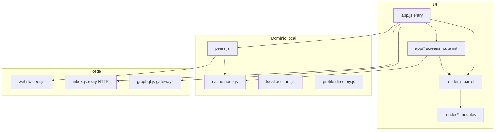

# Arquitetura — cliente Vox PWA

Cliente estático (ES modules) + relay Python opcional. Identidade local `vx_*`; gossip P2P; permaweb via gateways.

## Camadas

## Entry e rotas

- [`client/js/app.js`](../client/js/app.js) — entry fino (~13 linhas): wire route, listeners, demo seed.
- [`client/js/app/route.js`](../client/js/app/route.js) — `route()` dispatch por tela.
- [`client/js/app/route-parse.js`](../client/js/app/route-parse.js) — `parseRoute()` puro (sem DOM).
- [`client/js/app/init.js`](../client/js/app/init.js) — gossip, social, DM listeners globais.
- `app/screens-*.js` — home, community, profile, people, network, dm, compose.
- [`client/js/app/navigation.js`](../client/js/app/navigation.js) — `setRoute` / defer `route()` (evita ciclos).
- Hash `#/c/:id`, `#/people`, `#/connect/:vx`, `#/settings/network`, etc.

## Malha (gossip)

- [`peers.js`](../client/js/peers.js) — BroadcastChannel + WebRTC; `GOSSIP` / `UPDATE` / `DELETE`.
- [`peers-gossip-profile.js`](../client/js/peers-gossip-profile.js) — PROFILE_CARD (sem feed).
- [`peers-cache-manifest.js`](../client/js/peers-cache-manifest.js) — manifestos assinados.
- Posts/listings: `cache-node.saveLocalPost` + `dispatchGossipPost`.

## Identidade e perfil

- [`local-account.js`](../client/js/local-account.js) — ECDSA P-256, `signPayload` / `verifyPayload`.
- [`oauth-profile.js`](../client/js/oauth-profile.js) — GIS/Meta client-only (ADR-002).
- [`profile-card.js`](../client/js/profile-card.js) + [`mesh-profile.js`](../client/js/mesh-profile.js) — descoberta opt-in (ADR-003).

## DM E2E

- [`crypto-dm.js`](../client/js/crypto-dm.js) — ECDH + AES-GCM.
- Relay [`relay/inbox.py`](../relay/inbox.py) — caixa cega TTL 72h.

## Relay HTTP

- [`relay/server.py`](../relay/server.py) — cache/tx espelho.
- [`relay/signaling.py`](../relay/signaling.py) — WebRTC signaling transitório.

## ADRs

- [002 OAuth client-only](adr/002-oauth-profile-enrich-client.md)
- [003 Profile card gossip](adr/003-profile-card-gossip.md)

## Testes

- `tests/*.test.js` — Node test runner + mocks em `tests/setup.js`.
- `relay/test_*.py` — unittest.

## Offline

- [`client/sw.js`](../client/sw.js) — `SHELL_ASSETS` lista módulos cacheados.
