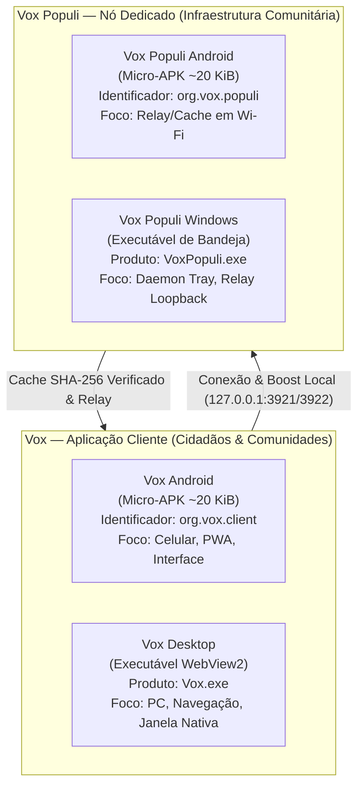

# ADR-011: Taxonomia Canônica Dual — Vox (Cliente) e Vox Populi (Nó Dedicado)

**Status:** accepted · **Fase 3.5 (Padronização e Governança de Produto)**

---

## 1. Contexto

A evolução do ecossistema Vox reuniu diversas frentes de engenharia: interfaces gráficas cívicas, nós de infraestrutura em segundo plano e serviços de relay/cache local.
Ao longo do desenvolvimento, termos como "Farol", "VoxFarol", "Seeder" ou "Node Zero" foram usados de maneira sobreposta, gerando ruído conceitual entre a ferramenta do cidadão e o serviço de sustentação comunitária.

Para garantir simplicidade, intuitividade e clareza absoluta, estabelece-se a taxonomia canônica dual:
- **`Vox`** é o **CLIENTE** (UI, navegação cívica, PWA, feed e participação popular).
- **`Vox Populi`** é o **NÓ DEDICADO** (infraestrutura em segundo plano, relay HTTP em loopback `127.0.0.1:3921`, cache SHA-256 e controle de recursos `127.0.0.1:3922`).
- **Abrir ambos dá um boost mútuo:** o cliente se conecta ao nó dedicado local, acelerando o throughput e aquecendo o cache verificado.
- Ambos compartilham a mesma identidade visual e ícone normalizado em fundo branco.

---

## 2. Decisão

Fica formalizada a **Taxonomia Canônica Dual** do ecossistema Vox em todas as plataformas:

### A. Matriz Simétrica Multiplataforma

| Plataforma | Papel: CLIENTE (`Vox`) | Papel: NÓ DEDICADO (`Vox Populi`) | Sinergia (Boost) |
|:---|:---|:---|:---|
| **Windows Desktop** | `dist/Vox.exe` (WebView2, interface de navegação cívica) | `dist/VoxPopuli.exe` (Daemon sem janela, ícone na System Tray, relay `3921`) | `Vox.exe` dispara `POST /api/resume` no nó local e acelera renderização via cache local. |
| **Android** | `android/vox.apk` (`org.vox.client`, tela cheia, navegação PWA) | `android/vox-populi.apk` (`org.vox.populi`, tela nativa enxuta, foreground service) | O cliente consome o cache mantido pelo nó local em loopback quando em Wi-Fi. |

### B. Princípios e Diretrizes

1. **Abandono do termo "Farol":** Toda nomenclatura pública e executáveis abandonam a denominação transitória "Farol" ou "VoxFarol". O nó dedicado é exclusivamente **Vox Populi**.
2. **Ícone Unificado:** Ambos os produtos utilizam o mesmo ícone oficial normalizado em fundo branco, simplificando o reconhecimento da marca pelo usuário.
3. **Distribuição Ultraleve:** Ambos os APKs (`vox.apk` e `vox-populi.apk`) são mantidos estritamente abaixo do limite de 100 KiB para viabilizar permanência no Free Tier do Turbo Arweave.
4. **Segurança de Bind:** O nó dedicado em qualquer plataforma escuta estritamente em loopback (`127.0.0.1`), sem exposição externa de portas ou alteração indevida de regras de firewall.
