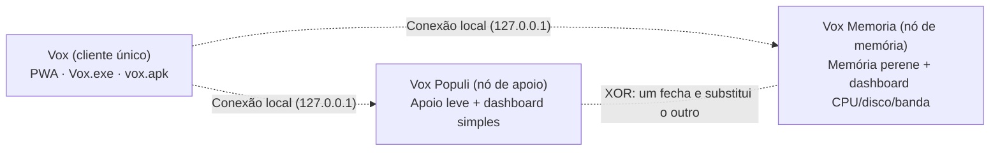

# ADR-011: Taxonomia Canônica Tripartite — Vox, Vox Populi e Vox Memoria

**Status:** accepted · **Fase 3.5 (Padronização e Governança de Produto)** · **Emenda 2026-11-19:** taxonomia tripartite consolidada (`Vox`, `Vox Populi`, `Vox Memoria`), substituição de "Boost Local" por **Conexão local** e invariante de **nó local único (XOR)**.

---

## 1. Contexto

A evolução do ecossistema Vox reuniu três papéis complementares sobre **um único cliente**:
- **`Vox`** é o **CLIENTE ÚNICO** (UI, navegação cívica, PWA, feed, comunidades e DM). Todos usam o mesmo cliente — quem só quer usar a rede não precisa instalar nenhum serviço adicional.
- **`Vox Populi`** é o **NÓ DE APOIO** (serviço leve em segundo plano, cache SHA-256 e relay em loopback `127.0.0.1:3921`, com **dashboard simplificado** para ligar/pausar, limitar só ao Wi-Fi e ajustar cota leve).
- **`Vox Memoria`** é o **NÓ DE MEMÓRIA** (serviço dedicado de quem opta por ceder **X CPU, disco e banda** para sustentar a memória perene da rede — WAL, snapshot, delta sync e relay completo — com **dashboard de mantenedor** para configurar limites e acompanhar o estado; substitui os nomes antigos `VoxPopuli-ZeroMemory` e `Node Zero`).
- **Conexão local** *(substitui "Local Boost" / "Boost Local")*: quando o `Vox` detecta `Vox Populi` ou `Vox Memoria` ativo na própria máquina (`127.0.0.1`), conecta automaticamente em loopback — exibido na UI como **"Usando seu nó"**.
- Todos compartilham a mesma identidade visual e ícone normalizado em fundo branco.

---

## 2. Decisão

Fica formalizada a **Taxonomia Canônica Tripartite** do ecossistema Vox em todas as plataformas:

### A. Matriz de Papéis e Plataformas

| Plataforma | `Vox` (Cliente único) | `Vox Populi` (Nó de apoio) | `Vox Memoria` (Nó de memória) |
|:---|:---|:---|:---|
| **Windows Desktop** | `Vox.exe` (WebView2, interface única) | `VoxPopuli.exe` (serviço de bandeja + painel simples) | `VoxMemoria.exe` *(hoje compilado localmente via `packaging/zero-central-memory-windows/build.ps1`; painel de CPU/disco/banda)* |
| **Android** | `vox.apk` (`org.vox.client`, PWA em tela cheia) | `vox-populi.apk` (`org.vox.populi`, foreground service leve em Wi-Fi) | — *(nó dedicado pensado para desktop/SBC/servidor)* |
| **Linux / macOS** | Guia WebKitGTK / Safari PWA | Daemon `systemd` / `launchd` leve | `relay/server.py` (`central_memory.py`) com cotas configuráveis |

### B. Princípios e Diretrizes

1. **Abandono de nomes legados:** `Farol`, `VoxFarol`, `Node Zero`, `VoxPopuli-ZeroMemory` e `Local Boost` / `Boost Local` deixam de ser termos canônicos. O trio oficial é **`Vox`**, **`Vox Populi`** e **`Vox Memoria`**; o enlace em loopback chama-se **Conexão local** (na UI: **"Usando seu nó"**).
2. **Cliente único + dashboards enxutos:** ninguém troca de cliente para apoiar ou manter a rede. `Vox Populi` e `Vox Memoria` oferecem apenas **dashboard simplificado** em loopback (`127.0.0.1`) ou janela nativa para configurar cotas e saúde — sem duplicar feed/DM e sem acrescentar bytes ao precache do PWA `Vox` (`PM-01`).
3. **Exclusão mútua de nó local (`Vox Populi` XOR `Vox Memoria`):** existe **no máximo um nó local ativo por aparelho**. Abrir o `Vox Populi` com o `Vox Memoria` rodando (ou vice-versa) detecta o serviço ativo via lock/healthcheck local e oferece fechar um e abrir o outro. Se a pessoa confirmar, o nó anterior executa **encerramento limpo** (flush de WAL/snapshot e liberação das portas `127.0.0.1:3920–3922`) antes de o novo assumir; se cancelar, o nó atual permanece intacto.
4. **Ícone unificado e distribuição ultraleve:** os produtos compartilham o mesmo ícone oficial normalizado; APKs (`vox.apk` e `vox-populi.apk`) ficam abaixo de 100 KiB.
5. **Segurança de bind:** o dashboard e o relay local escutam estritamente em loopback (`127.0.0.1`) por padrão, sem exposição automática na LAN/WAN.
