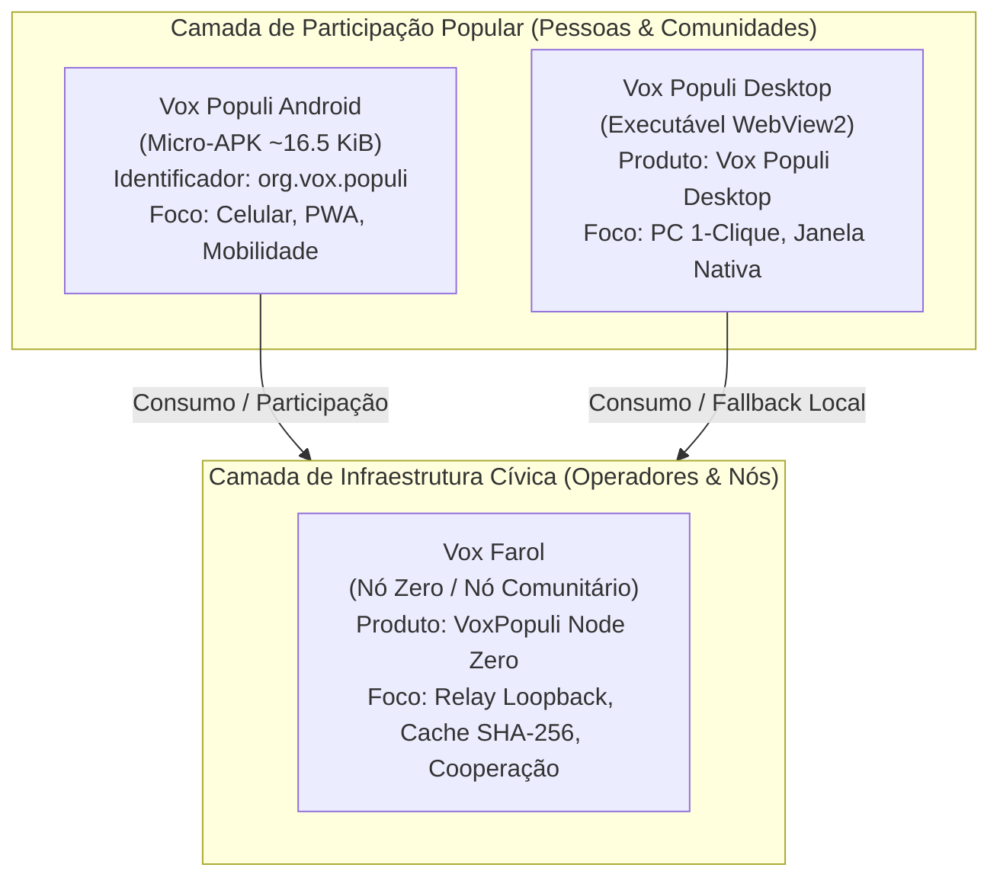

# ADR-011: Taxonomia Tripartite de Produtos — Vox Populi Android, Desktop e Vox Farol

**Status:** accepted · **Fase 3.5 (Padronização e Governança de Produto)**

---

## 1. Contexto

A evolução do ecossistema Vox reuniu diversas frentes de engenharia: wrappers móveis, clientes desktop para Windows, daemons de relay/cache em loopback e especificações de ancoragem comunitária.

Historicamente, termos técnicos de engenharia como "Seeder", "Nó Zero", "Steward Kit" e "Relay" foram ocasionalmente expostos em atalhos, nomes de executáveis ou empacotamentos preliminares (ex: `org.vox.seeder`, `Vox Seeder.lnk`, `VoxSeeder.exe`). Essa sobreposição causava fricção cognitiva:
1. Usuários comuns e cidadãos eram expostos a termos de infraestrutura P2P sem necessidade;
2. Instalações preliminares mantinham nomes residuais em menus do sistema operacional;
3. Havia risco de promessas excessivas caso "Seeder" fosse interpretado como distribuição WebTorrent ativa quando o serviço opera apenas relay/cache local em loopback (`seederStatus: not_implemented`).

Para blindar a arquitetura contra degradação de branding e alinhar a experiência das pessoas cidadãs com a realidade operacional da infraestrutura, faz-se necessária uma distinção canônica entre produtos e papéis.

---

## 2. Decisão

Fica formalizada a **Taxonomia Tripartite de Produtos** do ecossistema Vox:

### A. Definição dos Três Produtos

| Produto | Nome de Exibição | Público-Alvo | Função Principal | Distribuição & Identificador |
|:---|:---|:---|:---|:---|
| **Vox Populi Android** | Vox Populi | Cidadãos em dispositivos móveis | Porta de entrada comunitária, acesso ao PWA em tela cheia com Foreground Service leve | Micro-APK nativo (`org.vox.populi`, 16.868 bytes, API 24–35) |
| **Vox Populi Desktop** | Vox Populi Desktop | Usuários de computadores pessoais | Uso diário no PC via janela WebView2 nativa com fallback para espelho local loopback | Executável standalone (`VoxPopuliDesktop.exe`, 24.599.978 bytes) |
| **Vox Farol** | Vox Farol (Node Zero) | Coletivos, operadores e nós comunitários | Infraestrutura de cache verificável, proxy de gateways e relay HTTP em loopback | Executável de bandeja (`VoxPopuli.exe`) e scripts Linux (`vox-populi/`) |

### B. Princípios de Separação de Nomenclatura

1. **Branding voltado ao usuário:** Toda interface, título de janela, atalho de sistema operacional (`.lnk`) e pacote visível às pessoas utiliza exclusivamente **Vox Populi**. O cidadão não precisa compreender BitTorrent, DHT, CGNAT ou topologia de rede para participar.
2. **Infraestrutura cívica:** O serviço de distribuição cooperativa e sustentação local é denominado **Vox Farol** (ou *Nó Comunitário*). Ele expressa a ideia de um ponto de referência e sinalização para a malha cívica.
3. **Nomenclatura técnica interna:** Termos como `seeder`, `relay`, `node-zero` e `steward-kit` são restritos estritamente ao código interno de engenharia (ex: nomes de variáveis de telemetria, módulos de guardrails ou diretórios legados de compilação como `tools/desktop-seeder-windows`).
4. **Doutrina de Honestidade nas Flags de Status:** As propriedades de telemetria continuam reportando com exatidão `seederActive: false` e `seederStatus: not_implemented` enquanto a camada WebTorrent P2P não for concluída e auditada. Nenhuma capacidade futura pode ser alegada como existente.

---

## 3. Diretrizes de Migração e Integridade

1. **Migração de Identidade Android:**
   A transição de `org.vox.seeder` para `org.vox.populi` cria um novo Application ID. O Android trata como um aplicativo distinto. Os ambientes de teste e futuras distribuições devem orientar a remoção do pacote legado antes ou após a instalação do pacote canônico.
2. **Elegibilidade Arweave/Turbo:**
   O tamanho reduzido do APK (~16.47 KiB) atende com ampla folga ao teto de 100 KiB para micro-bundles gratuitos, mas a hospedagem perene e gratuita definitiva deve ser tratada como meta de distribuição a ser validada em pipeline e teste real de upload na rede Arweave.
3. **Integridade de Distribuição:**
   Todo artefato compilado (`.apk`, `.exe`) deve ter seus hashes criptográficos SHA-256 e certificados de assinatura registrados publicamente para auditoria independente.

---

## 4. Consequências

- **Positivas:** Desacoplamento cognitivo entre a experiência de uso comunitário e os detalhes técnicos de infraestrutura; eliminação de termos confusos em atalhos e menus do sistema operacional; preservação da integridade e transparência técnica da telemetria.
- **Limitações:** Diretórios internos de compilação permanecem mantendo nomes legados para evitar quebra de testes e scripts existentes (`tools/desktop-seeder-windows`), fato devidamente documentado na auditoria de branding.
