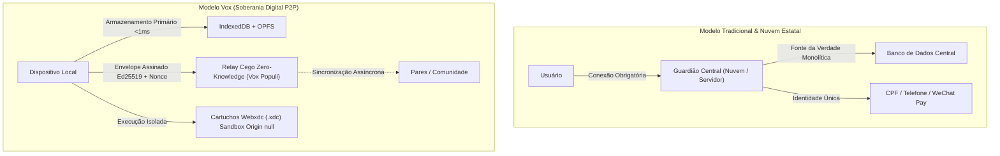
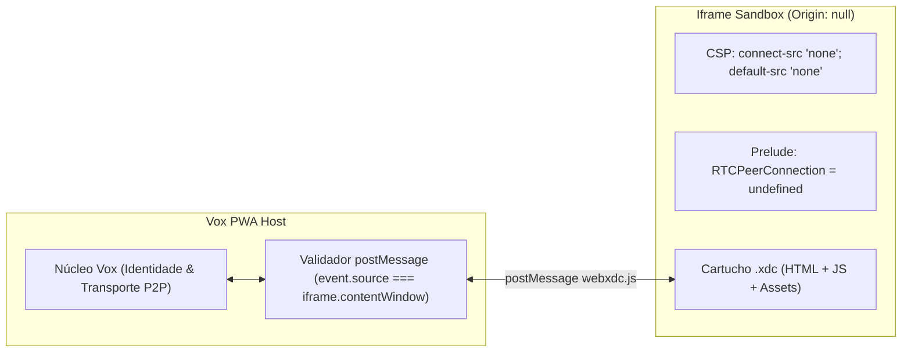

# ADR-012: Soberania Digital na Vox — Cintura Fina Criptográfica e Cartuchos Cívicos Webxdc

**Status:** accepted · **Fase 4 (Fundação Criptográfica & Ecossistema de Cartuchos)**

---

## 1. Contexto & Diagnóstico Estratégico

A Vox (`yurikayel.github.io/vox`) posiciona-se como uma infraestrutura pública digital local-first e peer-to-peer (P2P), operando sem servidores centrais nem dependência de nuvens corporativas. Diante do dilema sobre o próximo ciclo de engenharia — se devemos escalar primeiro a sincronização de dados CRDT ou estruturar os módulos de comércio, entregas, biblioteca e assembleias —, a teoria dos sistemas distribuídos e a história das redes descentralizadas oferecem um veredito claro:

1. **A Primazia da Autorização no Local-First:** Em sistemas cliente-servidor tradicionais (como o WeChat ou uma eventual expansão centralizada do gov.br), os dados residem em um banco central e a autorização é um cálculo executado na borda da rede por um servidor guardião. Em uma PWA P2P local-first, **não existe borda de rede**. As regras sobre quem pode criar, alterar ou revogar um catálogo, corrida ou acervo precisam viajar criptograficamente lacradas ao próprio dado. Construir módulos de alto nível sobre CRDTs sem fechar antes o envelope assinado (Ed25519) e o controle de capacidades condenaria a rede à corrupção por ataques Sybil ou disputas de moderação.
2. **A Lição do Scuttlebutt (SSB) e dos Pré-Alfas de 2026:** Tentar construir um protocolo criptográfico completo no vácuo gera dois perigos fatais: o inchaço de dados históricos cumulativos do SSB (onde superusuários acumulavam 15 GB e novos nós demoravam horas para sincronizar) e a paralisia por dependência de bibliotecas experimentais pre-alpha (como Keyhive 0.7.0, BeeKEM 0.5.0 e Subduction 0.19.0 do Ink & Switch, expressamente não recomendados para produção em 2026).
3. **A Solução "Cintura Fina" (Thin Waist) + Cartuchos Desacoplados:** A Vox deve fechar uma **Cintura Fina de Confiança** mínima sobre a Web Crypto API nativa do navegador (Ed25519/X25519, envelopes assinados com audience e nonce, persistência contra evicção do Safari/ITP e topologia de nós em 2 níveis) e acoplá-la a um executor de **Cartuchos Cívicos** baseado no padrão aberto **Webxdc (`.xdc`)** rodando em `iframe sandbox="allow-scripts"` de origem opaca (`null`) com rede zero.

---

## 2. Matriz Comparativa de Paradigmas



| Dimensão Arquitetural | WeChat (Modelo Corporativo) | "WeChat no gov.br" (Proposta Centralizada) | Vox (Local-First Cívico) |
|:---|:---|:---|:---|
| **Topologia & SoT** | Nuvem centralizada Tencent | Nuvem centralizada Serpro/Dataprev | Dispositivo local (IndexedDB/OPFS) como SoT; relays cegos |
| **Identidade Primária** | Telefone + ID Nacional Chinês | CPF único centralizado em todas as tabelas | Pares de chaves locais (Ed25519 / X25519) por círculo de confiança |
| **Autorização & Moderação** | Guardião central na nuvem | Guardião burocrático estatal | Capacidades Convergentes (Concap) e delegações assinadas |
| **Mini-Apps / Serviços** | Mini-Programs proprietários Tencent | Serviços federais monolíticos | Cartuchos Cívicos (`.xdc`) em sandbox com rede zero |
| **Liquidação Financeira** | WeChat Pay (custódia proprietária) | Conta estatal centralizada | Pix BR Code (EMVCo) offline; liquidação direta ponta a ponta |
| **Custo de Infraestrutura** | Financiado por anúncios e taxas | Financiado por orçamento público (data centers) | Marginalmente zero: nós domésticos e celulares da comunidade |

---

## 3. Especificação da Cintura Fina (Fase I)

A fundação criptográfica da Vox consolida quatro garantias invioláveis:

### A. Identidade Dual e Pareamento por Proxy
- Chaves de assinatura Ed25519 e acordo X25519 geradas via `crypto.subtle` e armazenadas como `CryptoKey` não exportáveis no IndexedDB (com fallback ECDSA/ECDH P-256).
- Chave principal do usuário (Proxy Key) assina certificados de delegação para dispositivos secundários (celular e notebook) via pareamento por QR Code local, evitando a armadilha do SSB onde cada aparelho era uma identidade isolada.

### B. Envelope Assinado com Audience, Contexto e Nonce
Todo pacote CRDT ou mensagem P2P viaja estruturado no envelope canônico:
```json
{
  "sender": "<pubKeyEd25519>",
  "audience": "<pubKeyOuHashRelay>",
  "documentId": "<idComunidadeOuTopico>",
  "timestamp": 1793866800,
  "nonce": "<hex128bits>",
  "capabilityChain": ["<certDelegaçãoAssinado>"],
  "payload": "<blobCifradoAES256GCM>",
  "sig": "<assinaturaEd25519DoEnvelope>"
}
```
- Validação de janela de deriva máxima de $\pm 10$ minutos para mitigar replay attacks.
- Vinculação estrita ao `documentId` para impedir context-swapping entre comunidades distintas.

### C. Topologia de 2 Níveis (Leaf Nodes vs. Shared Nodes)
- Celulares operam como **Leaf Nodes** (entram e saem, suspensos pelo SO).
- Computadores comunitários, Raspberry Pi ou servidores domésticos rodam o **Vox Populi** como **Shared Nodes** sempre online.
- O Shared Node atua como um **Relay Cego (Zero-Knowledge)**: armazena e encaminha envelopes cifrados sem possuir a chave de leitura, resolvendo o problema de CGNAT e suspensão do navegador em segundo plano.

### D. Mitigação da Evicção Proativa de 7 Dias do Safari/ITP
- Invocação imediata de `await navigator.storage.persist()` após geração das chaves.
- Detecção contextual de abas normais no iOS/Safari com exibição de banner educativo para adicionar à Tela de Início (Home Screen), elevando a quota para ~60% do disco e isentando a PWA da purga de 7 dias do ITP.
- Backup criptográfico local da chave raiz cifrado com senha do usuário (`Argon2id` + `AES-256-GCM`).

---

## 4. O Motor de Cartuchos Cívicos Webxdc e os Cinco Caminhos (Fase II)

Em vez de engessar utilidades no núcleo da aplicação, a Vox implementa o padrão aberto **Webxdc (`.xdc`)** como contêiner de mini-aplicativos distribuídos:



### Caminho 1: Isolamento Rigoroso em Sandbox
- Tag iframe declarando estritamente `sandbox="allow-scripts"` e `referrerpolicy="no-referrer"` (sem `allow-same-origin`, garantindo `Origin: null`).
- CSP injetada: `default-src 'none'; script-src 'unsafe-inline' blob:; style-src 'unsafe-inline' blob:; img-src data: blob:; font-src data: blob:; media-src data: blob:; connect-src 'none';`.
- Prelude neutralizando `window.RTCPeerConnection` e `navigator.sendBeacon` antes da inicialização de qualquer script.
- Validação estrita por igualdade referencial `event.source === iframeElement.contentWindow`.
- Motor CRDT dual: **Yjs** (via `y-webxdc` e padrão ID Lookup) para catálogos, feiras e filas ágeis; **Automerge** para atas de assembleia, orçamentos e auditoria com branches.

### Caminho 2: Feira Livre Digital e Pix Offline
- Aproveita a presença territorial já existente das comunidades (eliminando o custo proibitivo de atrito bilateral que vitimou o AppJusto).
- Geração de BR Code Pix Copia e Cola EMVCo 100% offline via módulo nativo [`client/js/brcode.js`](../../client/js/brcode.js), validado matematicamente com CRC-16/CCITT-FALSE (polinômio 0x1021).
- Liquidação ponta a ponta na conta do comerciante/entregador, sem taxa e sem custódia intermediária.

### Caminho 3: Biblioteca de Bolso (OPFS & Merkle Streaming)
- Separação em três níveis: Cache Storage (App Shell), IndexedDB (Catálogo CRDT leve) e Origin Private File System (`OPFS`) para binários pesados (PDF/EPUB).
- Leitura e escrita via `createSyncAccessHandle()` em Web Worker.
- Streaming verificado por Árvore de Merkle em fatias de 64 KB, permitindo pausa, retomada e download multifonte de pares locais.

### Caminho 4: Parasitismo Virtuoso sobre gov.br / ICP-Brasil
- Verificação client-side de assinaturas PAdES/PKCS#7 usando WebCrypto + PKI.js.
- Extração de CPF para resistência Sybil via OID `2.5.4.5` (serialNumber) e OID `2.16.76.1.3.1` (Dados de Pessoa Física), registrando hash salgado `SHA-256(idEleicao + CPF)` sem vazar identidade para a rede.
- Preservação do PDF original assinado no OPFS para eventual auditoria formal no portal VALIDAR do ITI.

### Caminho 5: Kits de Fundação como Manifestos Declarativos
- Gênese de comunidades pré-configuradas em menos de dois minutos através de manifestos declarativos `kit-manifest.json`:
  1. **Kit Bairro / Condomínio:** Fóruns `#zeladoria-e-obras`, `#feira-livre-do-bairro`; cartuchos `feira-pix.xdc`, `mural-entregas.xdc`.
  2. **Kit Sindicato / Categoria:** Fóruns `#assembleia-permanente`, `#prestacao-de-contas`; cartuchos `urna-pades-govbr.xdc`, `ata-automerge.xdc`.
  3. **Kit Coletivo Cultural / Estudantil:** Fóruns `#leituras-e-debates`, `#agenda-cultural`; cartuchos `biblioteca-bolso.xdc`, `caderno-coletivo.xdc`.

---

## 5. Sequenciamento de Implementação (Roadmap de 90 Dias)

| Ciclo | Foco Técnico | Entregáveis Principais |
|:---|:---|:---|
| **Dias 1 a 30** | Cintura Fina de Confiança & Persistência | Módulo `vox-identity` (Ed25519/X25519 + IndexedDB), `navigator.storage.persist()`, instrução iOS Home Screen, Envelope Assinado e especificação de Relay Cego no Vox Populi. |
| **Dias 31 a 60** | Executor de Cartuchos Webxdc & Kits | Host iframe sandbox com CSP rede-zero e bloqueio WebRTC, binding `webxdc.js`, integração `y-webxdc` e seletor dos 3 Kits de Fundação. |
| **Dias 61 a 90** | Três Utilidades Cívicas Soberanas | Publicação dos cartuchos `feira-pix.xdc` (integrando `brcode.js`), `urna-pades-govbr.xdc` (PKI.js + anti-Sybil) e `biblioteca-bolso.xdc` (OPFS + Merkle stream). |

---

## 6. Blindagens Técnicas de Implementação (Corner Cases)

Para mitigar riscos de regressão e incompatibilidade entre motores JS (V8 vs JavaScriptCore) e políticas restritivas de navegadores móveis, a implementação deve seguir quatro blindagens explícitas:

1. **Cabeçalho Binário Fixo Determinístico (152 Bytes) para Assinatura Ed25519:**
   - Em vez de serializar JSON com `JSON.stringify` (sujeito a divergência de ordenação de chaves e floats entre plataformas), o `vox-identity.js` monta um buffer binário canônico de 152 bytes:
     - `sender` (32 bytes Ed25519) + `audience` (32 bytes) + `timestamp` (8 bytes BigUint64BE) + `nonce` (16 bytes) + `sha256(capabilityChain)` (32 bytes) + `sha256(payload)` (32 bytes).
   - O `crypto.subtle.sign("Ed25519", privateKey, binaryHeader)` assina exclusivamente este bloco, tornando a validação imune a variações de parsers e ordens de grandeza mais rápida em lotes CRDT.

2. **Padrão Wrap/Unwrap com Descarte de Semente RAM (CryptoKey Não-Extraível):**
   - Para compatibilizar a proteção `extractable: false` no IndexedDB com o backup cifrado (`Argon2id + AES-256-GCM`) e pareamento de Chave Proxy via QR Code:
     - No momento da geração, cria-se a semente bruta de 32 bytes em memória.
     - Deriva-se imediatamente o payload de backup cifrado e a chave efêmera de pareamento.
     - Importa-se a chave privada no `SubtleCrypto` com `extractable: false` para gravação definitiva no IndexedDB.
     - Zera-se a memória da semente via `seed.fill(0)` antes do término do ciclo de execução.

3. **Inlining e Data URLs no Runtime Webxdc (Mitigação de Bloqueio `blob:` em `Origin: null`):**
   - Navegadores com particionamento estrito de armazenamento (WebKit/Safari e Chromium recente) bloqueiam `blob:https://...` dentro de iframes com `Origin: null`.
   - O `webxdc-host.js` realiza inlining de scripts e folhas de estilo diretamente no HTML montado em memória (`<script>` e `<style>`), e converte imagens, fontes e ativos estáticos em **Data URLs (`data:...;base64,...`)**, que são independentes de origem e atravessam o sandbox sem restrições de CORS.

4. **Compactação de Época no `y-webxdc` (Prevenção de Inchaço de Deltas):**
   - Para evitar que novos nós precisem reexecutar milhares de deltas do Yjs desde a gênese (`serial = 1`), a cada rotação de chave de época ou após 200 operações, o nó emite um snapshot consolidado via `Y.encodeStateAsUpdateV2(doc)`.
   - O Relay Cego (`Vox Populi`) descarta os deltas intermediários antigos da época anterior, mantendo o tempo de carga (*cold boot*) do cartucho inferior a 15 ms.

---

## 7. Consequências

- **Positivas:** Blindagem criptográfica definitiva antes da proliferação de dados; compatibilidade com todo o ecossistema existente de mini-apps Webxdc; custo de servidor zero; independência jurídica e técnica em relação a plataformas corporativas e mudanças de governo.
- **Ressalvas & Cuidados:** Requer disciplina estrita no isolamento do iframe para garantir que nenhum cartucho consiga contornar a CSP; exige suporte a navegadores com WebCrypto moderna e fallbacks para dispositivos mais antigos.
