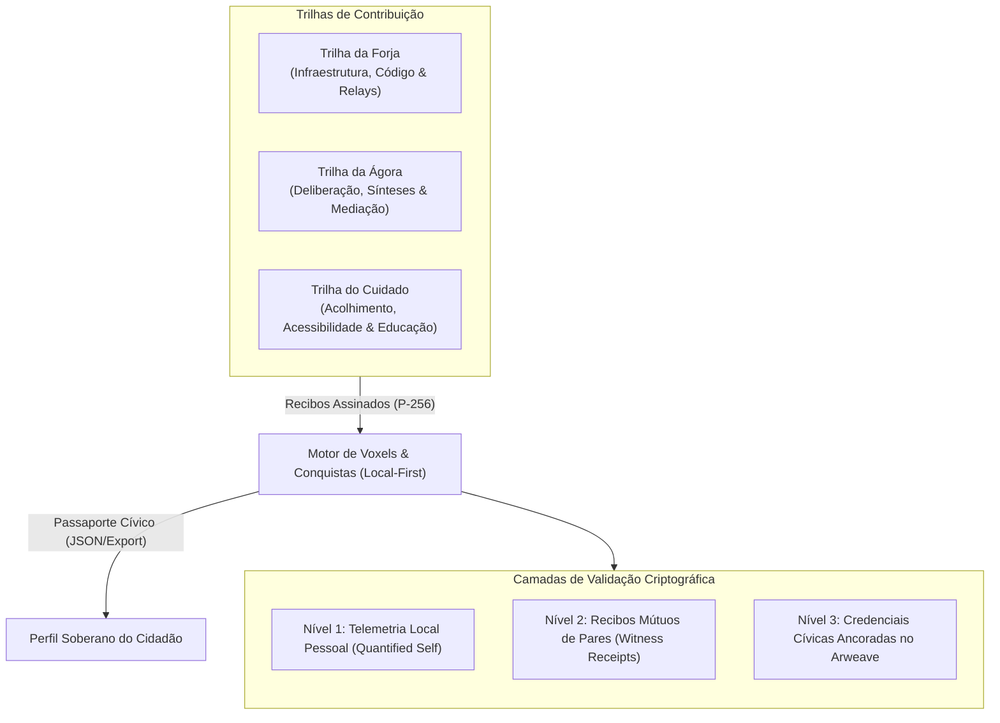

# ADR-013: Sistema de Voxels e Conquistas Cívicas Verificáveis

**Status:** accepted · **Fase 3.6 (Reconhecimento Cívico e Gamificação Ética Local-First)**

---

## 1. Contexto e Motivação

O crescimento e a sustentabilidade de redes abertas e descentralizadas enfrentam o dilema clássico da ação coletiva: a infraestrutura depende de voluntários que cedem disco, banda e atenção cívica, mas os incentivos costumam descambar para dois extremos problemáticos:
1. **Monetização e Especulação Cripto (Web3/Tokens Líquidos):** Gera atração por airdrops, fazendas de bots (Sybil attacks), especulação financeira e plutocracia ("quem tem mais tokens manda na rede").
2. **Gamificação Corporativa Viciante (Dark Patterns / Big Tech):** Algoritmos de engajamento baseados em discórdia, rankings predatórios de vaidade, métricas opacas e perda de soberania do usuário.

O Vox propõe uma terceira via fundamentada na **Gamificação Ética Local-First**:
- O reconhecimento da colaboração precisa existir para valorizar quem mantém nós, atua na moderação cívica ou traduz e acolhe novos participantes.
- Esse reconhecimento deve ser **criptograficamente verificável**, **intransferível (Soulbound)** e **desprovido de privilégios plutocráticos** (sem poder comprar votos nem comprar alcance no feed).

---

## 2. Decisão Arquitetural

Adota-se a unidade atômica **Voxel** e o catálogo de **Conquistas Cívicas (Civic Achievements)**, estruturados em três pilares complementares:



---

## 3. Especificação do Voxel

### 3.1. Propriedades Inegociáveis (Hard Constraints)
1. **Intransferibilidade Estrita (Soulbound):** Um Voxel gerado pela chave pública P-256 do autor não pode ser doado, vendido ou transferido para outro `routeId`.
2. **Alcance Comprado = ZERO:** O feed público do Vox permanece imune a Voxels. Ter $10.000$ Voxels não impulsiona publicações nem sobrepõe a ordem cronológica / de afinidade configurada pelo leitor.
3. **Poder Deliberativo = ZERO:** Em votações de temas comunitários ou plebiscitos cívicos, prevalece o princípio fundamental do Vox: cada voto é nominal e autônomo. Pontos não multiplicam peso de voto.
4. **Decaimento Suave de Infraestrutura (*Half-life*):** Voxels obtidos por operação de nós dedicados possuem atenuação temporal exponencial:
   $$V_{\text{ativo}}(t) = V_0 \cdot e^{-\lambda \Delta t}$$
   Isso assegura que quem operou um nó no passado não retenha prestígio vitalício de prontidão de rede caso tenha desativado seu serviço.

---

## 4. Estrutura Canônica de Dados (Esquema v1)

### 4.1. Recibo de Voxel (`voxel-receipt-v1`)

```json
{
  "schema": "vox-voxel-receipt-v1",
  "id": "vxr_7f8a9b1c2d3e4f5a",
  "routeId": "vx_1a2b3c4d5e6f...",
  "category": "forja",
  "action": "relay_cache_uptime",
  "amount": 25,
  "timestamp": 1793894400000,
  "witnessRouteId": "vx_9z8y7x6w5v4u...",
  "metadata": {
    "hoursActive": 24,
    "bytesRelayed": 104857600,
    "nodeVersion": "0.5.0"
  },
  "signature": "MEYCIQC3... (ECDSA P-256)"
}
```

### 4.2. Conquistas Cívicas (Achievements)

O catálogo canônico inicial é dividido entre as três trilhas vitais:

| ID | Nome | Trilha | Critério de Desbloqueio | Insígnia |
| :--- | :--- | :--- | :--- | :--- |
| `forja_farol_iniciante` | Farol de Entrada | Forja | 1º dia de nó dedicado ativo com status ok | 🕯️ |
| `forja_guardiao_malha` | Guardião da Malha | Forja | Uptime cumulativo $\ge 168\text{h}$ (7 dias) em nó dedicado | 🛡️ |
| `forja_semeador_permaweb`| Semeador Permaweb | Forja | $\ge 1\text{ GB}$ de cache público SHA-256 verificado servido | 🌐 |
| `agora_escriba_sintese` | Escriba da Ágora | Ágora | Publicação de síntese estruturada em debate cívico | 📜 |
| `agora_construtor_pontes`| Construtor de Pontes | Ágora | Resposta com alta concordância bilateral em pauta polarizada | 🌉 |
| `cuidado_guia_boas_vindas`| Guia Cívico | Cuidado | Apoio comprovado ao onboarding e sincronização de novo membro | 🤝 |
| `cuidado_acessibilidade` | Voz Acessível | Cuidado | Fornecimento de transcrição/audiodescrição para mídia pública | 👁️ |

---

## 5. Aplicações e Utilidade Prática

Se Voxels não são dinheiro e não compram alcance, quais são seus benefícios tangíveis?

1. **Qualidade de Serviço P2P (QoS Cooperativo):**
   - Nós `VoxPopuli.exe` priorizam atendimento de requisições e replicação de dados solicitadas por pares que apresentam recibos atestados de reciprocidade (*tit-for-tat* expandido).
2. **Customização Cosmética e Identidade Soberana:**
   - Desbloqueio local de temas de visualização (ex: Modo Terminal Monocromático, Alto Contraste Solar, Cartografia Cívica).
   - Selos visuais discretos no Perfil do Cidadão atestando histórico de confiabilidade técnica.
3. **Governança de Infraestrutura Técnica:**
   - Participação qualificada em consultas sobre parâmetros de rede (tamanho de blocos, quotas de relay, codecs suportados em WebRTC).
4. **Passaporte de Colaboração Exportável:**
   - O cidadão pode gerar um arquivo `.json` assinado contendo seu histórico auditável de serviços prestados à comunidade, utilizável como portfólio de militância digital ou formação em soberania tecnológica.

---

## 6. Conformidade e Compatibilidade

- **ADR-001:** O esquema estende a atestação de métricas (`contribution-attestation.js`), mantendo exportação opt-in e cooldown de segurança.
- **ADR-010:** Integra-se perfeitamente ao modelo *Execute e Ajude*, capturando dados reais do governador de recursos sem métricas inflacionárias.
- **ADR-011:** O nó `VoxPopuli.exe` atua como testemunha legítima de esforço computacional, enquanto o cliente `Vox` armazena e expõe o passaporte no cofre local.
