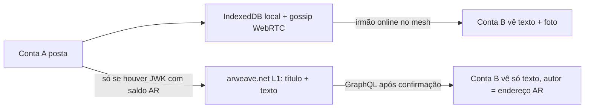

# Auditoria — Permaweb: descoberta, retenção e segurança (29/10/2026)

> Passagem de higiene sobre a resposta de chat "postar aqui, irmão vê lá, sem servidor central, via Arweave".
> Objetivo: separar **o que o código faz hoje** do que foi descrito como intenção. Sem mudanças de código nesta passagem.

## 1. Correções à resposta anterior (chat 29/10 ~14:55)

| # | Afirmação feita | Realidade no código (`main` `a4ac9c1`) | Fonte |
| :-: | :--- | :--- | :--- |
| C1 | Uploads ≤ 100 KB usam free tier Turbo, sem precisar de AR | **Falso hoje.** `postData` usa `arweave-js` → `arweave.transactions.post` em **arweave.net (L1)**. L1 cobra AR por qualquer tamanho. Free tier ≤ 100 KiB existe só no **Turbo (ANS-104 data items)**, não integrado. | [`upload.js`](../client/js/upload.js#L3-L58) |
| C2 | Indexação em 2–5 s | Vale para bundles Turbo. Tx L1 aparece como *pending* e confirma em blocos de ~2 min; indexação GraphQL varia por gateway. | idem |
| C3 | Foto vai para a Permaweb | **Não.** O composer grava on-chain só `{ title, body, communityId }`. Mídia segue por gossip P2P + blob local (`mediaBlob.detachMedia`). Irmão offline do mesh não vê a foto. | [`inline-composer.js`](../client/js/inline-composer.js#L493-L509) |
| C4 | Perfil (bio/avatar) descoberto via Arweave | **Não.** `profile-card` é gossip P2P assinado (vx_, TTL 30 d) + `localStorage`. On-chain existem só `handle`, `profile-key`, `membership`. | [`profile-card.js`](../client/js/profile-card.js), [`profile-directory.js`](../client/js/profile-directory.js) |
| C5 | Identidade Ed25519 | Identidade viva = **ECDSA P-256** (`vx_…`, `local-account.js`) + **carteira RSA/JWK Arweave** separada. Ed25519 é só tag reservada. | [`local-account.js`](../client/js/local-account.js#L58-L63), [`IDENTITY.md`](../IDENTITY.md) |
| C6 | Irmão valida a assinatura do post | Leitor confia no `owner.address` devolvido pelo gateway; **não há verificação local** (`transactions.verify`) da tx. | [`graphql.js`](../client/js/graphql.js) |

## 2. Riscos de segurança verificados

| Risco | Severidade | Detalhe | Mitigação proposta |
| :--- | :-: | :--- | :--- |
| R1 · Falha silenciosa on-chain | Alta | `catch {}` vazio após `upload.postData` — usuário vê "publicado na rede" mesmo se o Arweave recusou (ex.: saldo 0). | Toast honesto "P2P ✓ · Permaweb ✗ (motivo)"; status por post. |
| R2 · JWK em claro no `localStorage` | Alta | `vox-wallet-jwk` sem cifra; qualquer XSS exfiltra a chave de autoria perpétua. | Cifrar com passphrase (reusar `account-backup-wrap.js`); CSP estrita. |
| R3 · Gateway mentiroso | Média | Gateway único pode omitir ou forjar respostas GraphQL. | Cross-check em ≥ 2 gateways de [`gateways.json`](../client/config/gateways.json) + verificação de assinatura no cliente. |
| R4 · Spam no feed global | Média | `recentTopics` filtra só por `App-Name: vox-brasil` — qualquer um escreve essa tag. | Feed padrão por `owners:` (seguidos / web of trust); global vira aba opcional. |
| R5 · Duas identidades desligadas | Média | Post local assinado por `vx_`; on-chain pelo endereço Arweave. Irmão vê endereço AR sem prova de vínculo com o `vx_`. | Tx `Type: identity-link` com assinatura cruzada (P-256 assina endereço AR, RSA assina `vx_`). |
| R6 · Metadados públicos e IP | Baixa | `Topic-Title` vai em tag aberta; consultas expõem IP ao operador do gateway. | Já documentado em [`COMPLIANCE-BR.md`](../COMPLIANCE-BR.md); manter título opcional. |
| R7 · Imutabilidade | Por design | Nada publicado sai da Permaweb. DMs **nunca** vão on-chain (regra mantida). | Aviso explícito no primeiro post on-chain. |

## 3. Estado real do fluxo "eu posto, irmão vê"

**Conclusão:** hoje o caminho confiável é **P2P com os dois online**. A Permaweb só entrega texto, exige AR e não carrega foto nem perfil.

## 4. Backlog para o objetivo (ordem sugerida)

| ID | Tarefa | Fecha |
| :-: | :--- | :--- |
| PW-1 | Upload via **Turbo** (ANS-104, `@ardrive/turbo-sdk`) para itens ≤ 100 KiB, sem saldo | C1, C2 |
| PW-2 | Status honesto por post (remover `catch {}` silencioso) | R1 |
| PW-3 | Mídia lofi (≤ 100 KiB) como data item próprio, referenciada por `Media-Tx` no post | C3 |
| PW-4 | `profile-card` on-chain (bio/avatar ≤ 100 KiB), última versão por `owners:` | C4 |
| PW-5 | `identity-link` assinado nos dois sentidos | C5, R5 |
| PW-6 | Verificação local de assinatura + cross-check de 2 gateways | C6, R3 |
| PW-7 | JWK cifrado com passphrase | R2 |
| PW-8 | Feed padrão por seguidos (`owners:`); global opcional | R4 |

> [!NOTE]
> PW-1 + PW-2 já viabilizam o teste mínimo "eu posto, irmão vê depois" com texto. PW-3/PW-4 completam foto e perfil.
