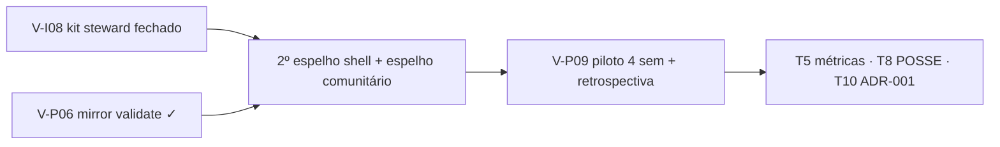

# Brainstorm — próximas 10 tarefas pós-v6.82 (nov/2026)

> **Status:** consolidação doc-only · sprint pós-**V-P06** (mirror validate)  
> **Linha de base:** `main` **`f43f8b8`** · SW **`vox-pwa-v6.82-mirror-validate-v1`** · **350** testes Node  
> **Horizonte:** **2026-Q4 → 2027-Q2** (piloto + malha sem loop do mantenedor)  
> **Público:** mantenedor/revisor, stewards, facilitadores de piloto  
> **Não é parecer jurídico** — [COMPLIANCE-BR.md](../COMPLIANCE-BR.md)

Complementa [antigravity-estrategia-mantenedor-revisor-2026.md](./antigravity-estrategia-mantenedor-revisor-2026.md) (T1 estratégico out/2026), [backlog-participacao-rede.md](./backlog-participacao-rede.md), [rede-sustentada-participantes.md](./rede-sustentada-participantes.md) e [brainstorm-dez-tarefas-estrategia-2026-10.md](./brainstorm-dez-tarefas-estrategia-2026-10.md).

**Task Antigravity (retry):** `95a45b1a-be79-4653-9afb-5e965237a9e8`

---

## Índice T1–T10

| # | Título | Trimestre alvo | Owner típico | Depende de |
|---|--------|----------------|--------------|------------|
| **T1** | Roadmap integrado mantenedor→revisor | Q4-2026→Q2-2027 | Community-doc | — (este doc) |
| **T2** | 2º espelho shell + drill DR | Q4-2026 | Steward espelho + maintainer Pages | V-P06 ✓ |
| **T3** | V-P09 piloto operacional (10–30 pessoas) | Q1-2027 | Facilitador local | T2 parcial + V-I08 |
| **T4** | V-P08 sucessão steward + relay buddy | Q1-2027 | Community-doc | V-I08 |
| **T5** | Métricas honestas v2 (implementação) | Q1-2027 | Cursor | V-P02 ✓, piloto |
| **T6** | Moderação E1–E5 (playbook) | Q1-2027 | Community-doc | T3 |
| **T7** | V-I08 gaps / runbook fechamento | Q4-2026→Q1-2027 | Antigravity + Cursor | V-P06 ✓ |
| **T8** | POSSE / Bridge / embed | Q2-2027 | Antigravity + Cursor | piloto retrospectiva |
| **T9** | Community fork (gatilhos republicanos) | Q2-2027 | Community-doc | T6 |
| **T10** | Export atestação ADR-001 (UI opt-in) | Q2-2027 | Cursor | V-P07 spec |

---

## T1 — Roadmap integrado Q4-2026 → Q2-2027 (mantenedor revisor)

### Objetivo

Amarrar **uma sequência única** pós-v6.82: o repositório permanece **revisor/aprovador FOSS** (CI, Pages, merge, RFC); a **malha** escala só quando **V-I08 → espelho confiável → piloto V-P09** fecham o loop — sem relay global, sem VPS de emergência do mantenedor.

Dossiê de papel (12 meses, T1–T4 exit): [antigravity-estrategia-mantenedor-revisor-2026.md](./antigravity-estrategia-mantenedor-revisor-2026.md).

### Linha de base pós-v6.82 (nov/2026)

| Entregue em `main` | Função no roadmap |
|--------------------|-------------------|
| V-P06 mirror validate (relay + client) | Steward publica espelho **estruturalmente válido** antes do piloto |
| V-P02 gateway telemetry + pill reserva | Baseline honesto para T5 métricas v2 |
| V-P04/05 painel vizinhos + seed | Ritual pós-comunidade no piloto |
| V-I09 blob soft priority | Menos gateway quando pares online |
| V-I08 **parcial** (health, compose, docs) | **Gargalo P0** — T7 fecha runbook 1-clique |

**Não executado ainda:** 2º espelho shell vivo (T2), piloto V-P09 (T3), retrospectiva escrita (gate Q2).

### Papel-alvo do mantenedor (revisor)

| Faz | Não faz |
|-----|---------|
| Merge `main`, CI verde, bump SW quando shell muda | Relay/TURN/inbox **global** |
| Pages + workflow; revisar PRs de protocolo | Moderação central ou hotline WhatsApp oficial |
| Documentar 2º espelho; tags release quando necessário | Comprar VPS para “salvar” comunidade lenta |
| Participar do app como **cidadão** nas próprias comunidades | Ser NOC único da malha |

Handoff protocolo: Antigravity em `feat/*` → Cursor integra ([antigravity-operating.md](./antigravity-operating.md)).

### Cadeia crítica: V-I08 → espelho → piloto

Ordem **não negociável** para Q4-2026→Q1-2027:

| Etapa | ID / artefato | Critério mínimo | Risco se pular |
|-------|---------------|-----------------|----------------|
| **1 — Steward pode subir relay** | V-I08 + [steward-relay-kit.md](./steward-relay-kit.md) · [steward-seed-15min.md](./steward-seed-15min.md) | Win/Linux runbook; health/quota; wizard `#/settings/network/steward` | Piloto fica 100% gateway → pill permanente → “rede quebrada” |
| **2 — Espelho confiável** | V-P06 ✓ + T2 [ops-shell-mirrors.md](./ops-shell-mirrors.md) | ≥1 steward espelha comunidade piloto; **2 URLs shell** com SHA/`CACHE_NAME` publicados | SW mismatch; DR inexistente; Art. 19 cai no único ponto |
| **3 — Piloto relacional** | V-P09 + [piloto-comunidade-retrospectiva-template.md](./piloto-comunidade-retrospectiva-template.md) | 10–30 pessoas, 4 sem, ≥5 Apoiadores **ou** 1 steward verificado | Roadmap Q2 vira feature creep sem dados qualitativos |

**Regra:** piloto **não** começa sem **decisão explícita** Caminho A vs B (seed doc) **e** plano T2 (mesmo que Caminho A — documentar bloqueio steward).

### Mapa trimestral integrado (T1–T10 deste doc)

| Trimestre | Foco release | Tarefas deste brainstorm | Exit criteria (mantenedor) |
|-----------|--------------|--------------------------|----------------------------|
| **2026-Q4** | Hardening pós-v6.82 | **T1** (este), **T7** (V-I08 gaps), **T2** (2º espelho + drill) | V-I08 runbook fechado **ou** gaps listados com owner; 2º espelho **testado**; zero “VPS emergência” |
| **2027-Q1** | Piloto + sustentação | **T3** V-P09, **T4** V-P08, **T5** métricas v2, **T6** mod E1–E5 | Retrospectiva **iniciada**; buddy steward documentado; gateway-heavy comunidade piloto **medido** (local) |
| **2027-Q2** | Validação + P2 honesto | **T8** Bridge/embed, **T9** fork, **T10** ADR-001 UI | Retrospectiva **publicada**; backlog P2 priorizado **sem** reabrir relay global |

Alinhado aos marcos T1–T4 do dossiê mantenedor→revisor (Q4 contrato → Q1 loop sem maintainer → Q2 legal/humano → Q3 validação escala); **este** doc encurta o horizonte operacional até **Q2-2027** com entregáveis concretos pós-v6.82.

### Modos de release (freeze vs hardening)

| Modo | Quando | Entra | Não entra |
|------|--------|-------|-----------|
| **Hardening** | Agora → fim Q4-2026 | T7, T2, regressão malha | OAuth enrich, feed experiments, Bridge XL |
| **Feature freeze** | Semanas 0–4 do piloto (T3) | Bugfix, SW bump, copy | Novos tipos TX sem spec |
| **Protocol window** | Branch Antigravity pronta | Cursor merge + testes | >1 XL malha em paralelo |

### Cenários e resposta do mantenedor

| Cenário | Sinais | Ação maintainer |
|---------|--------|-----------------|
| **A — Piloto fechado** | 1–3 comunidades, T3 em curso | Só CI/docs; membro, não NOC |
| **B — Orgânico lento** | Pill reserva frequente, poucos stewards | Merge T7/T2; reforçar copy — **não** hostear relay |
| **C — Onda local** | Pico 100–300 MAU regional | **Congelar features**; hardening T2/T7 |
| **D — Estagnação** | Cold start, salas vazias | Empurrar seed V-P05; **não** growth central |
| **E — Pressão regulatória** | Art. 19 → **espelho/steward** | Atualizar COMPLIANCE-BR; **zero** inbox jurídica no repo |

### Definition of Done — T1 (roadmap)

- [x] Índice T1–T10 + cadeia V-I08 → espelho → piloto documentada
- [ ] T2–T10 consolidados neste arquivo (agentes paralelos nov/2026)
- [ ] Lobby `foco D` aponta para este doc quando lista estiver fechada
- [ ] Piloto V-P09 **não** go-live antes de T2 drill **ou** waver explícito no template retrospectiva

### Anti-padrões (roadmap)

- Piloto antes de runbook steward (V-I08) **e** plano espelho (T2).
- Maintainer sobe relay “temporário” para destravar demo.
- Métricas v2 (T5) como scoreboard público — só estimativa **por comunidade**, opt-in.
- Q2-2027 cheio de Bridge/fork **sem** retrospectiva T3.

---

## T2 — 2º espelho shell + drill DR

> *Seção em consolidação (agente paralelo). Ver [ops-shell-mirrors.md](./ops-shell-mirrors.md) e T9 em [brainstorm-dez-tarefas-estrategia-2026-10.md](./brainstorm-dez-tarefas-estrategia-2026-10.md).*

---

## T3 — V-P09 piloto operacional

> *Seção em consolidação (agente paralelo). Ver T3 em [brainstorm-dez-tarefas-estrategia-2026-10.md](./brainstorm-dez-tarefas-estrategia-2026-10.md).*

---

## T4 — V-P08 sucessão steward

> *Seção em consolidação (agente paralelo).*

---

## T5 — Métricas honestas v2 (implementação)

> *Seção em consolidação (agente paralelo).*

---

## T6 — Moderação E1–E5

> *Seção em consolidação (agente paralelo). Ver [brainstorm-auto-escala-organica-2026-10.md](./brainstorm-auto-escala-organica-2026-10.md) §5.5.*

---

## T7 — V-I08 gaps / runbook

> *Seção em consolidação (agente paralelo). Análise de gaps — implementação V-I08 em agente dedicado.*

---

## T8 — POSSE / Bridge / embed

> *Seção em consolidação (agente paralelo).*

---

## T9 — Community fork

> *Seção em consolidação (agente paralelo).*

---

## T10 — Export atestação ADR-001 (UI opt-in)

> *Seção em consolidação (agente paralelo). Ver [adr/001-contribution-attestation-export.md](./adr/001-contribution-attestation-export.md).*

---

**Versão:** 0.1 · **T1** Antigravity retry `95a45b1a` · **Data:** 25 out 2026
