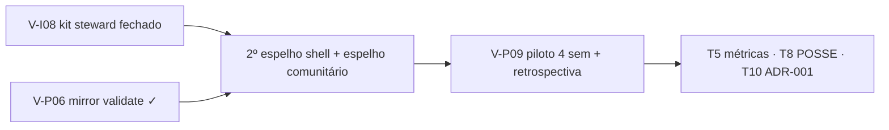

# Brainstorm — próximas 10 tarefas pós-v6.82 (nov/2026)

> **Status:** consolidação doc-only · sprint pós-**V-P06** (mirror validate)  
> **Linha de base:** `main` **`f43f8b8`** · SW **`vox-pwa-v6.82-mirror-validate-v1`** · **350** testes Node  
> **Horizonte:** **2026-Q4 → 2027-Q2** (piloto + malha sem loop do mantenedor)  
> **Público:** mantenedor/revisor, stewards, facilitadores de piloto  
> **Não é parecer jurídico** — [COMPLIANCE-BR.md](../COMPLIANCE-BR.md)

Complementa [antigravity-estrategia-mantenedor-revisor-2026.md](./antigravity-estrategia-mantenedor-revisor-2026.md) (T1 estratégico out/2026), [backlog-participacao-rede.md](./backlog-participacao-rede.md), [rede-sustentada-participantes.md](./rede-sustentada-participantes.md) e [brainstorm-dez-tarefas-estrategia-2026-10.md](./brainstorm-dez-tarefas-estrategia-2026-10.md).

**Task Antigravity (retry):** `95a45b1a-be79-4653-9afb-5e965237a9e8`

---

## Índice T1–T10

| # | Título | Trimestre alvo | Owner típico | Depende de |
|---|--------|----------------|--------------|------------|
| **T1** | Roadmap integrado mantenedor→revisor | Q4-2026→Q2-2027 | Community-doc | — (este doc) |
| **T2** | 2º espelho shell + drill DR | Q4-2026 | Steward espelho + maintainer Pages | V-P06 ✓ |
| **T3** | V-P09 piloto operacional (10–30 pessoas) | Q1-2027 | Facilitador local | T2 parcial + V-I08 |
| **T4** | V-P08 sucessão steward + relay buddy | Q1-2027 | Community-doc | V-I08 |
| **T5** | Métricas honestas v2 (implementação) | Q1-2027 | Cursor | V-P02 ✓, piloto |
| **T6** | Moderação E1–E5 (playbook) | Q1-2027 | Community-doc | T3 |
| **T7** | V-I08 gaps / runbook fechamento | Q4-2026→Q1-2027 | Antigravity + Cursor | V-P06 ✓ |
| **T8** | POSSE / Bridge / embed | Q2-2027 | Antigravity + Cursor | piloto retrospectiva |
| **T9** | Community fork (gatilhos republicanos) | Q2-2027 | Community-doc | T6 |
| **T10** | Export atestação ADR-001 (UI opt-in) | Q2-2027 | Cursor | V-P07 spec |

**Escolha T10:** **ADR-001 / V-P07** em vez de *Pluggable Feeds* — backlog [P1, baixo ops](./backlog-participacao-rede.md); lentes plugáveis **P3** ([incubacao-p2-backlog.md](./incubacao-p2-backlog.md)).

---

## T1 — Roadmap integrado Q4-2026 → Q2-2027 (mantenedor revisor)

### Objetivo

Amarrar **uma sequência única** pós-v6.82: o repositório permanece **revisor/aprovador FOSS** (CI, Pages, merge, RFC); a **malha** escala só quando **V-I08 → espelho confiável → piloto V-P09** fecham o loop — sem relay global, sem VPS de emergência do mantenedor.

Dossiê de papel (12 meses, T1–T4 exit): [antigravity-estrategia-mantenedor-revisor-2026.md](./antigravity-estrategia-mantenedor-revisor-2026.md).

### Linha de base pós-v6.82 (nov/2026)

| Entregue em `main` | Função no roadmap |
|--------------------|-------------------|
| V-P06 mirror validate (relay + client) | Steward publica espelho **estruturalmente válido** antes do piloto |
| V-P02 gateway telemetry + pill reserva | Baseline honesto para T5 métricas v2 |
| V-P04/05 painel vizinhos + seed | Ritual pós-comunidade no piloto |
| V-I09 blob soft priority | Menos gateway quando pares online |
| V-I08 **parcial** (health, compose, docs) | **Gargalo P0** — T7 fecha runbook 1-clique |

**Não executado ainda:** 2º espelho shell vivo (T2), piloto V-P09 (T3), retrospectiva escrita (gate Q2).

### Papel-alvo do mantenedor (revisor)

| Faz | Não faz |
|-----|---------|
| Merge `main`, CI verde, bump SW quando shell muda | Relay/TURN/inbox **global** |
| Pages + workflow; revisar PRs de protocolo | Moderação central ou hotline WhatsApp oficial |
| Documentar 2º espelho; tags release quando necessário | Comprar VPS para “salvar” comunidade lenta |
| Participar do app como **cidadão** nas próprias comunidades | Ser NOC único da malha |

Handoff protocolo: Antigravity em `feat/*` → Cursor integra ([antigravity-operating.md](./antigravity-operating.md)).

### Cadeia crítica: V-I08 → espelho → piloto

Ordem **não negociável** para Q4-2026→Q1-2027:



| Etapa | ID / artefato | Critério mínimo | Risco se pular |
|-------|---------------|-----------------|----------------|
| **1 — Steward pode subir relay** | V-I08 + [steward-relay-kit.md](./steward-relay-kit.md) · [steward-seed-15min.md](./steward-seed-15min.md) | Win/Linux runbook; health/quota; wizard `#/settings/network/steward` | Piloto fica 100% gateway → pill permanente → “rede quebrada” |
| **2 — Espelho confiável** | V-P06 ✓ + T2 [ops-shell-mirrors.md](./ops-shell-mirrors.md) | ≥1 steward espelha comunidade piloto; **2 URLs shell** com SHA/`CACHE_NAME` publicados | SW mismatch; DR inexistente; Art. 19 cai no único ponto |
| **3 — Piloto relacional** | V-P09 + [piloto-comunidade-retrospectiva-template.md](./piloto-comunidade-retrospectiva-template.md) | 10–30 pessoas, 4 sem, ≥5 Apoiadores **ou** 1 steward verificado | Roadmap Q2 vira feature creep sem dados qualitativos |

**Regra:** piloto **não** começa sem **decisão explícita** Caminho A vs B (seed doc) **e** plano T2 (mesmo que Caminho A — documentar bloqueio steward).

### Mapa trimestral integrado (T1–T10 deste doc)

| Trimestre | Foco release | Tarefas deste brainstorm | Exit criteria (mantenedor) |
|-----------|--------------|--------------------------|----------------------------|
| **2026-Q4** | Hardening pós-v6.82 | **T1** (este), **T7** (V-I08 gaps), **T2** (2º espelho + drill) | V-I08 runbook fechado **ou** gaps listados com owner; 2º espelho **testado**; zero “VPS emergência” |
| **2027-Q1** | Piloto + sustentação | **T3** V-P09, **T4** V-P08, **T5** métricas v2, **T6** mod E1–E5 | Retrospectiva **iniciada**; buddy steward documentado; gateway-heavy comunidade piloto **medido** (local) |
| **2027-Q2** | Validação + P2 honesto | **T8** Bridge/embed, **T9** fork, **T10** ADR-001 UI | Retrospectiva **publicada**; backlog P2 priorizado **sem** reabrir relay global |

Alinhado aos marcos T1–T4 do dossiê mantenedor→revisor (Q4 contrato → Q1 loop sem maintainer → Q2 legal/humano → Q3 validação escala); **este** doc encurta o horizonte operacional até **Q2-2027** com entregáveis concretos pós-v6.82.

### Modos de release (freeze vs hardening)

| Modo | Quando | Entra | Não entra |
|------|--------|-------|-----------|
| **Hardening** | Agora → fim Q4-2026 | T7, T2, regressão malha | OAuth enrich, feed experiments, Bridge XL |
| **Feature freeze** | Semanas 0–4 do piloto (T3) | Bugfix, SW bump, copy | Novos tipos TX sem spec |
| **Protocol window** | Branch Antigravity pronta | Cursor merge + testes | >1 XL malha em paralelo |

### Cenários e resposta do mantenedor

| Cenário | Sinais | Ação maintainer |
|---------|--------|-----------------|
| **A — Piloto fechado** | 1–3 comunidades, T3 em curso | Só CI/docs; membro, não NOC |
| **B — Orgânico lento** | Pill reserva frequente, poucos stewards | Merge T7/T2; reforçar copy — **não** hostear relay |
| **C — Onda local** | Pico 100–300 MAU regional | **Congelar features**; hardening T2/T7 |
| **D — Estagnação** | Cold start, salas vazias | Empurrar seed V-P05; **não** growth central |
| **E — Pressão regulatória** | Art. 19 → **espelho/steward** | Atualizar COMPLIANCE-BR; **zero** inbox jurídica no repo |

### Definition of Done — T1 (roadmap)

- [x] Índice T1–T10 + cadeia V-I08 → espelho → piloto documentada
- [x] **T2–T4** consolidados (objetivo, DoD, riscos, owner)
- [ ] T5–T10 consolidados neste arquivo (agentes paralelos nov/2026)
- [ ] Lobby `foco D` aponta para este doc quando lista estiver fechada
- [ ] Piloto V-P09 **não** go-live antes de T2 drill **ou** waver explícito no template retrospectiva

### Anti-padrões (roadmap)

- Piloto antes de runbook steward (V-I08) **e** plano espelho (T2).
- Maintainer sobe relay “temporário” para destravar demo.
- Métricas v2 (T5) como scoreboard público — só estimativa **por comunidade**, opt-in.
- Q2-2027 cheio de Bridge/fork **sem** retrospectiva T3.

---

## T2 — 2º espelho shell + drill DR

**Escopo:** distribuição **read-only** do cliente PWA — não confundir com relay/steward ([ops-shell-mirrors.md](./ops-shell-mirrors.md) · drill detalhado: T9 em [brainstorm-dez-tarefas-estrategia-2026-10.md](./brainstorm-dez-tarefas-estrategia-2026-10.md)).

### Objetivo

Eliminar o **SPOF** do espelho **A** (GitHub Pages): manter espelho **B** (Cloudflare Pages / Gitea / nginx coletivo) com **paridade de release** (`git_sha`, `CACHE_NAME`) e **drill DR** documentado (simulação de indisponibilidade de A), para o piloto ter URL alternativa antes de onda local.

### Definition of done (DoD)

| Critério | Evidência |
|----------|-----------|
| Espelho **B** público, mesmo `client/` da release | Registro: `mirror_id`, `base_url`, `git_sha`, `cache_name`, `operator`, `read_only: true` |
| Paridade A↔B | `git rev-parse HEAD` + `CACHE_NAME` em `sw.js` **iguais** na mesma release |
| **Um** drill DR executado | Passos 1–6 do playbook (janela, A pausado/aviso, smoke B, comunicação piloto, reativar A) com data |
| Smoke em B | PWA; `#/settings/network`; `#/c/demo-aprenda-vox-mirror`; steward **Testar espelho agora** se relay existir |
| Steward ≠ shell | Docs: relay/VPS **não** migra com espelho estático |

### Riscos

| Risco | Impacto | Mitigação |
|-------|---------|-----------|
| Só A ou só B atualizado | App branco; SW mismatch | P0: paridade antes de feature; checklist ops por push `main` |
| Voluntário abandona B | Retorno ao SPOF A | Contato no registro; rotacionar operador; drill semestral |
| Diff silencioso em `gateways.json` | Malhas divergentes | Documentar diff por coletivo |
| Espelho confundido com “nó da rede” | Expectativa T&S no host estático | [COMPLIANCE-BR.md](../COMPLIANCE-BR.md); steward ≠ shell |
| Hype anti-censura | Confiança quebrada | Espelho reduz dependência de **um domínio**, não apaga permaweb |

### Owner

| Papel | Responsabilidade |
|-------|------------------|
| **Mantenedor CI** | Espelho **A**, workflow Pages, SHA publicado |
| **Voluntário espelho (ops FOSS)** | Espelho **B**, drill DR |
| **Community-doc** | [ops-shell-mirrors.md](./ops-shell-mirrors.md) + registro de URLs |

**Prioridade:** P0 · **Dep:** release v6.82+ · **Antes de:** go-live piloto (T3) sem waver no template.

---

## T3 — V-P09 piloto operacional

**Escopo:** execução **humana** — playbook semanas 0–4: [brainstorm-dez-tarefas-estrategia-2026-10.md](./brainstorm-dez-tarefas-estrategia-2026-10.md) § T3 · template [piloto-comunidade-retrospectiva-template.md](./piloto-comunidade-retrospectiva-template.md).

### Objetivo

Rodar **1–3** pilotos (10–30 pessoas, ~4 semanas) para validar flywheel **uso → espaço digital → `commOnly` → leitura mais rápida**, calibrar copy honesta (pill gateway, steward opcional) e alimentar V-P04/V-P05/V-I08 com dados **qualitativos** — não DAU nacional.

### Definition of done (DoD)

| Critério | Evidência |
|----------|-----------|
| Piloto executado | Facilitador + fundador; Zap/Telegram paralelo; `#/c/:slug` |
| Retrospectiva preenchida | Template 7–14 dias pós go-live; continuar / pausar / abortar |
| Roles mínimos | Trio ou Caminho A/B explícito ([steward-seed-15min.md](./steward-seed-15min.md)) |
| Métricas template | Ativo/Apoiador, stewards, pill reserva, gateway (estimativa local) |
| Barra mínima 2026 | ≥3 Apoiadores `commOnly` **ou** 1 steward + espelho verificado (V-P06) até semana 4 |
| Abortar bem | Retrospectiva + pin “piloto encerrado — arquivo permanece” |

### Riscos

| Risco | Impacto | Mitigação |
|-------|---------|-----------|
| Sala vazia | “Vox não funciona” | Seed semana 0: feira/voto/POSSE dia 1 |
| “Mais um app” | Abandono | Vox = arquivo/decisão; Zap = urgência |
| Steward herói | Relay cai; VPS no fundador | Caminho A OK; buddy V-P08 (T4) cedo |
| Mod polícia | Repúdio | Mandato ~90d; E4; carta mod |
| Maintainer = suporte 1:1 | Escopo estoura | Playbook; sem hotline oficial |
| SLO como SLA | Expectativa comercial | Observação local only |

### Owner

| Papel | Responsabilidade |
|-------|------------------|
| **Community-doc** | Template, lições no backlog |
| **Facilitador local** | Rituais 0–4; ponte Zap ↔ link |
| **Fundador** | Convites, seed, mod/steward |
| **Cursor / mantenedor** | Bugfix/docs — **não** animar piloto |

**Prioridade:** V-P09 (P0/P2 backlog) · **Dep:** V-P04/05/06; **ideal:** T2 comunicado ao grupo.

---

## T4 — V-P08 sucessão steward + relay buddy

**Escopo:** processo **humano + doc** para relay/índice não morrer com uma pessoa — complementa V-I08 ([steward-relay-kit.md](./steward-relay-kit.md)).

### Objetivo

Runbook de **sucessão** e **relay buddy**: segundo voluntário treinado, handoff compose/credenciais, quotas disco, contato Art. 19 na camada espelhada, anúncio de segundo espelho POST quando couber — reduzir SPOF **humano** (anti burn-out Mastodon).

### Definition of done (DoD)

| Critério | Evidência |
|----------|-----------|
| Doc **V-P08** publicado | Buddy, handoff, emergência 72h, offboarding steward |
| Checklist handoff | VPS/compose, `.env`, WSS, backup `index_*.json`, rotação chaves, aviso comunidade |
| Buddy nomeado antes do burnout | Ritual/campo no template V-P09; heurística 1 steward / 3–5 comunidades |
| Copy steward ≠ mod | [GOVERNANCE.md](../GOVERNANCE.md) + wizard |
| Referência em comunidade real | Buddy documentado **ou** “Caminho A — risco aceito” |
| Compliance | Link [COMPLIANCE-BR.md](../COMPLIANCE-BR.md); README steward (URL, filtros, contato judicial) |

### Riscos

| Risco | Impacto | Mitigação |
|-------|---------|-----------|
| Steward único some | Índice congelado; pill crítica | Buddy + segundo mirror POST |
| Handoff no Zap | Vazamento | Checklist escrito; rotacionar segredos |
| Buddy sem acordo | Conflito de índice | Política publicada; escolha de URL |
| Maintainer compra VPS | Antipadrão T1 | Escalar ao coletivo |
| UI handoff prematura | Atraso P1 | v1 doc-only; UI = P2 |

### Owner

| Papel | Responsabilidade |
|-------|------------------|
| **Community-doc** | Runbook V-P08 |
| **Steward + buddy** | Handoff na comunidade |
| **Antigravity / Cursor** | Revisão técnica kit — **não** buddy default |
| **Fundador / mod** | Visibilidade do buddy (pin/governança) |

**Prioridade:** P1 · **Dep:** V-I08 repetível · **Sinergia:** T3 nomeia buddy; T2 cobre distribuição **cliente**.

---

## T5 — Métricas honestas v2 (implementação)

> *Seção em consolidação (agente paralelo).*

---

## T6 — Moderação E1–E5

> *Seção em consolidação (agente paralelo). Ver [brainstorm-auto-escala-organica-2026-10.md](./brainstorm-auto-escala-organica-2026-10.md) §5.5.*

---

## T7 — V-I08 gaps / runbook

> *Seção em consolidação (agente paralelo). Análise de gaps — implementação V-I08 em agente dedicado.*

---

## T8 — POSSE / Bridge / embed — funil criadores

**Refs:** [RFC 0001 POSSE](./rfc/0001-posse-export.md) · [vox-bridge-spike.md](./vox-bridge-spike.md) · [embed-integration.md](./embed-integration.md) · `posse-dispatch.js` · [vox-bridge/](../vox-bridge/).

### Objetivo

Criador publica **canônico no Vox** e distribui para Zap/redes **sem** prometer crosspost automático antes de Tier A/B — funil até Apoiador/steward.

### Funil

```
Cantina / convite Zap → post #/t/:id assinado
        ├─ Tier A: share sheet (WhatsApp, X, copiar link)     [P0]
        ├─ Tier B: vox-posse-export + CLI webhook             [P1]
        ├─ Tier C: vox-embed.js em site parceiro              [P1]
        └─ Tier D: Bridge MV3 (IG/Threads) experimental       [P2]
        → leitor externo → comunidade → commOnly / steward
```

### Ordem de build

| Ordem | Entrega | Prioridade |
|-------|---------|------------|
| 1 | Link canônico + OG honestos em `#/t/` | P0 |
| 2 | Sheet POSSE Tier A (intents + microcopy) | P0 |
| 3 | Export JSON estável + `tools/posse-cli` | P1 |
| 4 | Embed: doc + 3 sites piloto | P1 |
| 5 | Flag «Bridge experimental» em settings | P2 |
| 6 | `vox-bridge` MV3 clipboard handoff | P2 |

### DoD

- [ ] Tier A + B em `main`; embed documentado com demo
- [ ] Bridge **não** default-on; copy sem “Instagram automático” antes de Tier A

### Riscos

ToS Meta/X; expectativa MEI queimada; `externally_connectable` precipitado.

### Owner

Cursor (PWA/CLI) · contribuidor FOSS (extensão).

**Anti-padrão:** competir com ActivityPub boost antes de link canônico estável.

---

## T9 — Community fork — conflitos e gatilhos republicanos

**Refs:** [incubacao-p2-backlog.md](./incubacao-p2-backlog.md) · demo `demo-aprenda-vox-mirror` · [brainstorm-tracao-escalabilidade-incubacao.md](./brainstorm-tracao-escalabilidade-incubacao.md).

### Objetivo

Pressão republicana sobre mods **sem** litígio no repo central — fork civilizado com histórico preservado.

### Cenários e respostas

| Cenário | Resposta republicana |
|---------|----------------------|
| Mod tirânico (hide em massa, sem appeal) | Proposta fork + migração filiação |
| Steward aplica índice além do mod eleito | Documentar; espelho alternativo |
| Schism de regras | Fork + cutoff na votação |
| Captura fundador | E1 + mandato 90d + governance |

### Gatilhos objetivos (propor fork)

1. ≥3 `mod-action` contestadas + appeal E5 negado sem voto cutoff.
2. Recusa carta mod (E2) após 14 dias.
3. Política de índice steward incompatible com voto válido.
4. Heurística piloto: ≥20 membros ativos e ≥40% assinam proposta fork.

### Alvo produto (P2)

- TX `Type: community-fork` + `parentCommunityId`
- UI «Migrar minha filiação» 1 clique; banner espelho (estender demo)
- **Não** apagar histórico parent

### DoD

- [ ] Spec protocolo + UI mínima além do demo; GOVERNANCE § fork
- [ ] Mantenedor **não** escolhe lado

### Riscos

Fork spam; brigading na votação; central “escolher fork oficial”.

### Owner

Antigravity (TX spec) · Cursor (UI).

---

## T10 — Export atestação ADR-001 (UI opt-in)

**Refs:** [ADR-001](./adr/001-contribution-attestation-export.md) · [backlog-participacao-rede.md](./backlog-participacao-rede.md) · [COMPLIANCE-BR.md](../COMPLIANCE-BR.md).

### Objetivo

Apoiador/steward exporta snapshot **assinado** das métricas **do próprio aparelho** — reconhecimento privado, **sem** ranking público nem gossip automático.

### Por que T10 e não Pluggable Feeds

V-P07 fecha loop “contribuí → prova opt-in” com impl menor que motor de lentes JS; feeds plugáveis exigem sandbox, governança de scripts e moderação de algoritmo — **P3** após piloto e POSSE Tier A.

### DoD

- [ ] UI `#/settings/network`: export JSON `contribution-attestation` + `signPayload`
- [ ] Rate limit + disclaimers (self-attested)
- [ ] **Não** upload automático; **não** alterar WANT/feed
- [ ] Testes schema; export default **não** lista peers servidos

### Riscos

Comunidades comparando exports como scoreboard; telemetria disfarçada.

### Owner

Cursor.

---

## Rastreio lobby

Lista 1–10 em `lobby.md` § **Brainstorm próximas 10 pós-v82 (nov/2026)**.

**Versão:** 1.0 · **T1** `95a45b1a` · **T2–T4** análise · **T8–T10** consolidado · **Data:** 25 nov 2026
