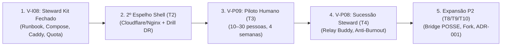
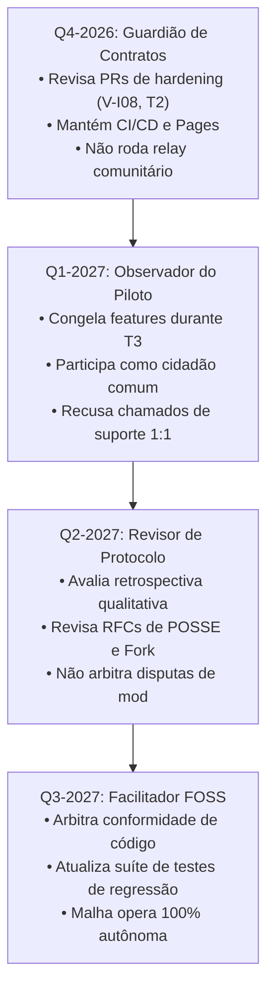

# Brainstorm — próximas 10 tarefas pós-v6.82 (nov/2026)

> **Status:** consolidação doc-only · sprint pós-**V-P06** (mirror validate)  
> **Linha de base:** `main` **`898509c`** (V-I08 steward kit) · SW **`vox-pwa-v6.83-steward-kit-v-i08`** · **333** testes Node + **22** relay  
> **Horizonte:** **2026-Q4 → 2027-Q2** (piloto + malha sem loop do mantenedor)  
> **Público:** mantenedor/revisor, stewards, facilitadores de piloto  
> **Não é parecer jurídico** — [COMPLIANCE-BR.md](../COMPLIANCE-BR.md)

Complementa [antigravity-estrategia-mantenedor-revisor-2026.md](./antigravity-estrategia-mantenedor-revisor-2026.md) (T1 estratégico out/2026), [backlog-participacao-rede.md](./backlog-participacao-rede.md), [rede-sustentada-participantes.md](./rede-sustentada-participantes.md) e [brainstorm-dez-tarefas-estrategia-2026-10.md](./brainstorm-dez-tarefas-estrategia-2026-10.md).

**Task Antigravity (retry):** `95a45b1a-be79-4653-9afb-5e965237a9e8`

---

## Índice T1–T10

| # | Título | Trimestre alvo | Owner típico | Depende de |
|---|--------|----------------|--------------|------------|
| **T1** | Roadmap integrado mantenedor→revisor | Q4-2026→Q2-2027 | Community-doc | — (este doc) |
| **T2** | 2º espelho shell + drill DR | Q4-2026 | Steward espelho + maintainer Pages | V-P06 ✓ |
| **T3** | V-P09 piloto operacional (10–30 pessoas) | Q1-2027 | Facilitador local | T2 parcial + V-I08 |
| **T4** | V-P08 sucessão steward + relay buddy | Q1-2027 | Community-doc | V-I08 |
| **T5** | Métricas honestas v2 (implementação) | Q1-2027 | Cursor | V-P02 ✓, piloto |
| **T6** | Moderação E1–E5 (playbook) | Q1-2027 | Community-doc | T3 |
| **T7** | V-I08 gaps / runbook fechamento | Q4-2026→Q1-2027 | Antigravity + Cursor | V-P06 ✓ |
| **T8** | POSSE / Bridge / embed | Q2-2027 | Antigravity + Cursor | piloto retrospectiva |
| **T9** | Community fork (gatilhos republicanos) | Q2-2027 | Community-doc | T6 |
| **T10** | Export atestação ADR-001 (UI opt-in) | Q2-2027 | Cursor | V-P07 spec |

**Escolha T10:** **ADR-001 / V-P07** em vez de *Pluggable Feeds* — backlog [P1, baixo ops](./backlog-participacao-rede.md); lentes plugáveis **P3** ([incubacao-p2-backlog.md](./incubacao-p2-backlog.md)).

---

## T1 — Roadmap integrado Q4-2026 → Q2-2027 (mantenedor revisor)

### 1. Tese de Sustentação da Malha

O Vox não escala por injeção de capital corporativo em servidores nem por algoritmos predatórios de retenção: a malha só cresce de forma saudável quando cada nova comunidade traz consigo sua própria infraestrutura de cache e moderação voluntária. A transparência do método — que expõe sem falsas promessas o estado local da rede e elimina comitês centrais opacos — converte participantes em guardiões corresponsáveis pelo seu território digital. Essa sustentação não se atinge por marketing viral abstrato, mas através de pilotos relacionais humanos (10 a 30 pessoas), onde rituais simples de auto-semeadura e deliberação provam o valor da rede no mundo real antes de qualquer expansão em massa. O papel do mantenedor não é bancar a infraestrutura da comunidade, mas fornecer um cliente soberano confiável, suíte rigorosa de testes e especificações abertas de protocolo.

### 2. Grafo de Dependências Críticas

A expansão da rede obedece a uma cadeia linear rigorosa. Pular etapas gera dependência de emergência do mantenedor e colapso na experiência do usuário:



1. **V-I08 (Steward Kit Fechado):** Sem um kit de relay reproduzível em 15 minutos em Linux/Windows, o piloto depende de gateways Arweave lentos ou de um relay improvisado pelo mantenedor.
2. **2º Espelho Shell (T2):** Sem uma URL alternativa síncrona com GitHub Pages, o projeto tem um ponto único de falha de distribuição (SPOF) e vulnerabilidade de domínio.
3. **Piloto Humano V-P09 (T3):** A validação real de moderação e cache ocorre em uma comunidade viva de 10 a 30 pessoas, gerando dados qualitativos antes de qualquer novo código de rede.
4. **Sucessão Steward V-P08 (T4):** Antes de expandir para novas comunidades, a comunidade piloto precisa documentar o "Relay Buddy" para evitar o burnout do operador pioneiro.
5. **Expansão P2 (T8 Bridge POSSE, T9 Fork, T10 ADR-001):** Funcionalidades de amplificação só entram após a infraestrutura de acolhimento e sucessão estar provada.

### 3. Planejamento Trimestral (Q4-2026 → Q3-2027)

| Trimestre | Objetivos Centrais | Entregáveis Principais | Exit Criteria (Critérios de Saída) | O Que NÃO Fazer |
|---|---|---|---|---|
| **2026-Q4**<br/>*Hardening & Contrato da Malha* | Eliminar SPOFs operacionais do mantenedor; fechar kit steward e redundância de front-end. | • V-P06 integrado (`mirror_validate.py` + pré-validação client)<br/>• V-I08 concluído (runbook, wizard, kits Win/Linux)<br/>• T2: 2º espelho shell ativo e drill DR documentado em [`ops-shell-mirrors.md`](./ops-shell-mirrors.md) | • Zero relays rodando sob responsabilidade do mantenedor.<br/>• 2 URLs de cliente PWA ativas e sincronizadas.<br/>• Suíte de testes verde (≥350 testes). | • **NÃO** subir relay de emergência em VPS do mantenedor.<br/>• **NÃO** iniciar piloto sem plano de 2º espelho.<br/>• **NÃO** adicionar novas tags on-chain sem spec formal. |
| **2027-Q1**<br/>*Piloto Humano & Loop Fechado* | Validar convivência real, auto-semeadura e moderação local em 1–3 comunidades (10–30 membros). | • T3: V-P09 piloto 4 semanas executado.<br/>• T4: V-P08 runbook de sucessão steward e relay buddy.<br/>• T5: Métricas honestas v2 (estimativa local, sem phone-home).<br/>• T6: Playbook de moderação E1–E5 testado. | • Retrospectiva do piloto preenchida ([`piloto-comunidade-retrospectiva-template.md`](./piloto-comunidade-retrospectiva-template.md)).<br/>• ≥1 relay comunitário mantido 100% por terceiros.<br/>• Zero tickets de suporte 1:1 ao mantenedor. | • **NÃO** criar ranking público ou gamificação de nós.<br/>• **NÃO** interferir em disputas de moderação local.<br/>• **NÃO** prometer P2P total em rede celular (4G/CGNAT). |
| **2027-Q2**<br/>*Validação Qualitativa & POSSE P2* | Publicar lições do piloto e abrir funil de criadores com link canônico e defesa contra tirania. | • T8: POSSE Tier A/B (link canônico, CLI webhook, `vox-embed.js`).<br/>• T9: Spec e UI mínima de Community Forking.<br/>• T10: UI de export de atestação ADR-001 (opt-in local).<br/>• Retrospectiva formal do piloto publicada no repo. | • Comunidade piloto operando há 90 dias sem intervenção técnica central.<br/>• Decisão formal registrada sobre avanço ou pausa da Bridge MV3.<br/>• Relatório qualitativo de moderação E1–E5 arquivado. | • **NÃO** implementar extensões invasivas que violem ToS de terceiros.<br/>• **NÃO** reabrir backends centralizados para facilitar onboarding.<br/>• **NÃO** criar comitê central de apelação de moderação. |
| **2027-Q3**<br/>*Consolidação Federada* | Estabilizar o protocolo para múltiplos coletivos autônomos; abrir processo de RFCs externas. | • Biblioteca canônica de tags Vox consolidada.<br/>• Múltiplos relays comunitários federados via gossip de manifestos.<br/>• Processo formal de RFCs comunitárias no GitHub.<br/>• Documentação multilíngue básica (PT/ES). | • Coletivos externos abrem comunidades e sobem relays sem contato prévio com o mantenedor.<br/>• O repositório opera 100% como árbitro de código aberto e especificações. | • **NÃO** assumir despesas de infraestrutura de terceiros.<br/>• **NÃO** aceitar PRs que quebrem o modelo client-first serverless.<br/>• **NÃO** centralizar chaves ou registros de handles. |

### 4. Cenários de Adoção Realista (Escala Cívica)

O Vox rejeita métricas de vaidade corporativa (MAU na casa de milhões) e planeja sua resiliência para a escala cívica real (dezenas a centenas de participantes por comunidade):

| Dimensão | Cenário Pessimista (Atrito & Estagnação) | Cenário Base (Adoção Focalizada) | Cenário Otimista (Onda Local / Expansão) |
|---|---|---|---|
| **Escala Numérica** | 1 comunidade; <10 participantes ativos; abandono após semana 2. | 1–3 comunidades; 20–80 participantes ativos; retenção semanal estável. | 5–10 comunidades; 100–300 participantes ativos; múltiplos coletivos regionais. |
| **Infraestrutura** | 0 stewards voluntários; 100% de tráfego recaindo em gateways Arweave de reserva. | 1 steward ativo por comunidade + 3 a 5 apoiadores `commOnly`; >70% de leituras locais. | 3 a 5 stewards independentes em VPS/PC; malha P2P ativa; gateways atuam como backup real. |
| **Dinâmica Social** | Poucos posts; tópicos sem resposta; sensação de "sala vazia". | 2 a 5 tópicos por semana; deliberações com quórum cumprido; feira com ofertas reais. | Debate ativo diário; assembleias digitais com corte temporal; feira com circulação de Pix Zaps. |
| **Resposta do Mantenedor** | **Não entrar em pânico.** Não criar bots de engajamento nem comprar tráfego. Revisar atrito no onboarding (ritual V-P05), arquivar dados honestamente no template e aguardar caso de uso com demanda real. | **Manter o papel de revisor.** Focar em estabilidade de release, documentar lições aprendidas e apoiar o facilitador local apenas com melhorias de documentação. | **Congelar features imediatamente.** Realizar auditoria de banda e quotas nos relays (V-I08), executar drill de espelho shell (T2) e garantir que nenhum suporte centralizado seja criado. |

### 5. Tensões Abertas e Trade-offs Estratégicos

1. **Painel Honesto vs. Gamificação de Participação:**
   - *A Tensão:* Usuários acostumados com redes tradicionais pedem rankings ("Top Contribuidores", "Melhores Nós", badges de reputação pública).
   - *A Resolução do Vox:* O Vox proíbe placares públicos e pontuações de reputação de nós ([COMPLIANCE-BR.md](../COMPLIANCE-BR.md) § infra). A gamificação gera vigilância, pressão social informal e potenciais passivos trabalhistas. O painel da comunidade exibe estritamente **estimativas locais agregadas da praça** (ex: "~14 vizinhos online", "~90% de leituras locais"), tratando a infraestrutura como bem comum cooperativo e não como competição individual.
2. **Separação de Camadas vs. Risco Legal (Marco Civil Art. 19 em Espelhos):**
   - *A Tensão:* A crença ingênua de que código aberto traz "imunidade absoluta" versus o risco real de ordens judiciais de remoção de conteúdo ilícito.
   - *A Resolução do Vox:* O repositório FOSS não é provedor de aplicação (não tem CNPJ, banco de dados nem servidores). Contudo, quem opera espelhos públicos estáticos ou relays com índices curados pode receber notificações (Marco Civil Art. 19). A blindagem técnica reside na **separação estrita de camadas**: ordens judiciais são cumpridas na camada que o operador controla (suprimindo a TX do índice JSON do espelho local), sem que o mantenedor do código seja intimado a "apagar dados da permaweb global", o que é tecnicamente impossível.
3. **Burnout de Stewards e Moderadores (A Armadilha do Mastodon):**
   - *A Tensão:* A decentralização muitas vezes transfere o estresse das Big Techs para voluntários sobrecarregados que acumulam os papéis de sysadmin, juiz e suporte técnico.
   - *A Resolução do Vox:* Desacoplamento de papéis e mandatos rotativos. O steward cuida apenas de disco e banda (infraestrutura cega); as regras e moderações pertencem à comunidade via `mod-action` eleito. A introdução obrigatória do **Relay Buddy (V-P08)** impede que a infraestrutura dependa de uma única pessoa, e o ciclo de moderação de 90 dias (E4) garante rotatividade de lideranças cívicas.

### 6. Decisões Irreversíveis vs. Experimentos Reversíveis

O mantenedor e os revisores devem categorizar qualquer proposta antes da aprovação em `main`:

```
┌────────────────────────────────────────────────────────────────────────┐
│ DECISÕES IRREVERSÍVEIS (One-Way Doors) — Exigem RFC e Quórum Formal    │
├────────────────────────────────────────────────────────────────────────┤
│ • Esquema de tags e tipos de transação on-chain (App-Name: vox-brasil) │
│ • Regra matemática de corte temporal (Eligibility-Cutoff = Created-At) │
│ • Padrão criptográfico de identidade (Ed25519) e chaves locais         │
│ • Proibição expressa de DMs gravadas no Permaweb (minimização LGPD)    │
│ • Algoritmo BR Code EMV offline puro para Pix Zaps                     │
├────────────────────────────────────────────────────────────────────────┤
│ EXPERIMENTOS REVERSÍVEIS (Two-Way Doors) — Foco em Iteração Rápida     │
├────────────────────────────────────────────────────────────────────────┤
│ • Layouts de cards e temas visuais (Carbon, Sky, Civic Typography)     │
│ • Modais, toasts e fluxos explicativos de onboarding (Porta da Cantina)│
│ • Heurísticas locais de cache e prioridade de busca em IndexedDB       │
│ • Menus de transbordo (Post-more sheet) e abas secundárias             │
│ • Scripts auxiliares de deploy (Docker Compose, Caddyfile, batch)      │
└────────────────────────────────────────────────────────────────────────┘
```

#### Gatilhos de Feature Freeze vs. Hardening
- **Hardening Ativo:** Aplicado sempre que a suíte de testes apresentar instabilidade, quando houver descompasso entre documentação e código (*doc drift*), ou na semana anterior à ativação de um novo relay/espelho. Durante o hardening, apenas correções de bugs e alinhamento de documentação entram em `main`.
- **Feature Freeze Rígido:** Acionado obrigatoriamente durante as **4 semanas do piloto humano V-P09 (T3)** ou se houver pico repentino de acessos (Cenário C). É expressamente proibido introduzir novos tipos de transação, reescrever componentes do Service Worker ou alterar schemas de tags durante a janela de observação do piloto.

### 7. O Papel do Mantenedor por Trimestre (Transição Mantenedor → Revisor)

A meta existencial do mantenedor é tornar-se dispensável para a operação diária da rede:



- **Em 2026-Q4:** O mantenedor atua como revisor rigoroso de código. Garante que o kit steward (V-I08) e o espelho redundante (T2) sejam operáveis por terceiros. Não aceita ser "o hospedeiro provisório" de comunidades de teste.
- **Em 2027-Q1:** O mantenedor entra em modo de observação. No piloto V-P09, ele frequenta a praça apenas com seu par de chaves pessoal, postando e deliberando como membro comum. Toda dúvida de uso é direcionada para a documentação e rituais do grupo.
- **Em 2027-Q2:** O mantenedor atua como analista de produto aberto. Lê a retrospectiva comunitária, avalia a maturidade das ferramentas de export e bifurcação (T8/T9), e garante que nenhuma pressão por crescimento comprometa a arquitetura serverless.
- **Em 2027-Q3 em diante:** O mantenedor atinge o papel pleno de **revisor de especificações e releases**. Ele aprova PRs, audita a segurança criptográfica do cliente e assegura que a governança do repositório permaneça pública, enquanto a infraestrutura física é gerida organicamente pelos coletivos do país.

### 8. Definition of Done & Anti-Padrões de T1

#### Definition of Done (DoD)
- [x] Tese em 3–5 frases definindo o crescimento por infraestrutura participante e piloto humano.
- [x] Grafo de dependências formalizando a cadeia linear: `V-I08 → 2º espelho → V-P09 piloto → V-P08 sucessão → P2`.
- [x] Cronograma trimestral completo (Q4-2026 a Q3-2027) com objetivos, entregáveis, exit criteria e vedações explícitas.
- [x] Matriz de cenários realista (Pessimista, Base, Otimista) dimensionada para escala cívica (dezenas a centenas por comunidade).
- [x] Análise aprofundada das tensões abertas: painel honesto, risco legal no Art. 19 e burnout de operadores.
- [x] Critérios objetivos delimitando decisões irreversíveis vs. experimentos reversíveis, com gatilhos de freeze e hardening.
- [x] Matriz trimestral do papel do mantenedor em sua transição definitiva para revisor FOSS.

#### Anti-Padrões Críticos
- Iniciar qualquer piloto humano antes de validar o runbook de steward (V-I08) e o 2º espelho shell (T2).
- O mantenedor ceder à tentação de subir um relay "temporário" em sua própria VPS para destravar uma demonstração.
- Introduzir leaderboards ou pontuações de reputação de nós no painel comunitário.
- Queimar esforço de desenvolvimento na extensão Vox Bridge (Tier D) antes de consolidar o link canônico (Tier A) e a retrospectiva do piloto.

---

## T2 — 2º espelho shell + drill DR

**Escopo:** distribuição **read-only** do cliente PWA — não confundir com relay/steward ([ops-shell-mirrors.md](./ops-shell-mirrors.md) · drill detalhado: T9 em [brainstorm-dez-tarefas-estrategia-2026-10.md](./brainstorm-dez-tarefas-estrategia-2026-10.md)).

### Objetivo

Eliminar o **SPOF** do espelho **A** (GitHub Pages): manter espelho **B** (Cloudflare Pages / Gitea / nginx coletivo) com **paridade de release** (`git_sha`, `CACHE_NAME`) e **drill DR** documentado (simulação de indisponibilidade de A), para o piloto ter URL alternativa antes de onda local.

### Definition of done (DoD)

| Critério | Evidência |
|----------|-----------|
| Espelho **B** público, mesmo `client/` da release | Registro: `mirror_id`, `base_url`, `git_sha`, `cache_name`, `operator`, `read_only: true` |
| Paridade A↔B | `git rev-parse HEAD` + `CACHE_NAME` em `sw.js` **iguais** na mesma release |
| **Um** drill DR executado | Passos 1–6 do playbook (janela, A pausado/aviso, smoke B, comunicação piloto, reativar A) com data |
| Smoke em B | PWA; `#/settings/network`; `#/c/demo-aprenda-vox-mirror`; steward **Testar espelho agora** se relay existir |
| Steward ≠ shell | Docs: relay/VPS **não** migra com espelho estático |

### Riscos

| Risco | Impacto | Mitigação |
|-------|---------|-----------|
| Só A ou só B atualizado | App branco; SW mismatch | P0: paridade antes de feature; checklist ops por push `main` |
| Voluntário abandona B | Retorno ao SPOF A | Contato no registro; rotacionar operador; drill semestral |
| Diff silencioso em `gateways.json` | Malhas divergentes | Documentar diff por coletivo |
| Espelho confundido com “nó da rede” | Expectativa T&S no host estático | [COMPLIANCE-BR.md](../COMPLIANCE-BR.md); steward ≠ shell |
| Hype anti-censura | Confiança quebrada | Espelho reduz dependência de **um domínio**, não apaga permaweb |

### Owner

| Papel | Responsabilidade |
|-------|------------------|
| **Mantenedor CI** | Espelho **A**, workflow Pages, SHA publicado |
| **Voluntário espelho (ops FOSS)** | Espelho **B**, drill DR |
| **Community-doc** | [ops-shell-mirrors.md](./ops-shell-mirrors.md) + registro de URLs |

**Prioridade:** P0 · **Dep:** release v6.82+ · **Antes de:** go-live piloto (T3) sem waver no template.

---

## T3 — V-P09 piloto operacional

**Escopo:** execução **humana** — playbook semanas 0–4: [brainstorm-dez-tarefas-estrategia-2026-10.md](./brainstorm-dez-tarefas-estrategia-2026-10.md) § T3 · template [piloto-comunidade-retrospectiva-template.md](./piloto-comunidade-retrospectiva-template.md).

### Objetivo

Rodar **1–3** pilotos (10–30 pessoas, ~4 semanas) para validar flywheel **uso → espaço digital → `commOnly` → leitura mais rápida**, calibrar copy honesta (pill gateway, steward opcional) e alimentar V-P04/V-P05/V-I08 com dados **qualitativos** — não DAU nacional.

### Definition of done (DoD)

| Critério | Evidência |
|----------|-----------|
| Piloto executado | Facilitador + fundador; Zap/Telegram paralelo; `#/c/:slug` |
| Retrospectiva preenchida | Template 7–14 dias pós go-live; continuar / pausar / abortar |
| Roles mínimos | Trio ou Caminho A/B explícito ([steward-seed-15min.md](./steward-seed-15min.md)) |
| Métricas template | Ativo/Apoiador, stewards, pill reserva, gateway (estimativa local) |
| Barra mínima 2026 | ≥3 Apoiadores `commOnly` **ou** 1 steward + espelho verificado (V-P06) até semana 4 |
| Abortar bem | Retrospectiva + pin “piloto encerrado — arquivo permanece” |

### Riscos

| Risco | Impacto | Mitigação |
|-------|---------|-----------|
| Sala vazia | “Vox não funciona” | Seed semana 0: feira/voto/POSSE dia 1 |
| “Mais um app” | Abandono | Vox = arquivo/decisão; Zap = urgência |
| Steward herói | Relay cai; VPS no fundador | Caminho A OK; buddy V-P08 (T4) cedo |
| Mod polícia | Repúdio | Mandato ~90d; E4; carta mod |
| Maintainer = suporte 1:1 | Escopo estoura | Playbook; sem hotline oficial |
| SLO como SLA | Expectativa comercial | Observação local only |

### Owner

| Papel | Responsabilidade |
|-------|------------------|
| **Community-doc** | Template, lições no backlog |
| **Facilitador local** | Rituais 0–4; ponte Zap ↔ link |
| **Fundador** | Convites, seed, mod/steward |
| **Cursor / mantenedor** | Bugfix/docs — **não** animar piloto |

**Prioridade:** V-P09 (P0/P2 backlog) · **Dep:** V-P04/05/06; **ideal:** T2 comunicado ao grupo.

---

## T4 — V-P08 sucessão steward + relay buddy

**Escopo:** processo **humano + doc** para relay/índice não morrer com uma pessoa — complementa V-I08 ([steward-relay-kit.md](./steward-relay-kit.md)).

### Objetivo

Runbook de **sucessão** e **relay buddy**: segundo voluntário treinado, handoff compose/credenciais, quotas disco, contato Art. 19 na camada espelhada, anúncio de segundo espelho POST quando couber — reduzir SPOF **humano** (anti burn-out Mastodon).

### Definition of done (DoD)

| Critério | Evidência |
|----------|-----------|
| Doc **V-P08** publicado | Buddy, handoff, emergência 72h, offboarding steward |
| Checklist handoff | VPS/compose, `.env`, WSS, backup `index_*.json`, rotação chaves, aviso comunidade |
| Buddy nomeado antes do burnout | Ritual/campo no template V-P09; heurística 1 steward / 3–5 comunidades |
| Copy steward ≠ mod | [GOVERNANCE.md](../GOVERNANCE.md) + wizard |
| Referência em comunidade real | Buddy documentado **ou** “Caminho A — risco aceito” |
| Compliance | Link [COMPLIANCE-BR.md](../COMPLIANCE-BR.md); README steward (URL, filtros, contato judicial) |

### Riscos

| Risco | Impacto | Mitigação |
|-------|---------|-----------|
| Steward único some | Índice congelado; pill crítica | Buddy + segundo mirror POST |
| Handoff no Zap | Vazamento | Checklist escrito; rotacionar segredos |
| Buddy sem acordo | Conflito de índice | Política publicada; escolha de URL |
| Maintainer compra VPS | Antipadrão T1 | Escalar ao coletivo |
| UI handoff prematura | Atraso P1 | v1 doc-only; UI = P2 |

### Owner

| Papel | Responsabilidade |
|-------|------------------|
| **Community-doc** | Runbook V-P08 |
| **Steward + buddy** | Handoff na comunidade |
| **Antigravity / Cursor** | Revisão técnica kit — **não** buddy default |
| **Fundador / mod** | Visibilidade do buddy (pin/governança) |

**Prioridade:** P1 · **Dep:** V-I08 repetível · **Sinergia:** T3 nomeia buddy; T2 cobre distribuição **cliente**.

---

## T5 — Métricas honestas v2 (implementação)

**Objetivo:** Evoluir o painel «Sustentada por vizinhos» (v1 em `computeCommunityNeighborStats`) para **v2** — estimativas locais úteis, sem phone-home nem ranking global ([brainstorm-dez-tarefas-estrategia-2026-10.md](./brainstorm-dez-tarefas-estrategia-2026-10.md) § T5 · [ADR-001](./adr/001-contribution-attestation-export.md)).

**DoD**

- [ ] `read_origin` por leitura (`mesh` \| `relay` \| `gateway` \| `cache_idb`) agregado só na comunidade atual
- [ ] Janela 24h ou 50 leituras; ocultar `%` se amostra &lt; 5
- [ ] Estados UI: saudável / degradado / frio-seed / insuficiente
- [ ] «Apagar estatísticas locais» em `#/settings/network`
- [ ] Testes render estendidos; **nenhuma** API nova de métricas no relay

**Riscos:** percentual falso induz confiança; vazar `routeId` em agregado; phone-home disfarçado.

**Owner:** Cursor.

---

## T6 — Moderação voluntária E1–E5 (90 dias)

**Objetivo:** Validar mods eleitos, carta, plantão e appeal **no piloto T3**, sem central Vox ([brainstorm-auto-escala-organica-2026-10.md](./brainstorm-auto-escala-organica-2026-10.md) § C.5).

**DoD**

- [ ] E1 trio + E2 carta pinned antes do dia 7
- [ ] E3 workshop mod-action; ≥1 ocultação de teste registrada
- [ ] E5 um ciclo appeal completo documentado
- [ ] Retro atualiza GOVERNANCE se gaps

**Riscos:** mod burnout; fundador permanente como mod; leaderboard de ações mod.

**Owner:** Facilitador + mods da comunidade piloto.

---

## T7 — V-I08 gaps / runbook (análise pós-fechamento)

**Objetivo:** Após **`898509c`** ([steward-relay-kit.md](./steward-relay-kit.md)), registrar lacunas **residuais** — não reimplementar o kit.

| Área | Estado pós-V-I08 | Gap residual | Owner |
|------|------------------|--------------|-------|
| Compose + Caddy + `/health` | ✓ | Drill em VPS BR real (CGNAT, firewall) | Steward voluntário |
| Wizard + quota UI | ✓ | Smoke por **não-maintainer** documentado | Cursor |
| Kits Win/Linux 1-clique | ✓ script Linux | AppImage/systemd user unit (P2) | FOSS |
| V-P08 buddy handoff | doc T4 | Runbook `docs/` dedicado ainda pendente | Community-doc |
| Manifest gossip pós-seed | spec v0 | Exemplo no kit «dia 1 após espelho» | Cursor doc |

**DoD T7:** checklist acima fechada ou virou issues P1/P2; seed 15 min testado por voluntário externo uma vez.

**Riscos:** doc perfeito mas relay na VPS do maintainer; wizard promete P2P total no 4G.

**Owner:** Cursor (impl residual) · revisão steward voluntário.

---

## T8 — POSSE / Bridge / embed — funil criadores

**Refs:** [RFC 0001 POSSE](./rfc/0001-posse-export.md) · [vox-bridge-spike.md](./vox-bridge-spike.md) · [embed-integration.md](./embed-integration.md) · `posse-dispatch.js` · [vox-bridge/](../vox-bridge/).

### Objetivo

Criador publica **canônico no Vox** e distribui para Zap/redes **sem** prometer crosspost automático antes de Tier A/B — funil até Apoiador/steward.

### Funil

```
Cantina / convite Zap → post #/t/:id assinado
        ├─ Tier A: share sheet (WhatsApp, X, copiar link)     [P0]
        ├─ Tier B: vox-posse-export + CLI webhook             [P1]
        ├─ Tier C: vox-embed.js em site parceiro              [P1]
        └─ Tier D: Bridge MV3 (IG/Threads) experimental       [P2]
        → leitor externo → comunidade → commOnly / steward
```

### Ordem de build

| Ordem | Entrega | Prioridade |
|-------|---------|------------|
| 1 | Link canônico + OG honestos em `#/t/` | P0 |
| 2 | Sheet POSSE Tier A (intents + microcopy) | P0 |
| 3 | Export JSON estável + `tools/posse-cli` | P1 |
| 4 | Embed: doc + 3 sites piloto | P1 |
| 5 | Flag «Bridge experimental» em settings | P2 |
| 6 | `vox-bridge` MV3 clipboard handoff | P2 |

### DoD

- [ ] Tier A + B em `main`; embed documentado com demo
- [ ] Bridge **não** default-on; copy sem “Instagram automático” antes de Tier A

### Riscos

ToS Meta/X; expectativa MEI queimada; `externally_connectable` precipitado.

### Owner

Cursor (PWA/CLI) · contribuidor FOSS (extensão).

**Anti-padrão:** competir com ActivityPub boost antes de link canônico estável.

---

## T9 — Community fork — conflitos e gatilhos republicanos

**Refs:** [incubacao-p2-backlog.md](./incubacao-p2-backlog.md) · demo `demo-aprenda-vox-mirror` · [brainstorm-tracao-escalabilidade-incubacao.md](./brainstorm-tracao-escalabilidade-incubacao.md).

### Objetivo

Pressão republicana sobre mods **sem** litígio no repo central — fork civilizado com histórico preservado.

### Cenários e respostas

| Cenário | Resposta republicana |
|---------|----------------------|
| Mod tirânico (hide em massa, sem appeal) | Proposta fork + migração filiação |
| Steward aplica índice além do mod eleito | Documentar; espelho alternativo |
| Schism de regras | Fork + cutoff na votação |
| Captura fundador | E1 + mandato 90d + governance |

### Gatilhos objetivos (propor fork)

1. ≥3 `mod-action` contestadas + appeal E5 negado sem voto cutoff.
2. Recusa carta mod (E2) após 14 dias.
3. Política de índice steward incompatible com voto válido.
4. Heurística piloto: ≥20 membros ativos e ≥40% assinam proposta fork.

### Alvo produto (P2)

- TX `Type: community-fork` + `parentCommunityId`
- UI «Migrar minha filiação» 1 clique; banner espelho (estender demo)
- **Não** apagar histórico parent

### DoD

- [ ] Spec protocolo + UI mínima além do demo; GOVERNANCE § fork
- [ ] Mantenedor **não** escolhe lado

### Riscos

Fork spam; brigading na votação; central “escolher fork oficial”.

### Owner

Antigravity (TX spec) · Cursor (UI).

---

## T10 — Export atestação ADR-001 (UI opt-in)

**Refs:** [ADR-001](./adr/001-contribution-attestation-export.md) · [backlog-participacao-rede.md](./backlog-participacao-rede.md) · [COMPLIANCE-BR.md](../COMPLIANCE-BR.md).

### Objetivo

Apoiador/steward exporta snapshot **assinado** das métricas **do próprio aparelho** — reconhecimento privado, **sem** ranking público nem gossip automático.

### Por que T10 e não Pluggable Feeds

V-P07 fecha loop “contribuí → prova opt-in” com impl menor que motor de lentes JS; feeds plugáveis exigem sandbox, governança de scripts e moderação de algoritmo — **P3** após piloto e POSSE Tier A.

### DoD

- [ ] UI `#/settings/network`: export JSON `contribution-attestation` + `signPayload`
- [ ] Rate limit + disclaimers (self-attested)
- [ ] **Não** upload automático; **não** alterar WANT/feed
- [ ] Testes schema; export default **não** lista peers servidos

### Riscos

Comunidades comparando exports como scoreboard; telemetria disfarçada.

### Owner

Cursor.

---

## Rastreio lobby

Lista 1–10 em `lobby.md` § **Brainstorm próximas 10 pós-v82 (nov/2026)**.

**Versão:** 1.1 · T1–T10 consolidado · V-I08 **`898509c`** · **Data:** 25 out 2026
