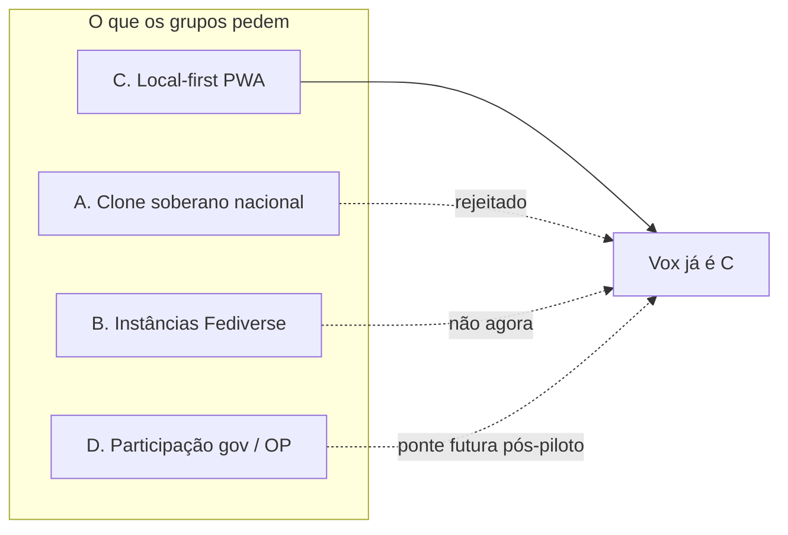

# Notas de campo: Debate Aberto, NDP e o debate de soberania cívica (out/2026)

> **Status:** canônico (notas de campo) · **Owner:** voluntário doc · **Data:** 2026-10-26  
> **Aviso:** Não substitui o [direcionamento-crescimento-rede-2026-11.md](./direcionamento-crescimento-rede-2026-11.md) nem o [dossiê N=25](./dossie-geral-inventario-master-breakdown-2026-11.md). Trata-se de observação empírica de campo para balizar posicionamento, produto e piloto.

---

## 1. Contexto e fontes de campo observadas

Em 26 de outubro de 2026, no rescaldo eleitoral e no contexto das tensões contínuas entre Judiciário brasileiro (STF/TSE) e grandes plataformas centralizadas (Meta, X), observou-se forte mobilização orgânica de voluntários de tecnologia e militantes cívicos buscando alternativas de soberania digital.

As fontes primárias registradas nesta rodada foram:
1. **Debate Aberto (WhatsApp):** Grupo cívico ativo. Observou-se a tensão permanente entre o filtro comunitário rápido contra notícias requentadas (ex.: vídeo antigo de mobilização desmentido em 2 minutos pelos próprios membros) e o impulso de manter mobilização contínua ("a luta não para") através de links do Instagram.
2. **NDP - Núcleo Democracia e Participação (WhatsApp):** Grupo criado espontaneamente em 26/10/2026 às 09:30 por Túlio Freire (analista de dados governamentais na PB). Em menos de 1 hora, reuniu dezenas de voluntários, mapeando formalmente 14 profissionais técnicos (backend, infraestrutura de IA, dados, produto, QA e design) de 9 estados (PB, ES, SP, MT, PR, RN, MS, PE, RS) com alta disposição para codar e construir infraestrutura cívica.
3. **Projeto Varanda (`bora.varanda.app`):** Apresentado no NDP por Rodrigo S. Pavezi (Staff Engineer, Curitiba). Proposta de rede social brasileira, de código aberto e sem dono, em reação direta ao controle algorítmico estrangeiro, trazendo o conceito da "Espiadinha" (feed de descoberta pública para contornar a necessidade de conhecer `@` antecipadamente).

---

## 2. Os quatro modelos que a base propõe vs. A resposta do Vox

O ecossistema cívico confunde frequentemente soberania política com hospedagem física. Mapeamos os quatro arquétipos em debate e a resposta objetiva do Vox:

| Modelo | O que a base imagina | Resposta do Vox |
|---|---|---|
| **A. Clone soberano nacional** | Um "Twitter/Instagram brasileiro" hospedado num datacenter no país com CNPJ próprio. | **Jurisdição não é soberania:** Servidor central no Brasil reproduz o mesmo risco de censura, custo fixo e ponto único de falha; a soberania real é a chave ficar no aparelho (metáfora Pix em [POSITIONING.md](../POSITIONING.md)). |
| **B. Instâncias Fediverse (ActivityPub)** | Subir instâncias Mastodon/Lemmy para cada sindicato, movimento ou partido. | **Custo empurrado para o voluntário:** Instâncias geram sobrecarga financeira de VPS e estafa do administrador (anti-Mastodon); o Vox elimina o servidor central obrigatório. |
| **C. Malha Local-first + PWA (O Vox)** | App estático no navegador, chaves locais, permaweb (Arweave) e replicação entre vizinhos. | **Onde o Vox já está:** Custo zero de servidor para o usuário, leitura de backup via gateways públicos, e distribuição POSSE para onde as pessoas já estão. |
| **D. Participação gov / OP** | Plataforma de consulta popular, plebiscito e orçamento participativo integrada ao Estado. | **Fora de escopo até o piloto:** O Vox é praça e fórum comunitário livre; pontes com dados governamentais só serão avaliadas após validação do piloto humano (V-P09). |

---

## 3. As cinco dores reais de campo e o diagnóstico no Vox

| # | Dor observada no campo | O que já existe no Vox | Gap identificado (Tipo DoD) |
|---|---|---|---|
| 1 | **Algoritmo de ódio e conflito:** Big Techs forçam engajamento por indignação; militantes se sentem reféns de brigar para ter alcance. | Feed cronológico, sem ranking, sem boost, sem leilão de ads e com governança auditável de comunidade. | Copy explícito na Voxpedia e em `#/ajuda/teste`: *"sem ranking, sem boost"* (`doc`). |
| 2 | **Silício / Apagão de contas:** Decisões arbitrárias no exterior ou bloqueios judiciais desestabilizam campanhas inteiras. | Identidade em chaves locais no aparelho (`vx_…`) e publicações ancoradas no permaweb permanente. | Transparência jurídica: não prometer "imunidade total a decisões judiciais/Art. 19", mas garantir custódia dos próprios dados (`doc`). |
| 3 | **Cidade fantasma e efeito de rede:** Ninguém quer ficar sozinho em app novo; a massa e a imprensa continuam no Zap/Insta. | Estratégia POSSE (*Publish on Own Site, Syndicate Elsewhere*): o Vox é a fonte de verdade, o Zap é canal de distribuição. | Ritual de postar no Vox **antes** de enviar no Zap; pergunta "divulgar pra fora?" no seed (`doc` + `ops-humano` no piloto). |
| 4 | **Custo VPS / Burnout de dev:** Iniciativas voluntárias morrem sem dinheiro para servidor, banco e APIs de IA. | Arquitetura serverless: GitHub Pages para o shell estático, gateways públicos como leitura reserva, relay opcional desktop. | NET-01/02 e PIL-01/02 continuam com gates humanos de infra e facilitadores (`ops-humano`). |
| 5 | **Notícia requentada:** Vídeos e notícias de 2 a 4 anos atrás reciclados como "fato de hoje", gerando desinformação interna. | Timestamps (`ts`) nativos em todas as transações; travas de elegibilidade temporal para votos em governança. | **Data visível e inequívoca** no card de post (relativa + absoluta legível), impedindo que post antigo passe por atual (`code`). |

---

## 4. Como acolher a energia do NDP sem inflacionar o repositório

A mobilização de 14 profissionais de TI em 9 estados no grupo NDP representa uma oportunidade real de adoção, mas impõe um guardrail estrito:

1. **Não transformar o repo em backlog de terceiros:** O Vox não vai adotar o roadmap do NDP nem virar consultoria de desenvolvimento para outros apps.
2. **Oferta objetiva de onboarding:**
   - Convidar desenvolvedores e testadores para rodar o roteiro de 15 minutos em `#/ajuda/teste`.
   - Canalizar apontamentos de bugs e melhorias via template formal de issues do GitHub: `[tester] Bug report`.
3. **Critério para Círculo Piloto (V-P09):**
   - O NDP ou o Debate Aberto são candidatos ideais a círculo piloto porque **já são coletivos que se reúnem**.
   - Para abrir o piloto formal, o grupo precisa indicar um **facilitador humano real** e um **canal de apoio** (PIL-01 permanece `blocked-human` até que alguém do grupo assuma formalmente esse papel).
