# Owlbear Rodeo — dossiê Stitch (produto)

> **Status:** pesquisa (referência de mercado para design) · **Revisado:** 2026-11-20
> **Uso:** anexar este ficheiro + pasta `owlbear-stitch-dossier/assets/` no Stitch ao redesenhar a Mesa Vox.
> **Escopo:** guias oficiais `/docs/*` (UI jogador/GM). API de extensões: https://docs.owlbear.rodeo/extensions/.
> **Gerado:** `python e2e/owlbear_stitch_dossier.py` · origem https://docs.owlbear.rodeo

## Leitura rápida (para o modelo)

| Ideia Owlbear | Implicação para Mesa Vox |
| :--- | :--- |
| Cena = canvas infinito com grelha | Mapa herói full-bleed; trocar cena ≈ trocar mesa física |
| Asset Manager no **dock** lateral | Hub de salas, cenas, mapas e tokens num painel compacto |
| Ferramentas na **toolbar** (medir, desenhar, fog) | Z4 tática flutuante; modos vs ações separados no fog |
| Fog com preview GM / jogador | Z4 visibility: GM vê através; jogador só vê áreas reveladas |
| Mapas reutilizáveis fora da cena | Biblioteca de assets desacoplada da cena ativa |
| Casting / permissões por sala | Entrada jogador simples; ocultar chrome de GM na projeção |

## Guias (texto condensado + figuras da documentação)

### Getting Started

- **Fonte:** `https://docs.owlbear.rodeo/docs/getting-started/`
- **Mesa Vox (`feature_id`):** `hub_campaign`, `mobile_or_dock`
- **Stitch:** onboarding de sala, convites e biblioteca no dock; dock inferior, responsivo, casting

**Resumo:** Owlbear Rodeo is a virtual tabletop (VTT) designed to be intuitive and feature rich. It works completely in a web browser so you don't need to download any extra software. The app is also responsive so it works across both mobile and desktop operating systems.

- Getting Started

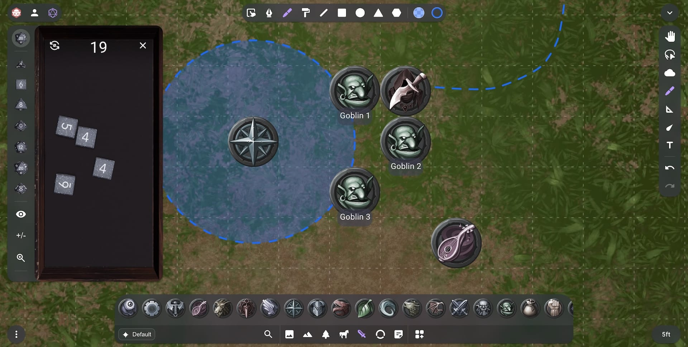
*Figura:* The Owlbear Rodeo interface

Owlbear Rodeo is a virtual tabletop (VTT) designed to be intuitive and feature rich. It works completely in a web browser so you don't need to download any extra software. The app is also responsive so it works across both mobile and desktop operating systems.

Owlbear Rodeo’s main focus is providing a great battle-map experience. This includes sharing maps, tokens and other images. We also provide robust drawing, text and fog tools that make it easy to replicate a physical tabletop.

We know every table is different so we also offer an easy way to customise Owlbear Rodeo. With deep support for extensions you can ensure that Owlbear Rodeo adapts to how you like to play.

#### First 5 Minutes in Owlbear Rodeo

The following guide is designed for a Game Master (GM). If you're a player all you need to do is open the link sent to you by your GM and click join.

##### Creating an account

To get started with Owlbear Rodeo you must first create an account.

Head to our sign up page and use your Google/Apple account or email.

Your players only need to create an account if they want to bring their own character token

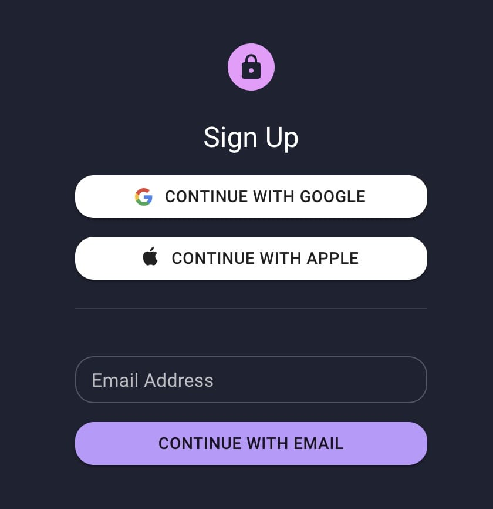
*Figura:* Create account

##### Creating a Room

A room connects you and your players.

Create a room from the profile page by using the Create Room button.

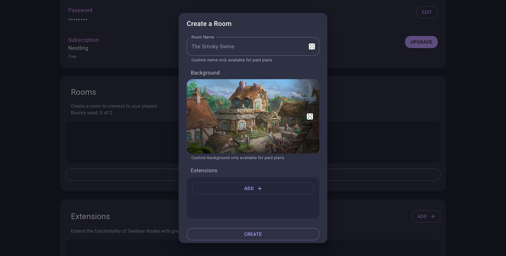
*Figura:* Create room

You can read more about rooms here .

##### Creating a Scene

A scene is an infinite space for you to lay out images, drawings, fog and more.

To create a scene open the Asset Manager using the Asset Manager button on the right side of the dock.

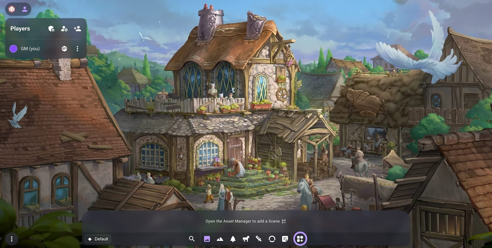
*Figura:* Dock scene tab

With the Scenes tab selected you can create a scene by clicking the Add button in the top right of the Asset Manager.

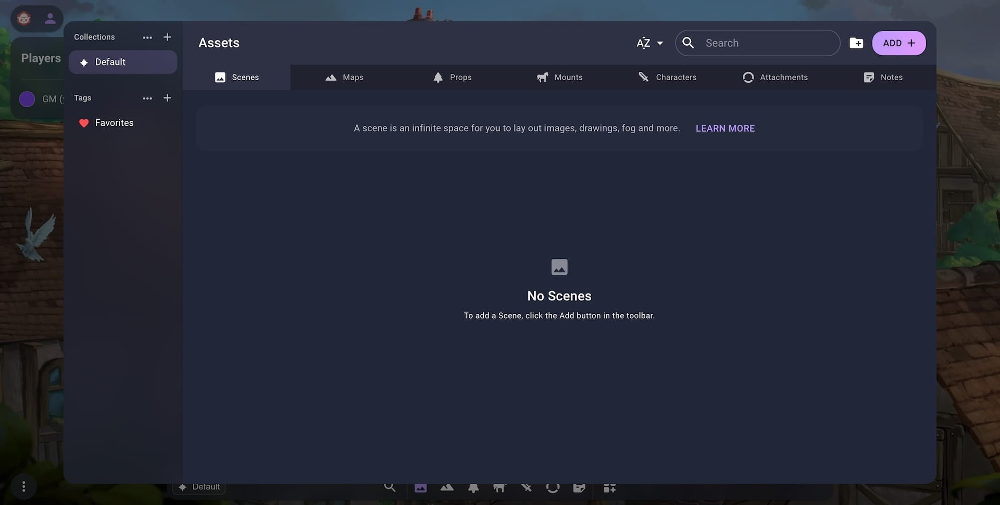
*Figura:* Create scene

When creating a new scene you can use one of the starter sets to get up and running as quickly as possible.

Clicking on the basic maps starter set will allow you to use a simple battlemat to get started.

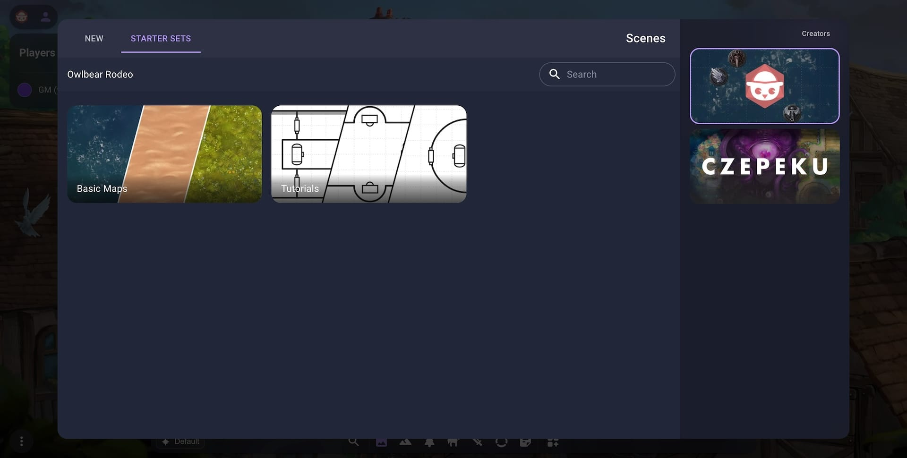
*Figura:* Starter sets

Selecting the Road map and clicking Add Selected in the bottom right will add that scene to your account.

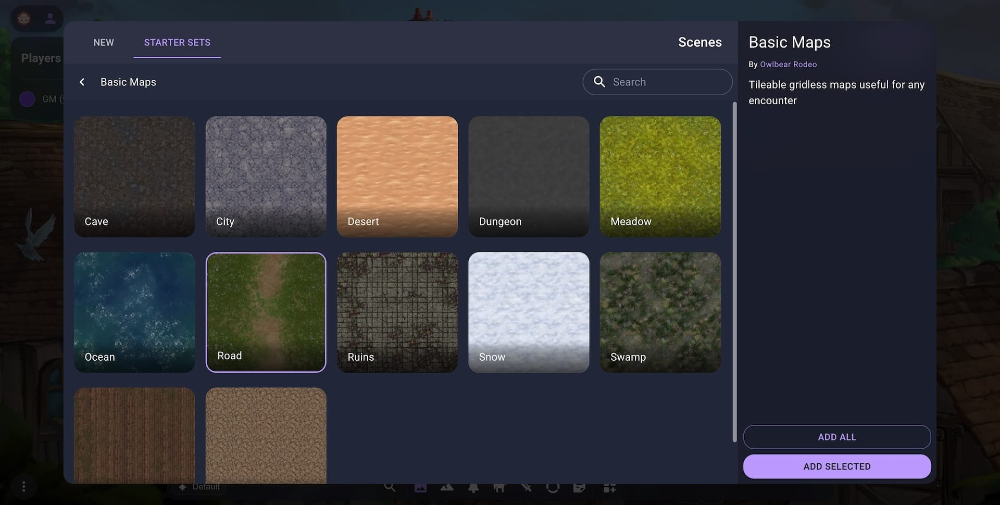
*Figura:* Basic maps

To create a new scene from your own map you can select New tab when creating your scene

Once you've created the scene, open it by selecting the Open button.

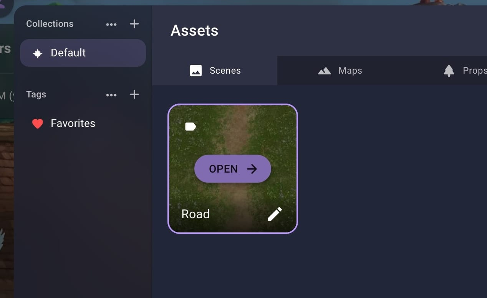
*Figura:* Open button

You can read more about scenes here .

##### Adding Images

To add images to your scene you can use the Dock on the bottom of the room.

The dock is split into a tab for each image type: Maps, Props, Mounts, Characters, Attachments and Notes.

Switch to the Characters tab and open the Asset Manager once again.

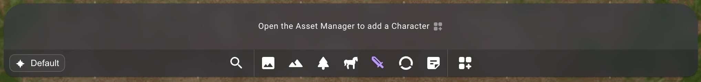
*Figura:* Character Dock

Click the Add button in the top right to add more character tokens.

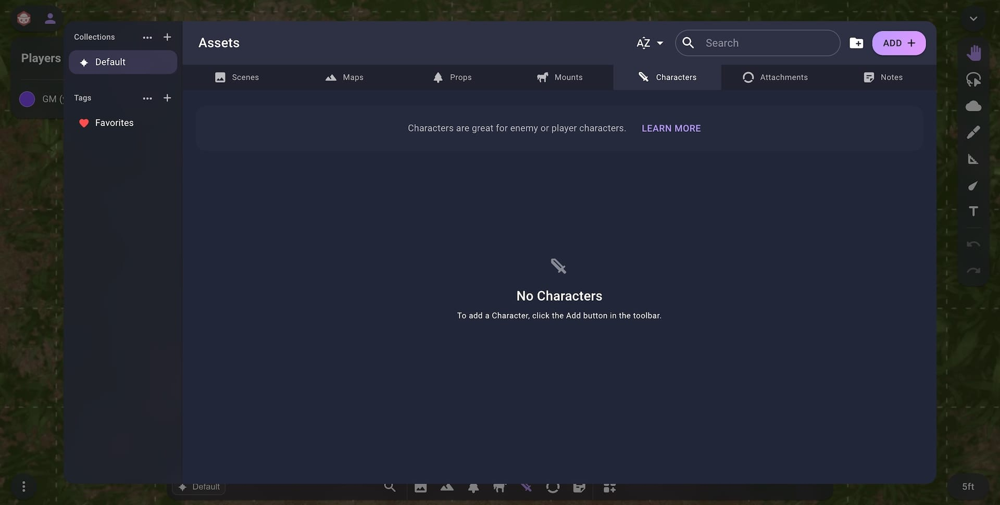
*Figura:* Asset manager characters

Click the Characters and Monsters starter set and select the tokens you would like or select Add All to add all the tokens.

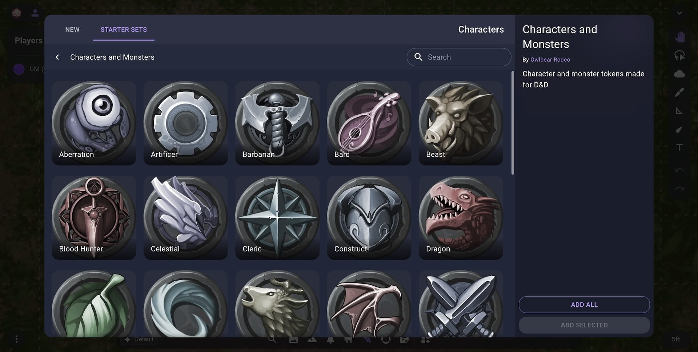
*Figura:* Characters and Monsters

Back in the Scene you can now drag and drop a Goblin token from your dock.

Add a token to the scene

##### Building an Encounter

To flesh out this encounter we can give our token a label.

Select the goblin we just added by clicking it then click the Edit Text button.

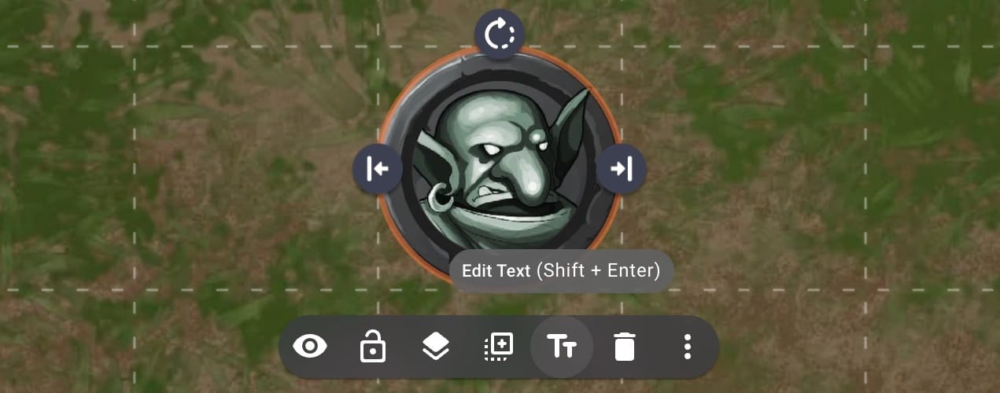
*Figura:* Edit text

Enter the text "Goblin 1" then click the done button.

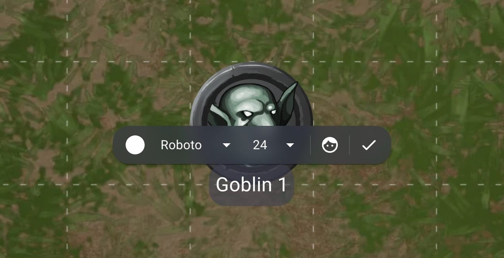
*Figura:* Text editor

To make this encounter more lively you can click the Duplicate button a few times.

This will create some new Goblin tokens and will also automatically increment the number for you to speed things up.

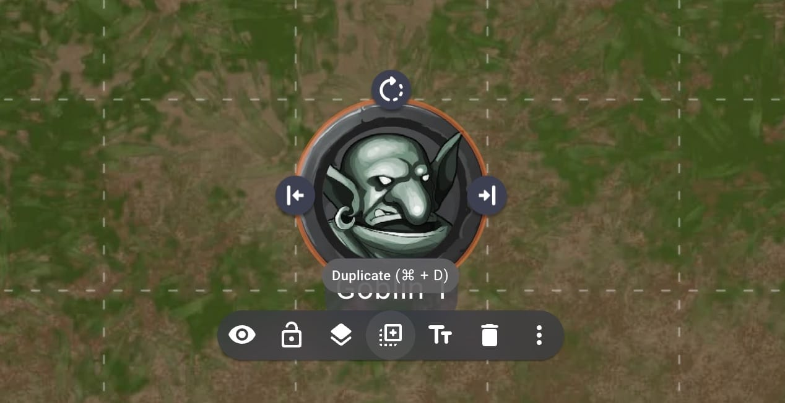
*Figura:* Duplicate

You can now move the goblins to where you want them by dragging and dropping them. You can also add your player tokens by dropping them from the dock into the scene.

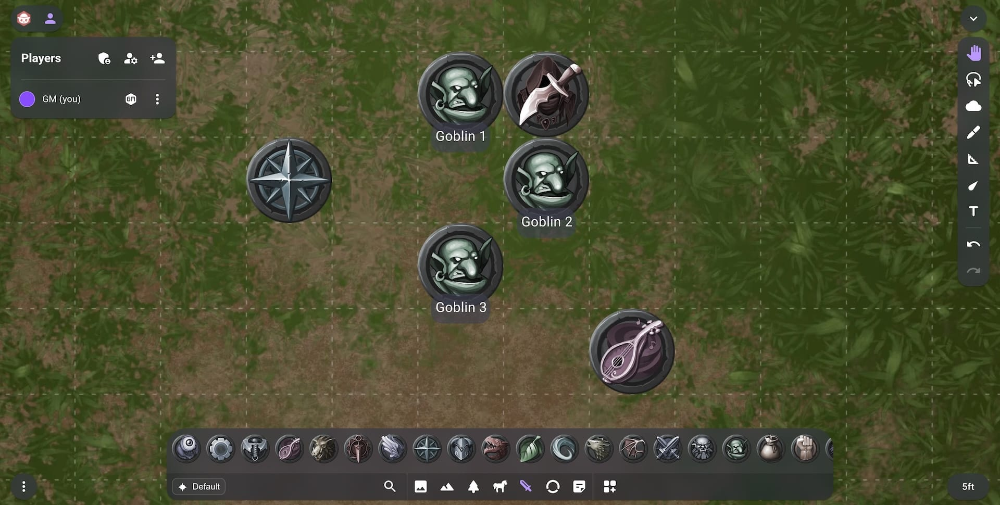
*Figura:* Encounter

##### Adding Extensions

Owlbear Rodeo has a vibrant ecosystem of extensions for you to be able to customise your experience.

To add a new extension you can open the Extras menu in the bottom left.

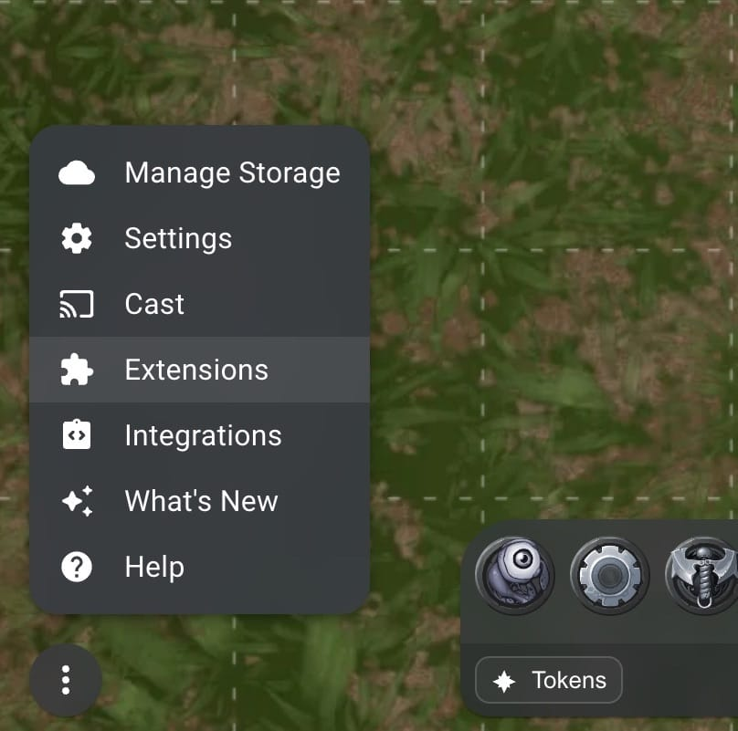
*Figura:* Extras menu

Clicking on the Extensions menu item will open the Extensions Manager.

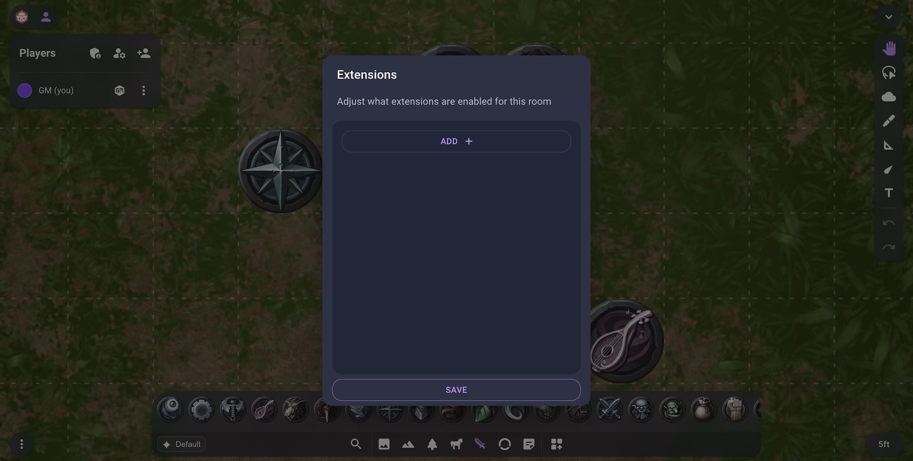
*Figura:* Extensions Manager

To add a new extension click the Add button.

This will allow you to view the list of published extensions.

To roll some dice add the Dice extension by Owlbear Rodeo.

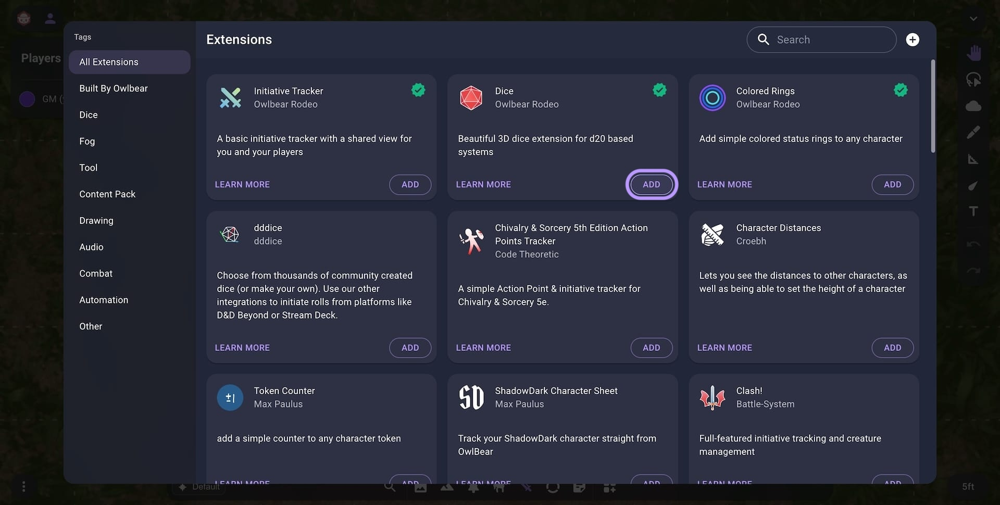
*Figura:* Extensions Modal

You can then enable that extension in your room by clicking the switch to the right of the extension.

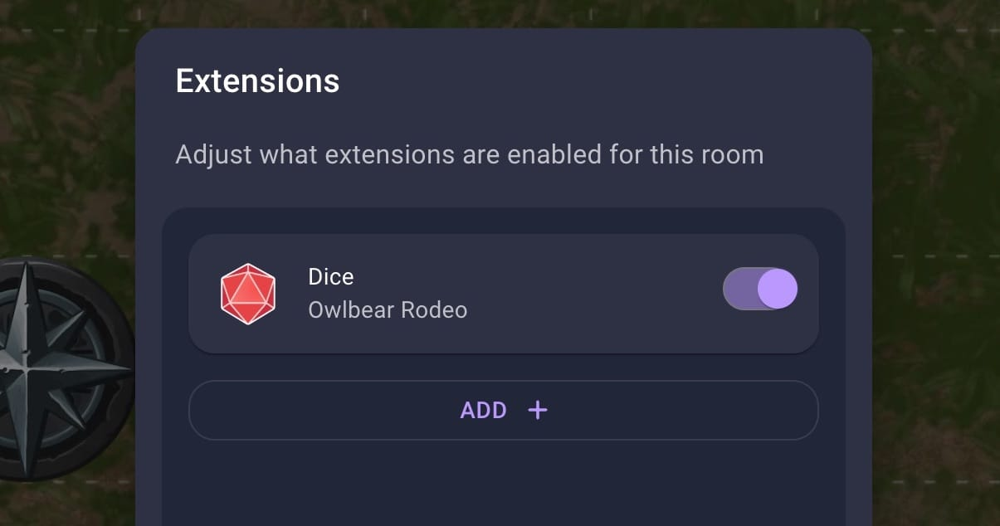
*Figura:* Enable extensions

The Dice extension adds a dice action in the top left that will let you roll dice.

Use the Dice extension

##### Inviting Players

To invite your players to your room send them the link to your room. You can get this link either from your browser’s URL bar or by clicking the Invite Players button.

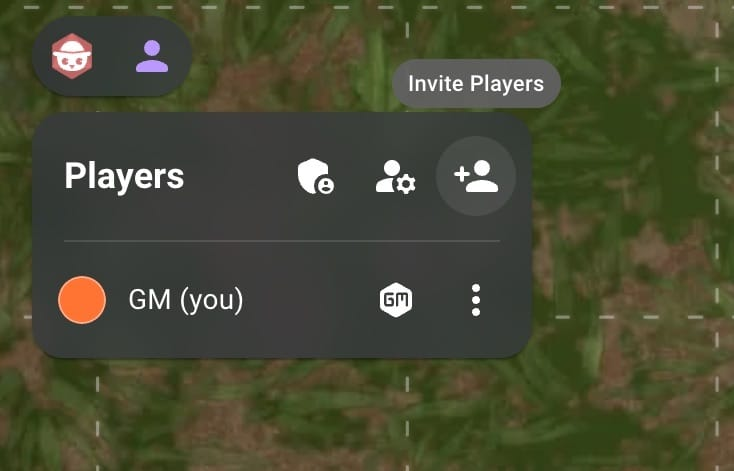
*Figura:* Invite Players using the Players action

Once the player opens this link they can request to join your room. You can then accept their request.

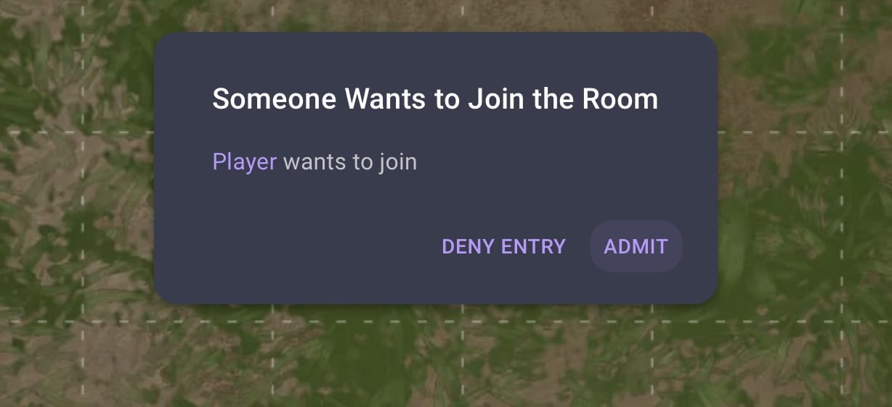
*Figura:* Join request

Now that you and your player are connected you can start adding drawings and more.

And that's it! You should now be ready to start running encounters for your players.

Owlbear Rodeo has a lot more to offer so feel free to continue exploring these guides.

### Rooms

- **Fonte:** `https://docs.owlbear.rodeo/docs/rooms/`
- **Mesa Vox (`feature_id`):** `hub_campaign`
- **Stitch:** onboarding de sala, convites e biblioteca no dock

**Resumo:** A room in Owlbear Rodeo is a space to connect to your players. The Game Master (GM) creates a room from their profile page. Once in the room the GM can send a link to their players that allows them to join the room.

- Rooms
A room in Owlbear Rodeo is a space to connect to your players. The Game Master (GM) creates a room from their profile page. Once in the room the GM can send a link to their players that allows them to join the room.

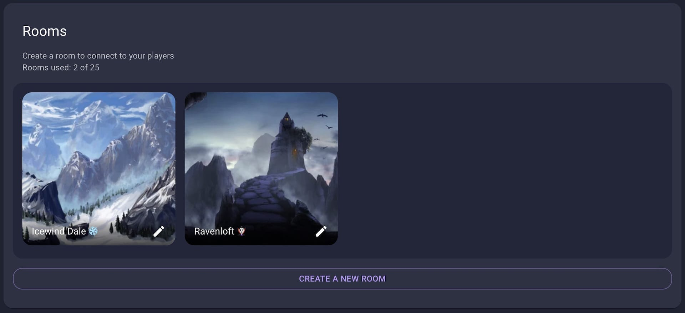
*Figura:* Room section of the profile page

Your user data in Owlbear Rodeo is not tied to a specific room. This includes saved images and scenes. This means that if you decide to delete a room you will not lose any of your saved data. Instead you can create a new room and all your data will be where you left it.

#### Creating a Room

You can create a room from the profile page by using the Create Room button. A room will have a name, background and a list of enabled extensions. For paid plans you will be able to customise your room name and background.

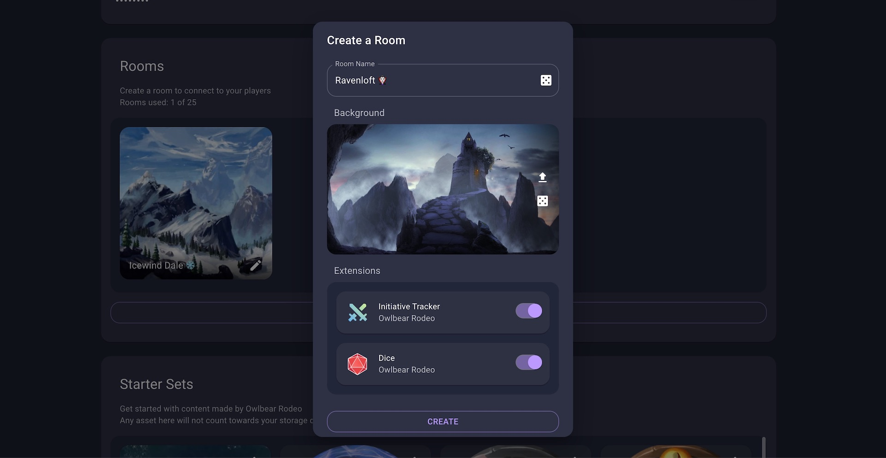
*Figura:* Room creation dialog

When you share your room with your players they can see its name and background.

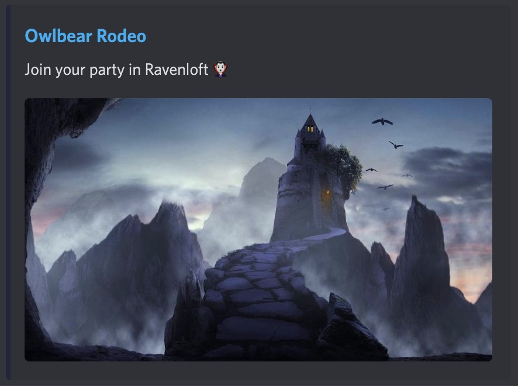
*Figura:* Room share card

#### Editing a Room

You can edit a room by clicking the Edit button on the room tile on the profile page. Here you can change the background image or extensions.

You are unable to change the name for a room once it has been created. This is because the name is a part of the URL for a room and changing it would break any links already sent to players.

To delete a room you can click the Delete button.

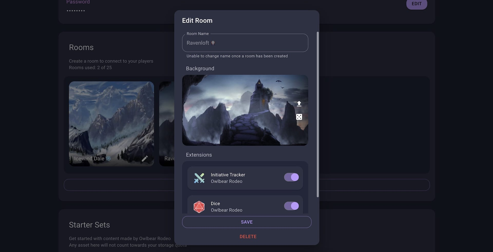
*Figura:* Room edit dialog

#### Inviting or Joining a Room

To invite your players to your room you send them the link to your room. You can get this link either from your browser’s URL bar or by clicking the Invite Players button.

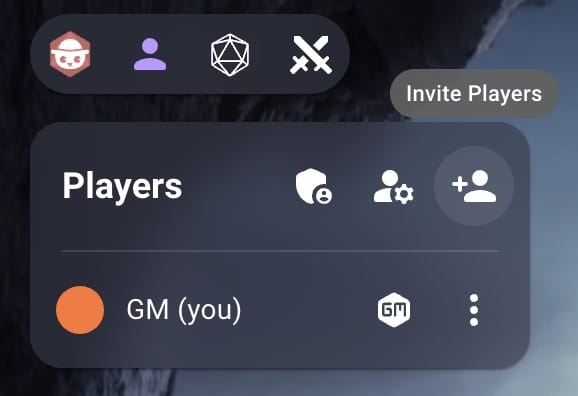
*Figura:* Invite Players using the Players action

As a player you can open the link sent to you by your GM in a web browser. This will put you in the waiting room where you can request to join. The GM can then approve your request and you will be let in to the room.

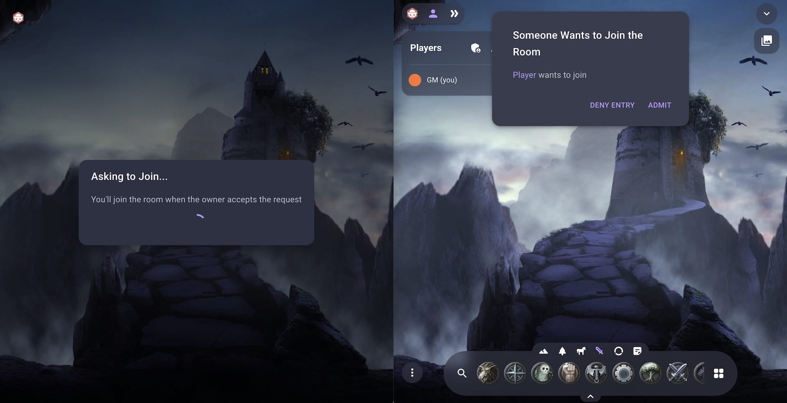
*Figura:* Player requesting to join (left) and GM waiting to accept (right)

Owlbear Rodeo supports anonymous users; this means as a player you do not need to create an account to join a room. As an anonymous user you can use all the tools and features that don't need saved data. This means that anonymous users won’t be able to create their own rooms, scenes or images.

If you are a player and would like to use your own images you can create a free account and upload your images as normal.

### Assets

- **Fonte:** `https://docs.owlbear.rodeo/docs/managing-assets/`
- **Mesa Vox (`feature_id`):** `hub_campaign`, `journal_handouts`
- **Stitch:** onboarding de sala, convites e biblioteca no dock; texto no mapa, handouts

**Resumo:** In Owlbear Rodeo there are a few different kinds of assets. For every kind of asset you will interact with them in two main places: the Dock and the Asset Manager.

- Assets
In Owlbear Rodeo there are a few different kinds of assets. For every kind of asset you will interact with them in two main places: the Dock and the Asset Manager.

The Dock sits at the bottom of your room and allows you to easily share assets with your players.

The Asset Manager can be opened using the Asset Manager button in the Dock and allows you to create new assets, edit existing assets or delete old assets.

#### Dock

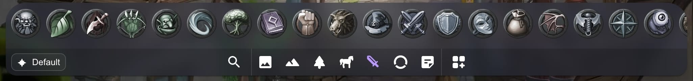
*Figura:* Dock

The Dock is split into tabs for each type of asset: Scenes, Maps, Props, Mounts, Characters, Attachments and Notes.

Scenes are an infinite space for you to lay out images, drawings, fog and more. You can think of them like the table that you will place your maps and tokens on. Once you have created a new scene you can open it from the Dock by dragging it into the viewport.

Opening a Scene from the Dock

The rest of the tabs Maps, Characters, etc. represent the images that you will add to a scene.

For example each token you import for your players will be added to the Characters tab. You can then drag these Characters from the Dock into an open scene.

Adding a character from the Dock

##### Dock Search

On the left side of the Dock is the Search button. Clicking this will open a search bar and preview section that makes it easier to find the asset you're looking for.

Before typing in anything the search will show a preview of any tags you have created. This makes it easy to find your most used assets.

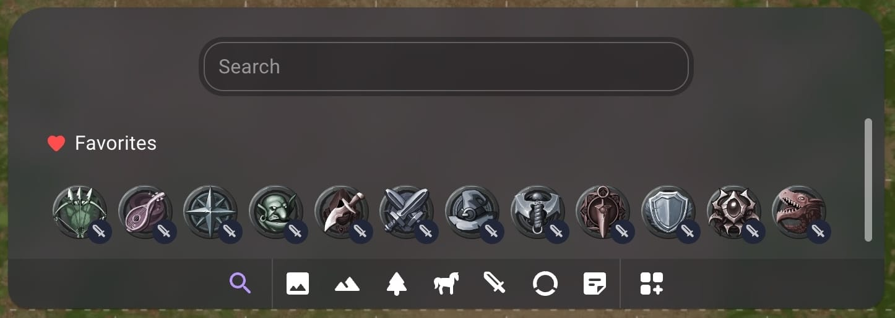
*Figura:* Dock search preview

Typing into the search bar will find any assets with a similar name.

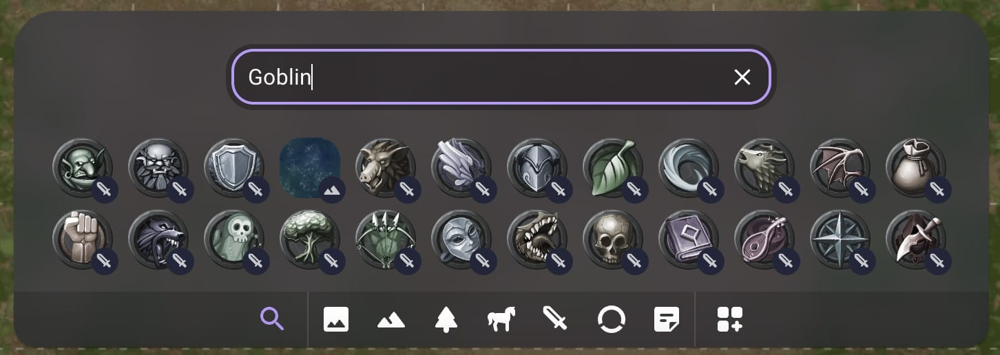
*Figura:* Dock search

Each asset shown in the search tab will have a small badge in the bottom right that tells you the type of the asset.

#### Asset Manager

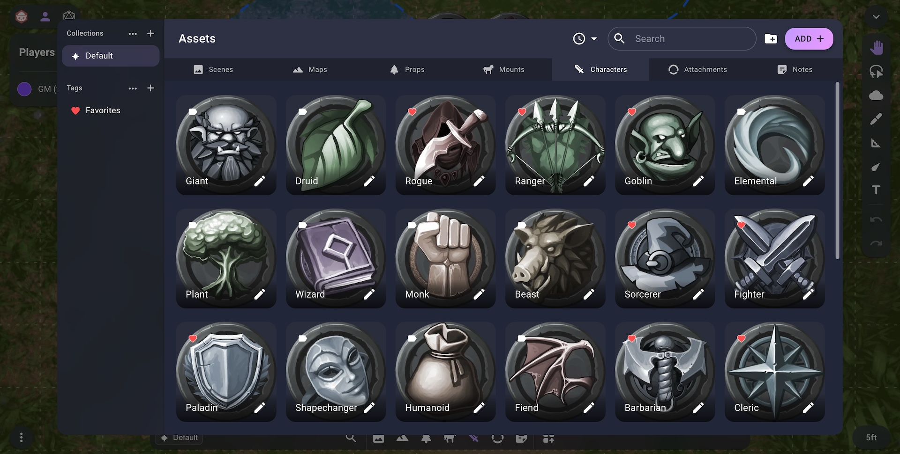
*Figura:* Asset Manager

The Asset Manager is where you will add new assets, edit existing assets or delete old assets.

To open the Asset Manager you can use the Asset Manager button on the right side of the Dock.

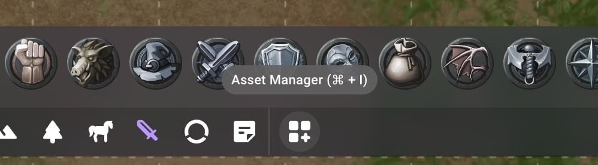
*Figura:* Asset Manager button

##### Add/Edit Assets

To add new assets you can click the Add button in the top right with the correct tab selected. For example clicking Add with the Scenes tab selected will open the Scene Importer.

You can also drag and drop an image from your computer or anywhere on the web to open an importer.

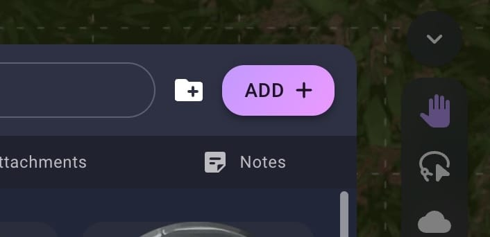
*Figura:* Add button

To edit an asset you can click on the pencil icon on the bottom right of the asset tile.

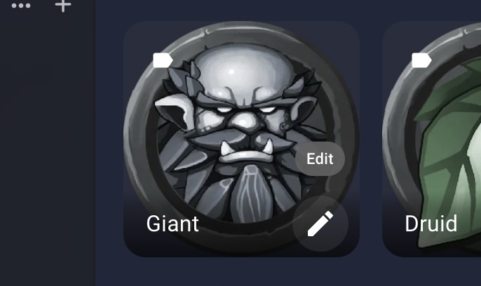
*Figura:* Edit button

This will open an editor for the type of asset selected.

To better explore these options see the Scenes guide for how to add/edit Scenes. For Maps, Characters and the other image types see the Images guide for a breakdown on how to add/edit images.

If you would like to add an image directly from your computer without opening the Asset Manager you can drag an image directly into an open scene.

This will open a type selector wheel that allows you to pick which image type to add. Once you've selected an image type by hovering over the correct icon you can release your mouse to begin uploading.

Importing a character directly into a scene

##### Delete Assets

To delete an asset select it in the Asset Manager then press the Delete key on the keyboard. You can also use the menu in bottom right with the three dots and select the Delete menu item.

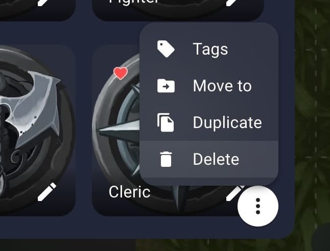
*Figura:* Delete menu

To delete multiple assets at one time you use the Shift/Ctrl key to select multiple assets before clicking the Delete key.

##### Sorting Assets

In the toolbar of the Asset Manager you can change between Sort by Created and Sort by Name.

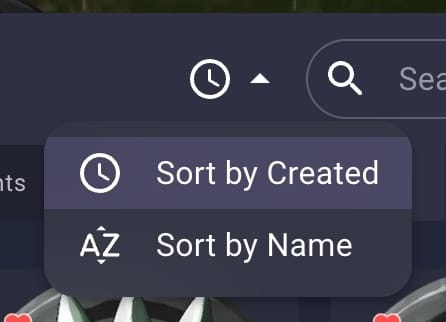
*Figura:* Sort menu

Sort by Created will sort your assets so the newest is first while Sort by Name will sort your assets alphabetically.

##### Asset Manager Search

In the toolbar of the Asset Manager is a search field that can be used to find assets by name.

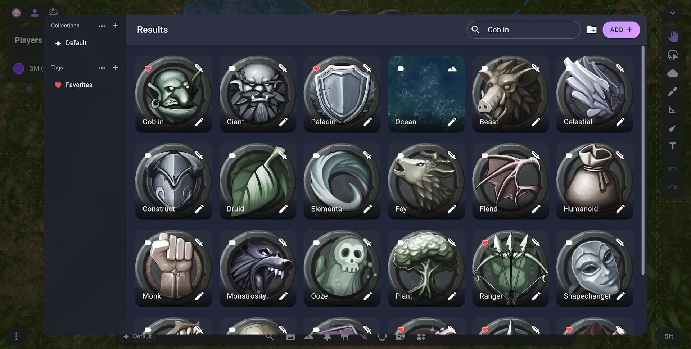
*Figura:* Asset Manager search

Similar to the Dock each asset shown in the search results will have a small icon in the top right that tells you the type of the asset.

##### Organizing Assets

As your collection continues to grow you'll likely want to organize your assets to make them easier to manage. You can do this with Folders, Collections and Tags.

##### Folders

Folders allow you to group common assets together. For example if you want to upload a hoard of different goblins then creating a single folder for them will make it easier to manage.

Folders can be created by clicking the folder icon with the plus button in the top right. You can then name your folder and give it a custom color.

Creating a new folder

To add existing assets to a folder you can either drag the assets into that folder or use the Move to menu option from the selection menu.

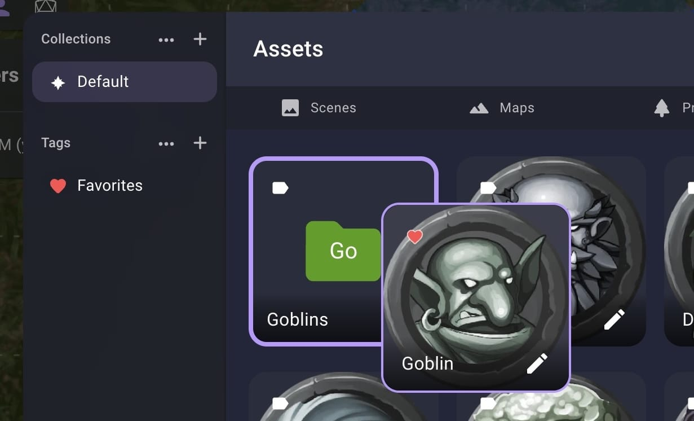
*Figura:* Asset drag

To move assets out of a folder you can either drag the assets to the back button or use the Move to menu option again.

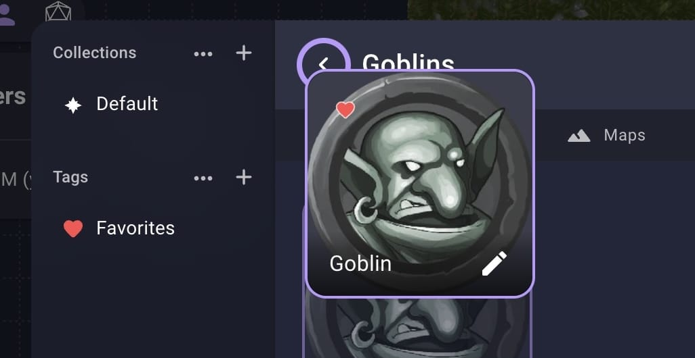
*Figura:* Back button

To add new assets to a folder you can open that folder and either drag from your device into the folder or click the Add button in the top right.

##### Collections

Collections are designed for GMs that need to run multiple campaigns, systems or worlds. For example if one day of the week I run a fantasy game but another day I run a sci-fi game. I can create a new collection for each world which would allow me to have two distinct sets of assets.

A new collection can be created by clicking the plus button in the sidebar next the the Collections label.

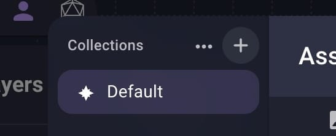
*Figura:* Collection plus button

This button will open the new collection dialog which will allow you to name and color your collection.

To activate a collection you can click the collection in the sidebar. The currently active collection is saved for each room. This means every time I go back to a room the correct collection will automatically be selected for me.

Here are some examples where a collection could be used:

- A collection for each campaign you're running with the Default collection used for assets that could be used in any campaign
- A collection for each setting you're running
- A collection for each game system you're running

##### Tags

Oftentimes when running a game you'll need to quickly find an asset and you can't remember which folder or collection you put it in. You could use the search if you remember the assets name but if you need to find a group of assets then searching for each individually can be a pain.

Tags are designed to solve this problem.

As an example I might have each character in my adventuring party tagged with their party name. Then during the game if I need to find them I can click on their tag to jump straight to the images I need.

A new tag can be created by clicking the plus button in the sidebar next to the Tags label.

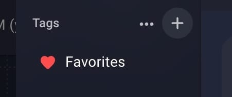
*Figura:* Tag plus button

This button will open the new tag dialog which will allow you to name and color your tag.

To activate a tag you can click the tag in the sidebar. A tag can also be chosen from the Dock when it is open.

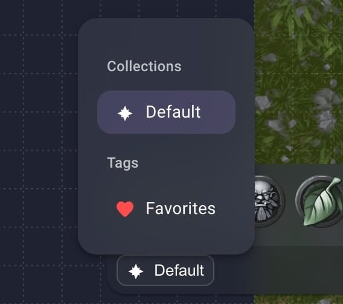
*Figura:* Tag picking in the Dock

When activating the search bar in the Dock a preview of your tags will also be shown. This makes it really simple to scroll through your tags and find the asset you need.

To tag an asset you can select the asset and press the tags button in the top left of the asset tile.

Once pressed you can click one or more tags to use for the selected assets.

Applying a tag to an asset

Here are some examples where tags could be used:

- Spells that need a visual representation such as spiritual weapon
- The characters in your current adventuring party
- Common NPCs that will join the players
- Wildshapes or player transformations

### Scenes

- **Fonte:** `https://docs.owlbear.rodeo/docs/scenes/`
- **Mesa Vox (`feature_id`):** `session_map_gm`, `session_map_player`
- **Stitch:** layout GM: cena ativa, grelha, painel lateral; projeção limpa; esconder ferramentas GM

**Resumo:** The primary focus of Owlbear Rodeo is to replicate the shared play-space available when playing a game around a table. Many games and gaming groups will use this space differently. You might simply place a large map and miniatures for your players to move.

- Scenes
The primary focus of Owlbear Rodeo is to replicate the shared play-space available when playing a game around a table. Many games and gaming groups will use this space differently. You might simply place a large map and miniatures for your players to move.

In Owlbear Rodeo this shared play-space is called a Scene.

#### Scenes Vs Maps

A scene is an infinite canvas. This canvas can be set up with a grid (square or hexagonal) and some information on how measurements should be made.

You can then use the tools in Owlbear Rodeo to fill that scene with your maps, tokens and drawings just like you would do on a physical table.

You can create multiple scenes and switch between them at any time. You can think of this as switching the table your players are sitting at but without the need to shuffle anything around. This can be useful when you wish to move to a new area or encounter.

A map is a single image in your library. A map will also have some information about how it should be positioned and resized to fit the grid of a scene. In Owlbear Rodeo maps are saved outside a scene. This means a single map can be used across multiple scenes.

#### Creating Scenes

The Asset Manager allows you to manage all your scenes. It can be opened by selecting the Asset Manager button on the right side of the Dock.

See the Assets guide for more information on using the Asset Manager.

*Figura:* Asset Manager

##### Creating a Scene with a Map

The most common workflow when using Owlbear Rodeo is to have a single map for each scene you create. To make this scenario as easy as possible Owlbear Rodeo allows you to create a new scene with a map in a single action.

To do this first open the Scene Importer by clicking the Add button with the Scene tab active.

The Scene Importer is split into two tabs. The Starter Sets tab allows you to get started with some sample scenes that are built into Owlbear Rodeo. The New tab allows you to create a new scene.

*Figura:* Scene Starter Sets

To create a new scene from a map you’ve either created or found online select the New tab.

The New Scene creator is split into two sections. On the left there are some controls for importing a new map for this scene. On the right there are options for this scene such as name and grid type.

*Figura:* New tab

To select a map for this scene you can either drag in an image from your computer or click on the upload button. Once you do this the left panel will turn into a visual editor that will allow you to preview how your map will look once imported.

When selecting a map for a scene the grid color for that scene will be automatically selected from the brightness of that map. For example a white map will have a dark grid and a black map will have a light grid.

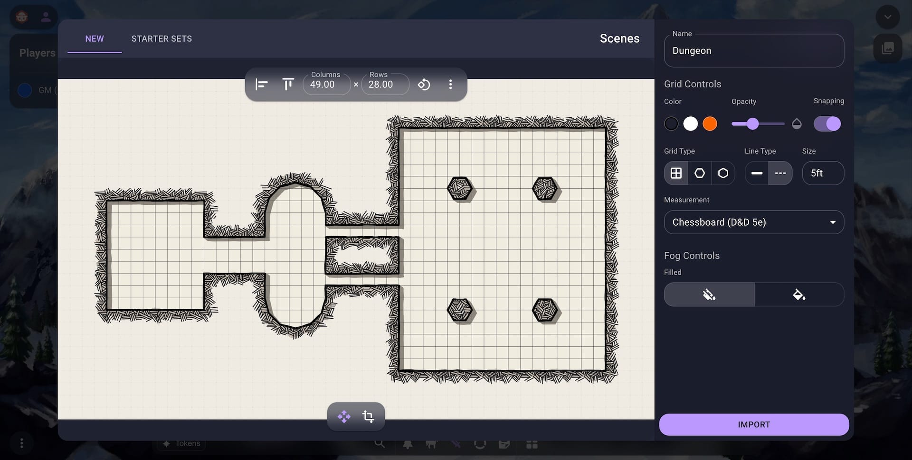
*Figura:* New scene with a map

Once you are happy with the alignment of your map click the Import button in the bottom right. This will create a new scene in the current collection and folder you have selected. This will also import the map into the base folder of the Maps tab.

To open your new scene select the Scene tile and click the Open button

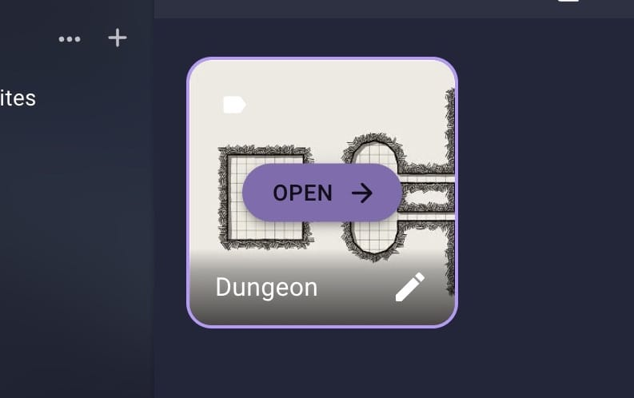
*Figura:* Scene open button

Once open you will see your map in an infinite grid, ready for you to add tokens, drawings or more.

##### Creating a Scene without a Map

In some cases you might want to create an empty scene without any map.

To do this open the Scene Importer by clicking the Add button with the Scene tab active.

Once in the Scene Importer ensure you are in the New tab. You can now give your scene a name or adjust the grid settings using the sidebar on the right side. Once your settings are to your liking you can create your new scene by clicking the Create button on the bottom right.

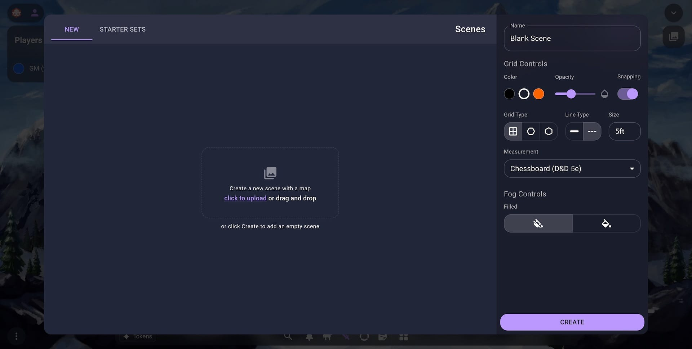
*Figura:* New Blank Scene

##### Creating a Scene with multiple Maps

If you are running an encounter where players may be split between two maps you can speed up combat by putting those maps side-by-side in a single scene. This can commonly occur if you have a building with multiple floors where players can explore freely.

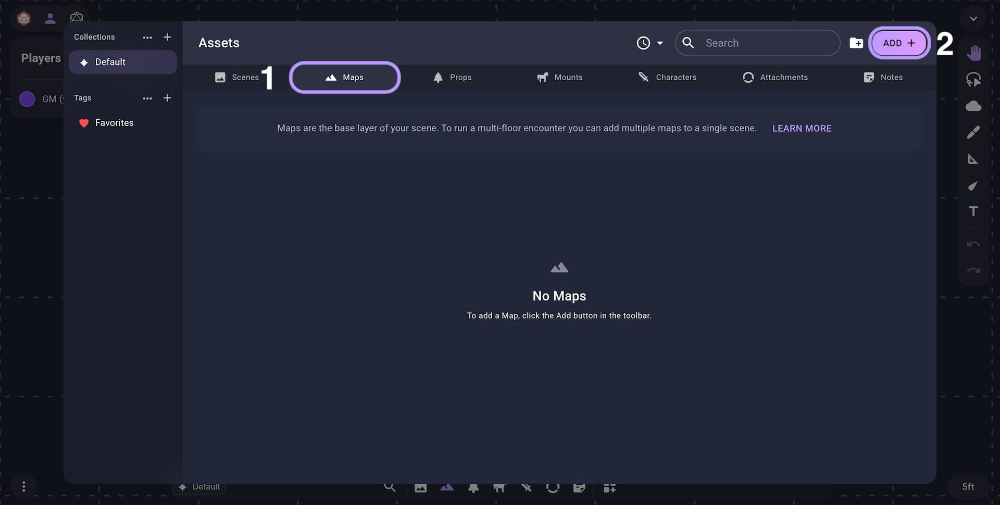
*Figura:* Maps tab

This will open the Image Importer which has two tabs like the Scene Importer. The Starter Sets and the New tab. To add your new maps select the New tab.

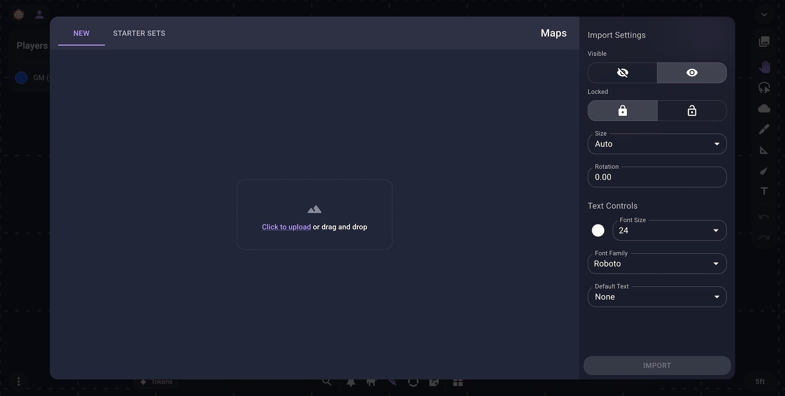
*Figura:* Image Importer

The New Image tab is split into two sections. On the left is a large area for you to import and preview new images. On the right are a set of import options which allow you to control the default values of each image. For a breakdown of each of these controls see here .

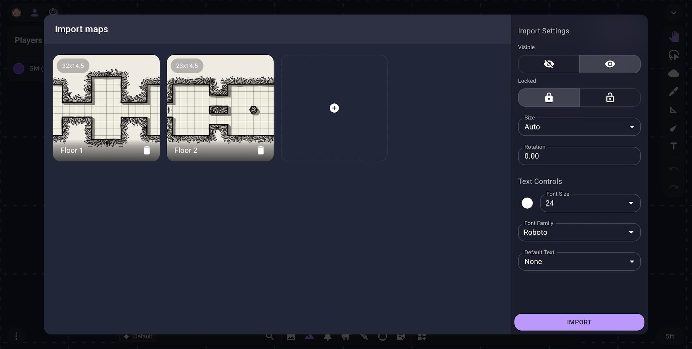
*Figura:* Image importer with images

If you would wish to adjust the alignment for your maps you can do this by selecting the Edit button on the Map tile.

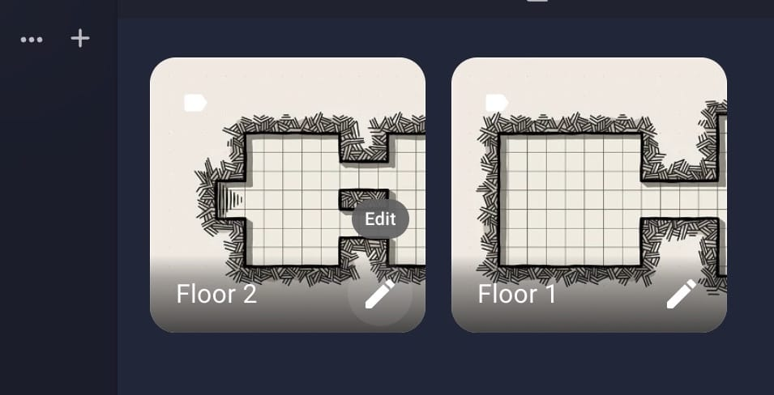
*Figura:* Map edit button

This will open the Image Editor which will give you access to the same editing controls shown in the alignment tutorial .

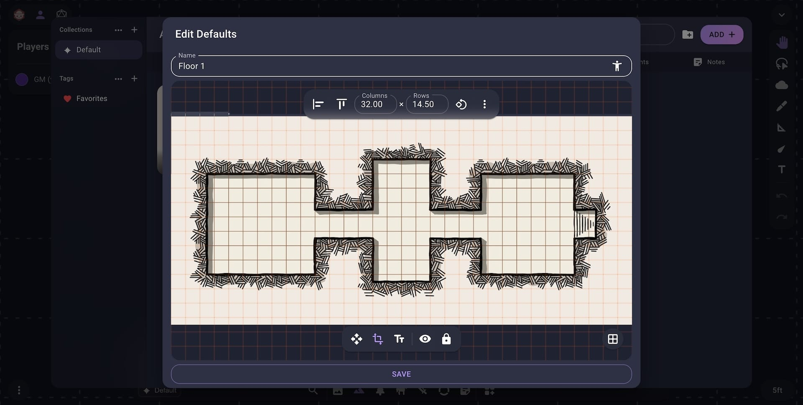
*Figura:* Image editor

To insert the new maps into the currently open scene drag them from the Dock.

Add maps from the Dock

By default a map will be locked when being inserted, this is to avoid accidentally moving it. To unlock a map so you can move it you will need to select it by double clicking. Once selected you can unlock the map by pressing the Unlock button.

*Figura:* Unlock button

Move the map to a place that makes sense for your encounter and once you are happy with where it is you can lock it again to prevent it from moving.

*Figura:* Multiple maps

#### Scene Controls

To support various game systems Owlbear Rodeo allows you to choose between a few options for your scene.

These options can be either be chosen before it is created or changed after it is created.

##### Name

To change the name of a scene before it is created use the Name input field on the top of the Scene Importer

*Figura:* Sidebar name field

To change the name of a scene after it has been created click the Edit button on the Scene tile.

*Figura:* Scene edit button

*Figura:* Scene Editor

##### Grid Controls

The grid controls allow you to change the visual display of the grid as well as determine how other tools work with the grid.

Bellow is a breakdown of the grid controls:

To adjust the grid controls before a scene is created use the settings on the sidebar of the Scene Importer.

*Figura:* Sidebar grid controls

When selecting an isometric grid type a new Axonometry control will be shown.

*Figura:* Axonometry

The two options for this control are Isometric and Dimetric. Isometric grids have a common angle between all sides and are used in art and design programs. Dimetric grids only have two common angles and are used in some video games.

To adjust the grid controls after a scene is created use the Scene Controls menu in the bottom right of an open scene.

*Figura:* Scene controls button

*Figura:* Scene controls

##### Fog Controls

Owlbear Rodeo has a large selection of fog tools. One tool is the Fog Fill which allows you to cover the whole screen in darkness to avoid players from seeing any spoilers.

To change the fog fill setting before a scene is imported use the Scene Importer sidebar.

*Figura:* Sidebar fog fill

Once a scene has been created adjust this setting using the Fog tool.

*Figura:* Toolbar fog fill

Read more about the fog tool here .

### Aligning a Map

- **Fonte:** `https://docs.owlbear.rodeo/docs/aligning-a-map/`
- **Mesa Vox (`feature_id`):** `toolbar_tactical`, `session_map_gm`
- **Stitch:** toolbar flutuante, modos de desenho/medida; layout GM: cena ativa, grelha, painel lateral

**Resumo:** Owlbear Rodeo uses a grid system to make it easier to run your encounters. By default your scenes will have subtle grid snapping to make it easier to move your characters. The ruler tools also rely on the built in grid to take accurate measurements.

- Aligning a Map
Owlbear Rodeo uses a grid system to make it easier to run your encounters. By default your scenes will have subtle grid snapping to make it easier to move your characters. The ruler tools also rely on the built in grid to take accurate measurements.

Custom maps will often have their own grid which means to use them you’ll need to align them with your scene. Some maps are designed to be used with software like Owlbear Rodeo and are easy to align. Others are designed to be printed and can be harder to align.

#### Alignment Tools

In Owlbear Rodeo there is a single set of alignment tools that can be used wherever a map is used. These tools consist of a set of controls that allow you to manually set row and column values for your grid.

*Figura:* Manual controls

If you don’t know the row and column values you can also use the alignment rulers which will visually align your grid.

*Figura:* Rulers

There are three main places where you will see these tools:

- Before the scene is created in the Scene Importer
- After the scene is created when the scene is open
- In the Image Editor when adjusting the default values of a map

##### Scene Importer

When importing a scene and a map together you will be able to align the grid during the import process. The Scene Importer is found by clicking the Add button in the Asset Manager when the Scene tab is active.

*Figura:* Scene Importer

The manual grid controls can be found on the top of the editor while the alignment rulers can be activated by selecting the Transform button in the bottom toolbar. When the Transform mode is selected the grid will turn into a solid orange line.

The Scene Importer will be the place where you most frequently encounter the alignment controls.

For more information about the Scene Importer see here .

##### Scene

After a scene has been created you can align a map while the scene is open. To access the alignment options select the map you wish to align. This will most likely require double clicking on the map. This is because by default maps will be locked so you don’t accidentally move them.

*Figura:* Context Menu

When in the alignment mode the manual grid controls will be shown hovering over the map while the alignment rulers will be shown in the scene.

*Figura:* Scene alignment

The alignment tools in the scene are most useful when you wish to tweak a map to better fit a scene. This can happen if you’re not happy with your initial alignment from the Scene Importer or if you’ve just changed your mind after seeing the map with your other tokens.

##### Image Editor

When editing the default values of a map you will be able to align the grid. These changes will take effect for any future uses of the map but won’t adjust any previous uses (with one exception that we’ll cover down below).

The Image Editor is found when clicking the Edit button on a map tile in the Asset Manager.

*Figura:* Image Editor

To access both the manual controls and alignment rulers select the Transform button in the bottom toolbar.

When you click Save all future uses of this map will use the new alignment values. If the current open scene includes the map that was just edited you will be prompted to update the map in that scene. If you select Update then the map inside that scene will be updated to match the new values.

*Figura:* Update image prompt

The alignment tools in the Image Editor will be used less frequently. But they can come in handy if you wish to create a multi-map scene .

#### Manual Alignment (Known Grids)

The easiest way to align a map in Owlbear Rodeo is if you know the dimensions of your grid. This is often the case if you use a map making software or if you download your map from an online map creator.

To input your grid dimensions you can use the Manual Controls menu in Owlbear Rodeo.

This menu can be found in any of the locations mentioned above.

You can also include the grid dimensions in the name of the file you're importing. For example if you have a map with 49 columns and 28 rows including “49x28” in the filename will set up the grid for you.

Below is a list of popular places when you will know the dimensions of your maps grid:

##### Online Creators

Many online creators make maps that are a wonderful fit for use in Owlbear Rodeo.

For example here is the creator Cze and Peku which uses Patreon.

*Figura:* Cze and Peku Patreon post

In this post you will see the numbers “40x22” these are the dimensions of the maps grid. Using these numbers in Owlbear Rodeo will perfectly align this map.

##### Dungeondraft

Dungeondraft is a piece of software you can use to create your own maps.

When creating a new map in Dungeondraft you will set the dimensions of the grid you wish to use.

*Figura:* Dungeondraft new map dialog

Using the width and height values as the columns and rows in Owlbear Rodeo will align your map.

##### Dungeon Scrawl

Dungeon Scrawl is an online tool for creating maps in a hand drawn style.

When exporting out of dungeon scrawl the grid dimensions will be included in the filename. Owlbear Rodeo will use these values to align the map when importing.

*Figura:* Dungeon Scrawl export dialog

#### Visual Alignment (Unknown Grids)

In some cases you may not know the dimension of your grid. For these cases the alignment rulers can be used. The alignment rulers are inspired by a physical drafting table and allow you to move and scale the map with precision.

To demonstrate the alignment ruler we'll be using a map from Mike Schley . In the example below we’ll be using the Scene Importer but the same controls are available in all the places mentioned at the start of this guide.

Using the alignment rulers is a three step process:

- Align the corner of the ruler with a grid cell you can see on your map
- Roughly scale the ruler so that the four marks on the ruler align with the maps grid
- Use the precision rails to fine tune the alignment for a perfect match
Below each step of this process is detailed with a video to help.

##### Align the Corners

Drag the rulers so that the corner aligns with the top left of a grid cell in your map.

Align the corners

If you need more precision don’t be afraid to zoom in or you can hold down the Ctrl/Cmd key to slow the movement down.

##### Scale the Ruler

Use the size handles to get the scale of the map close to the grid.

Scale the map

If you’re happy with this alignment you can stop at this step (in fact many VTTs will only allow this level of alignment).

You can see this below where the grid has drifted by tens of pixels at the corner of the map.

*Figura:* Error accumulation

##### Refine the Alignment

To fix the drift accumulated at the edge of the map use the precision rail that extends to the end of the map.

Precision rail

For square grids you should now have a perfect alignment even across a very large map.

However if you are using a hexagonal grid you may still notice some drift in one axis. To fix this you will need to use the precision rails again on the drifting axis.

This is because the size of a hex grid doesn't neatly fit into the pixel values used in an image. This means that many of the hex grids you find online will have drift that accumulates as the grid gets bigger. This drift is baked into the image of the map itself so you will need to account for it.

To demonstrate the issue with hex grids we can try to align an overland travel map. This map is also from Mike Schley .

Below we can see that we have perfectly aligned the grid on the horizontal axis.

*Figura:* Horizontal alignment

However if we change our view to the bottom of the image you will notice that the vertical axis is misaligned.

*Figura:* Vertical misalignment

To fix this we can hold Shift as we align the vertical axis. This will prevent Owlbear Rodeo from adjusting both axis at the same time. Meaning our horizontal alignment will remain fixed and we'll only be adjusting the vertical.

Fix hex alignment

The grid will now be aligned perfectly for the entire map.

*Figura:* Hex grid aligned

### Images

- **Fonte:** `https://docs.owlbear.rodeo/docs/images/`
- **Mesa Vox (`feature_id`):** `tokens_layers`
- **Stitch:** tokens, imagens e tipos de asset

**Resumo:** Images in Owlbear Rodeo are designed to support many different use cases. Commonly you will use images for maps and player characters. However, you can also use images for a variety of other things such as attachments, notes and props.

- Images
Images in Owlbear Rodeo are designed to support many different use cases. Commonly you will use images for maps and player characters. However, you can also use images for a variety of other things such as attachments, notes and props.

*Figura:* Hero image

#### Image Types

In Owlbear Rodeo images are organized into a variety of types. These types help simplify the image system in a few ways. They allow a base level of organization that helps keep your images where you expect them. Each image type will also give a hint to Owlbear Rodeo on how to use the image.

Below is a list of the images types and their intended usage:

#### Using Images

Images can be added to a scene by dragging them from the Dock.

Add image

Once an image has been added to a scene it can be moved, resized and more.

##### Moving Images

With the Move tool selected a image can be moved by dragging it to the desired position. By default there will be some slight grid snapping that will snap the image to the grid. If you wish to temporarily disable this snapping you can hold the Ctrl/Cmd key while dragging.

Image move

##### Editing Images

To further interact with an image you can select it by clicking on it in the scene. A locked image can be selected by double clicking.

Once selected a context menu will be shown below the image. This menu will allow you to change various properties on this image.

*Figura:* Context Menu

Below is a list of all the menu items for a image:

When clicking the more button you will see a popover menu of more items. This menu can also be accessed directly by right clicking on the image.

*Figura:* Overflow Menu

Below is a list of all the overflow menu items for an image. The overflow menu is also where extensions may choose to add functionality so your list may include more items.

##### Transforming Images

To resize or rotate an image use the provided handles on the top or sides of the image when it is selected.

Transform

For more advanced controls you can use the Align Image option in the overflow menu described above.

#### Managing Images

The Asset Manager allows you to create, edit or delete images. These images will then be shown in the Dock for quick access when you need them in your game. To open the Asset Manager use the Asset Manager button in the dock.

See the Assets guide for more information on using the Asset Manager.

##### Adding Images

To add a new image select the tab representing the type of image you wish to add. For example to add a new character select the Characters tab. Once the correct tab is active click the Add button in the top right.

*Figura:* Add button

This will open the Image Importer. The Image Importer is split into two tabs. The Starter Sets tab allows you to add a new asset from an image built in to Owlbear Rodeo. The New tab allows you to upload your own custom images.

For a guide on using the starter sets see the Getting Started guide.

To add a new image select the New tab. The New tab is split into two sections. On the left is a large area for you to import and preview new images. On the right are a set of import settings which allow you to control the default values of each image.

*Figura:* Empty new tab

To upload new images either click the Upload button or drag and drop your images from your computer into the upload section. Once an image has been added to the left section you will see a preview of that image. To stop that image from being uploaded you can click the delete button.

*Figura:* Full new tab

Below is a breakdown of the import settings available on the right side of the New Image Importer:

Once you have selected your desired settings click the Import button in the bottom right to begin importing your new images.

##### Editing Image Defaults

To edit an image once it has been added click the Edit button on the Image tile.

*Figura:* Edit button

This will open the Image Editor. The Image Editor will allow you to adjust the default values of your image. These default values will be used when you drag your image into a scene.

*Figura:* Image Editor

At the top of the Image Editor you can adjust the name and description of your image. Both of these will be used by assistive technologies once the image is added to a scene. In the middle of the editor is a preview viewport that shows how your image might look in a scene.

Below is a breakdown of each option in the Image Editor toolbar:

To see how this image may look in different grid configurations use the Grid button in the bottom right.

*Figura:* Grid button

Once you are done with your edits click the Save button on the bottom of the Image Editor to save your changes.

### Drawing

- **Fonte:** `https://docs.owlbear.rodeo/docs/drawing/`
- **Mesa Vox (`feature_id`):** `toolbar_tactical`
- **Stitch:** toolbar flutuante, modos de desenho/medida

**Resumo:** The drawing tools in Owlbear Rodeo are made for many different uses. Drawing maps on the fly, planning out battle tactics, measuring spell effects and more. Drawing in Owlbear Rodeo is flexible and user friendly.

- Drawing
The drawing tools in Owlbear Rodeo are made for many different uses. Drawing maps on the fly, planning out battle tactics, measuring spell effects and more. Drawing in Owlbear Rodeo is flexible and user friendly.

*Figura:* Drawing example image

#### Modes

The drawing tool has various modes that allow you to draw shapes, curves and polygon’s.

*Figura:* Drawing toolbar with the drawing modes highlighted

Below is a list of modes and there intended usage:

#### Fill Style

The Fill Style menu allows you to adjust the fill color and opacity of your drawings.

*Figura:* Fill Style menu

If you wish to customise a color in the Fill Style menu you can double click an existing to edit it. If you wish to add a new color to the Fill Style menu you can click the plus button.

*Figura:* Add a new color to the Fill Style menu

#### Stroke Style

The Stroke Style menu allows you to adjust the color used for the outline of your drawings. The menu also allows you to adjust the stroke width and style.

*Figura:* Stroke Style menu

You can customise the stroke colors just as you would with the Fill Style menu.

#### Editing Drawings

Any drawing can be moved using the move or grab tool. Drawings can also be scaled and rotated after being selected.

Scaling a drawing

If you need more control you can use the Edit menu item. Advanced editing is supported for the polygon, marker and brush tools. When in advanced mode you can edit points by dragging them where you want them. To add new points you can click on the edge of the curve.

Curve advanced editing

#### Layers

By default all drawings are added to the drawing layer. This layer sits above the map and scene grid but below all other images. This layer allows the drawing tool to act like a marker you would use when sitting around a physical table.

*Figura:* Drawing Layer menu item

#### Trim and Join

Drawings can be combined to make new shapes. To do this you can use the join action when selecting two or more drawings.

Joining drawings

Drawings can also be cut away from each other using the trim option. See the fog guide for more details on this.

### Measure

- **Fonte:** `https://docs.owlbear.rodeo/docs/measure/`
- **Mesa Vox (`feature_id`):** `toolbar_tactical`
- **Stitch:** toolbar flutuante, modos de desenho/medida

**Resumo:** When running a grid based game like D&D you will often have to measure distances for player movement or attacks. The measure tool makes it easy to find the distance between two points or move a character a set distance.

- Measure
When running a grid based game like D&D you will often have to measure distances for player movement or attacks. The measure tool makes it easy to find the distance between two points or move a character a set distance.

*Figura:* Ruler

#### Modes

The measure tool has two modes: ruler and movement.

*Figura:* Measure toolbar

When in the ruler mode you can click and drag to create a straight ruler. The center of this ruler will show the current measurement. Once you stop dragging the ruler will be removed.

Ruler being created

You can also create a permanent ruler that can be moved, adjusted or deleted. To create a permanent ruler you can double click or double tap on the Scene when the ruler mode is selected.

Permanent ruler being created

When in the movement mode you can click and drag on a character. When you do this the character will be moved and a ruler will be created at the same time. This allows you to see how far the character is being moved. Once you stop dragging the ruler is removed.

Movement mode

#### Measurement Type

Different games will use varying measurement systems. In a game like D&D some players measure distances like you would on a chessboard. Whereas other players might measure using an alternating diagonal method. (Where each second diagonal is worth double movement.)

In Owlbear Rodeo the measurement type is controlled per scene. To adjust this value you can use the Grid Controls menu.

*Figura:* Grid Controls with the measurement highlighted

Here are the list of measurement types and their usage for a square grid:

Here are the list of measurement types for a hexagonal grid:

#### Measurement Scale

To make the measure tool easier to use it will display measurements using the grid size. For example if you have a grid size of 5ft and move two grid cells the tool will display a measurement of 10ft. This scaling factor can be changed in the Grid Controls menu for each scene.

*Figura:* Grid Controls with the size highlighted

If you wish to use the metric system for your game you could change this value to 1.5m. If you’re displaying an overland map you could also change this value to use kilometers or miles.

The numerical precision of the ruler is also based on this value. For example if you need more precise measurements for large distances you could change the size to 5.00mi. This will make every grid cell count as 5 miles with a precision of two decimal places.

### Fog

- **Fonte:** `https://docs.owlbear.rodeo/docs/fog/`
- **Mesa Vox (`feature_id`):** `fog_visibility`
- **Stitch:** fog, preview jogador, fill/cut

**Resumo:** Fog allows you to hide parts of your scene from your players. There are many times when playing tabletop games when this will be useful. For example you can use fog to hide areas of a dungeon that players haven’t visited. You can use fog to reveal a secret room in a house being investigated.

- Fog
Fog allows you to hide parts of your scene from your players. There are many times when playing tabletop games when this will be useful. For example you can use fog to hide areas of a dungeon that players haven’t visited. You can use fog to reveal a secret room in a house being investigated.

*Figura:* Hero image

#### About this Guide

We often find the fog system is easiest to learn with some examples. With this in mind this guide will use four maps created using the drawing tools in Owlbear Rodeo. Each map is designed to showcase a specific feature of the fog system.

If you would like to follow along with this tutorial we have made the base scene available as a Starter Set. You can access this scene by clicking the Add button in the Asset Manager and selecting the Tutorials Starter Set.

*Figura:* Fog tutorial Starter Set

#### Example 1

*Figura:* Example 1

The first example includes a single room with a treasure chest.

To add fog to this scene first click on the Fog tool in the toolbar.

*Figura:* Fog tool

With the fog tool active you will have access to various modes and actions that can interact with the fog tool.

*Figura:* Fog toolbar

By the end of this tutorial we will have explored each option available but for now you should know that the top bar is split into two categories. On the left are the modes and on the right are the actions.

Before we explore adding fog, click on the Fog Style action and change the fog color to purple. This will make the fog easier to see for tutorial purposes.

*Figura:* Fog style

The first step to using the fog tool is to add fog over every room you want hidden. In this case there is only one rectangular room. To add fog to this room select the Rectangle mode.

*Figura:* Rectangle mode

Now click and drag from one corner of the room to the other.

Rectangle fog

The room has now been covered in some purple fog but you can still see the treasure chest underneath. This is because fog will be transparent for a GM. To see how a player will view the map click the Enable Fog Preview button in the top bar.

*Figura:* Fog preview enabled

Click the Fog Preview button again to turn back to the GM view.

Once your players enter the room you will want to remove the fog so they can see what is inside the room. To do this first select the fog shape by clicking it. This will open a context menu that will allow you to edit this shape.

*Figura:* Fog context menu

To be able to toggle this shape on and off use the Cut button.

Fog cut

The Cut button will cause this shape to cut away from any other fog in the scene. This is very important as we’ll see in a moment.

Commonly when using fog you will want to start by hiding everything from your players. To do this in Owlbear Rodeo you could use the Rectangle mode and draw a very large square to cover your map.

To demonstrate this click the Fog Fill button in the top bar.

*Figura:* Fill Fog button

Your viewport will now be entirely covered in fog except for the room in the center. This is because we enabled the Cut option on the fog shape so it cuts away from the infinite fog.

*Figura:* Infinite fog cutout

To fill that section of fog again select the fog shape and click the Uncut button. The entire viewport will now be covered in fog. This is generally the state that you will start in when running an encounter with your players.

To clean things up for the next example click the Fog Fill button again to remove the infinite fog from the scene.

*Figura:* Remove fill

#### Example 2

*Figura:* Example 2

In this example we will explore how single layer mode makes adding fog to multi-room dungeons easier.

This example includes three rooms with an entrance on the left, a second room on the right and some treasure in the middle.

The left room is a “C” shape so this will be perfect for the Polygon mode.

*Figura:* Polygon mode

With the polygon mode active click on the corners of the first room to add a new shape. Finally click the Finish label or press the Enter key to complete the shape.

Fog polygon room 1

The next room we’ll fog is the treasure room.

To do this change back to the Rectangle mode and drag from corner to corner.

Fog rectangle room 2

The last room is a backwards “C” shape. To fog this you could use the polygon tool like the first room but this will take longer than needed. Instead simply stay with the Rectangle mode and drag over the remainder of the room.

Fog rectangle room 3

Even though we are in the Rectangle mode, Owlbear Rodeo knows that we don’t usually want to create overlapping fog shapes so it will calculate the exact shape needed to prevent this from happening. This makes it quite a lot faster to create fog shapes for adjacent rooms.

Now that all the rooms are fogged you can enable Fog Fill and run this room as an encounter. Below is a demo of this with two browser windows side by side to demonstrate a GM view and a player view at the same time.

Example 2 demo

To clean things up for the next example remove the Fog Fill again.

#### Example 3

*Figura:* Example 3

In the previous example we made use of both the rectangle and polygon modes. These worked great because our rooms only had flat sides but often real-world maps will include curves and circles. In this example we will explore how to combine shapes to make perfect circular fog.

This example includes a single room but on the top and bottom there are two extensions where a statue might sit.

To start, add a rectangle over the large open area.

Example 3 rectangle

To create the semicircles first activate the Circle fog mode then draw a circle over the top left extrusion.

Example 3 circle

Because of the single-layer feature of Owlbear Rodeo the circle will automatically be cut in half to create the semicircle we need.

We could continue this process drawing a new circle over each statue instead we make this a little quicker using the Grab mode.

*Figura:* Grab mode

As we know each semicircle should be the same shape and size you can quickly duplicate the first shape by pressing the Alt or Option key while dragging.

Example 3 duplicate

If you’re using a touchscreen device the same thing can be accomplished by selecting the shape and clicking the Duplicate button.

To create the bottom extensions select both shapes by clicking on each while holding the Shift key. Now use the same Alt drag gesture as before and once both shapes are in position use the rotation handle to rotate them 180 degrees.

Example 3 rotation

When running this encounter you will want to cut out this room as your players enter it. If you select the main chamber and click the Cut button you will notice that none of the outcroppings are cut.

Example 3 cut out

To fix this you could use the Grab mode to select each shape using the Shift key and cut them all at once but this could become tedious. Instead with all the fog shapes selected use the three dots button to find all the options and select the Join option.

*Figura:* Join menu item

This will join all the shapes together so when you cut them out it will happen at once.

Example 3 cut all

#### Example 4

*Figura:* Example 4

This last example will explore the single layer mode more and discuss when you may want to disable it.

This example includes a large main area on the left with a semicircle treasure room on the right.

First draw a large circle on the right side using the Circle fog mode.

*Figura:* Circle fog shape

Now we wish to turn this circle into a semicircle. To do this we could draw a rectangle and use the Trim option to remove half of the circle. However when we do this the single layer fog mode is preventing us from overlapping these two shapes.

Example 4 rectangle overlap

To fix this you can disable single layer mode by selecting the Enable Multilayer button in the toolbar.

*Figura:* Enable Multilayer button

Draw a rectangle over the circle once more and select both then use the Trim menu option.

Example 4 rectangle split

This method of drawing basic shapes and using the Join/Trim options is a really powerful way to add fog to maps. Especially maps that were built with a grid system in mind.

Lastly enable the single layer mode again by pressing the Disable Multilayer button and draw a large rectangle over the rest of the room.

Example 4 main chamber

With these four examples you should now have an understanding of the most common workflow when using the fog tool.

#### Real World Example

Now that you know how to use all the aspects of the fog tool we can now explore adding fog to a more complex map. This example will be less of a step-by-step tutorial and instead we will try to explore the thought process for handling a larger map.

The map we’ll use here is the Adventurers Guildhall by Czepeku .

*Figura:* Guildhall

This map can also be found in the Starter Sets section of the Scene Importer by selecting the Czepeku creator.

The first thing I notice when I look at this map is that we have many rectangular rooms. These simple shapes will make a great place to start as they will be quick and easy to draw.

Below is a video showing the process of adding fog to all these rooms. For the rooms that are the same exact shape I will use the grab tool to duplicate that shape across the rooms.

Real world example square rooms

During the above video you will notice some moments where I move the viewport while drawing a shape. You can do this by holding down the spacebar as you draw. This technique is very handy when you need to draw a larger shape but also wish to be zoomed in.

The last two rooms of the house are more complicated shapes. However we can rely on the single layer feature to take most of the work out of it for us. For the room on the left we will draw a single rectangle that will be cut into the shape we need.

Non square rooms

Now that the interior of the guildhall is done we can move on to exterior rooms such as the stables and battlements.

To start with I’ll add some square fog shapes for each of the four guard towers.

*Figura:* Guard towers

Next I’ll add a rectangle for the stables. Zooming in on the stables you will notice that it doesn’t neatly line up with the grid as some of the other rooms did. To make this easier to fog I’ll hold down the Ctrl/Cmd key as I draw my fog shape to disable grid snapping.

Stables

The same grid snapping technique can also be done for the altar in the top left.

*Figura:* Altar

Next I’ll add two more rectangles for the armory and workshop in the bottom right.

*Figura:* Armory

Finally we can finish with the circular tower in the top right. For this I’ll use the Circle mode and after I’ve finished getting the correct size for the circle I’ll hold down the Alt/Option key to move it into place.

Circle guard tower

Now that we have all the fog shapes in place we will want a few final pieces to run this as an encounter. If we enable Fill Fog so that we can hide the size of the map from the players we will be able to cut out each room as we go.

*Figura:* Fog cutout side-by-side

However because we never made cut outs for the grounds we won’t be able to show them to the players.

Normally this would be a very complicated shape to make however since we’ve already cut out all other rooms we can simply drag a rectangle over the entire map and the perfect shape will be made for us.

Grounds

Now to run this encounter you can add your player tokens and as they enter each room you can select the fog shape and cut it out to reveal the map underneath.

Encounter

### Text

- **Fonte:** `https://docs.owlbear.rodeo/docs/text/`
- **Mesa Vox (`feature_id`):** `journal_handouts`
- **Stitch:** texto no mapa, handouts

**Resumo:** Owlbear Rodeo features a rich text editor that allows you to write directly on the infinite canvas.

- Text
Owlbear Rodeo features a rich text editor that allows you to write directly on the infinite canvas.

*Figura:* Text item

#### Text Editor

When using the Text tool you can click anywhere in a scene to create a new text item. Doing this you’ll be given a text editor which allows you to write text. Above the editor there is a menu that allows you to adjust the text style.

*Figura:* Text editor

Below is a list of the options available in the text editor menu:

Once you have finished editing text you can click the Done button or use the Shift + Enter shortcut. This will exit the text editor and return you to the common item controls.

*Figura:* Selected text item

Here you can adjust things such as scale, rotation and more. If you wish to edit the text again you can click the Edit Text menu item, use the Shift + Enter shortcut or double click on the text.

*Figura:* Item context menu with the Edit Text menu item highlighted

#### Shortcuts

The text editor supports common and markdown-style shortcuts to make styling text easier.

Here is a list of the supported shortcuts:

### Permissions

- **Fonte:** `https://docs.owlbear.rodeo/docs/permissions/`
- **Mesa Vox (`feature_id`):** `session_map_player`
- **Stitch:** projeção limpa; esconder ferramentas GM

**Resumo:** Permissions allow you to control what features your players can use. For example you can stop your players from deleting a map or drawing on a scene. To open the Player Permissions dialog click the Player Permissions button.

- Permissions
Permissions allow you to control what features your players can use. For example you can stop your players from deleting a map or drawing on a scene. To open the Player Permissions dialog click the Player Permissions button.

*Figura:* Player action with the Player Permissions button highlighted

#### Basic Permissions

*Figura:* Permissions Dialog

For each layer you can control whether your players can create, update or delete those items. For example if you remove the create option from the maps section. Your players won't be able to add new maps to the scene.

#### Advanced Permissions

In some cases you may want more control over the way characters work. To accomodate this the character section has a permission called Owner Only. With this permission enabled players can only interact with the characters that they own.

*Figura:* Permissions Dialog with the Owner Only tag added

A player “owns” a character if they are the one that created it. For example if Mitch adds their character to the scene then Mitch owns that character. This means they are the only player that can update it. This permission does not apply to the GM who can still move all images.

To make this feature easier to use the GM can also assign an owner by using the Owner menu item.

*Figura:* Owner menu

The owner menu item will only be available if you have the Owner Only permission enabled.

### Casting

- **Fonte:** `https://docs.owlbear.rodeo/docs/casting/`
- **Mesa Vox (`feature_id`):** `session_map_player`, `mobile_or_dock`
- **Stitch:** projeção limpa; esconder ferramentas GM; dock inferior, responsivo, casting

**Resumo:** While Owlbear Rodeo was designed to be a great tool for online play it was also designed to make in-person games as easy as possible. When sitting around a table with your players you'll often want to share a player view that everyone can see.

- Casting
While Owlbear Rodeo was designed to be a great tool for online play it was also designed to make in-person games as easy as possible. When sitting around a table with your players you'll often want to share a player view that everyone can see.

*Figura:* Header

#### Requirements

In order to support casting in Owlbear Rodeo your browser must implement the presentation web standard. Currently this includes browsers like Google Chrome and Microsoft Edge. The device also must support presenting to an external display.

The cast option allows you to connect to either a Chromecast or an external display that is connected to your computer. To cast to an external display it must be set up to extend the primary display.

If the casting requirements are met then a cast button will appear in the Extras menu at the bottom left of a room.

*Figura:* Extras menu

Clicking on the Cast option will open the cast dialog. This dialog allows you to either hide or show the Owlbear Rodeo interface on the cast device.

*Figura:* Cast dialog

Once the Cast button is clicked the web browser will show all the cast devices available.

*Figura:* Cast devices

Once a cast device is selected Owlbear Rodeo will open on that device and ask to join your room. To give the cast device access to the room click the Admit button.

*Figura:* Cast join

Once admitted the cast device will act as a new player. This means it won't be able to see through fog or access any other GM features.

To stop casting you can open the cast dialog and press the Stop button.

*Figura:* Cast stop

#### AirPlay

Since the Owlbear Rodeo cast feature works with external monitors you can use Apple's AirPlay on a Mac to cast to an AirPlay device such as an Apple TV. To do this you must first use the Screen Mirroring feature in the Mac's Control Center.

*Figura:* Screen mirroring

Once a display is selected make sure to select the Use As Separate Display option.

*Figura:* Separate display

You should now be able to use the cast option in Owlbear Rodeo as shown above.

#### Controlling the Cast Device

Oftentimes the device you are casting to will not be able to receive user input. This can be an issue if you want to zoom the viewport to match your content. To solve this issue Owlbear Rodeo implements a feature called Sync View.

You can find the Sync View option In the Scene Controls in the bottom right of the app.

*Figura:* Sync view

The Sync View option is split into two parts. Clicking on the right side of the button where the label reads Sync View will cause all other connected players to animate to your current view. Clicking on the left side of the button enables the Sync View toggle.

### Troubleshooting

- **Fonte:** `https://docs.owlbear.rodeo/docs/troubleshooting/`

**Resumo:** For Owlbear Rodeo to run optimally, your system needs to meet certain technical requirements. Specifically, your browser must support WebGL and have hardware acceleration enabled.

- Troubleshooting

#### Hardware Acceleration

##### Overview

For Owlbear Rodeo to run optimally, your system needs to meet certain technical requirements. Specifically, your browser must support WebGL and have hardware acceleration enabled.

Some browsers may refer to this setting as "graphics acceleration" instead of "hardware acceleration."

##### Enabling Hardware Acceleration

Each major browser has its own location for this setting. Follow the instructions below based on your browser:

- Click the three-dot menu (⋮) in the upper-right corner
- Select Settings
- Scroll down and click on System in the left sidebar
- Ensure the toggle for "Use graphics acceleration when available" is turned ON
- Restart Chrome for changes to take effect
- Click the three-bar menu (≡) in the upper-right corner
- Select Settings
- Scroll down to the Performance section
- Check the box for "Use recommended performance settings" (or specifically enable hardware acceleration if you've customized settings)
- Restart Firefox for changes to take effect
- Click the three-dot menu (⋯) in the upper-right corner
- Select Settings
- Click on System and performance in the left sidebar
- Ensure the toggle for "Use graphics acceleration when available" is turned ON
- Restart Edge for changes to take effect
Safari users generally do not need to worry about hardware acceleration.

##### Using Dedicated Graphics Cards with Web Browsers

Many computers, especially laptops, have both integrated graphics (built into the CPU) and dedicated graphics cards (separate GPU). For optimal performance in graphically intensive applications like Owlbear Rodeo, your browser should utilize the dedicated graphics card when available.

- Open your preferred browser
- Type chrome://gpu in your address bar
- Look for "Graphics Feature Status" → "GL_RENDERER" section to confirm which GPU is active
- Open your preferred browser
- Type about:support in your address bar
- Look for "Graphics" → "Web GL 2 Driver Renderer" section to confirm which GPU is active
NVIDIA Graphics Cards:

- Right-click on your desktop and select NVIDIA Control Panel
- Navigate to Manage 3D Settings in the left sidebar
- Click on the Program Settings tab
- Add your browser to the list of programs if it's not already there
- Set the Preferred graphics processor to "High-performance NVIDIA processor"
- Click Apply and restart your browser
AMD Graphics Cards:

- Right-click on your desktop and select AMD Radeon Software
- Go to Gaming → Global Graphics
- Find your browser in the applications list or add it manually
- Set the graphics preference to "High Performance"
- Apply changes and restart your browser
Windows 10/11 Graphics Settings:

- Open Settings → System → Display
- Scroll down and click on Graphics settings
- Select Browse and navigate to your browser's installation folder to add it Chrome: Usually in C:\Program Files\Google\Chrome\Application\ Firefox: Usually in C:\Program Files\Mozilla Firefox\ Edge: Usually in C:\Program Files (x86)\Microsoft\Edge\Application\
- Click on the browser in the list, then select Options
- Choose High performance and click Save
- Restart your browser
These instructions are only relevant for Macs using Intel chips

macOS generally manages graphics switching automatically, but you can:

- Open System Settings (or System Preferences on older macOS)
- Click on Battery (or Energy Saver on older macOS)
- Uncheck "Automatic graphics switching" to always use the dedicated GPU (Note: This will use more battery when unplugged)
- Restart your browser
If you're experiencing graphics-related issues after enabling hardware acceleration and dedicated graphics:

- Update your graphics drivers - Visit your graphics card manufacturer's website for the latest drivers
- Check browser compatibility - Ensure you're using the latest version of your browser
- Disable browser extensions - Some extensions can interfere with graphics processing
- Verify WebGL is enabled : Chrome/Edge: Type chrome://flags in address bar, search for "WebGL" and ensure it's enabled Firefox: Type about:config in address bar, search for "webgl.disabled" and ensure it's set to "false"
- Test with hardware acceleration disabled - If performance worsens with hardware acceleration enabled, you may have an incompatible graphics driver

#### Scene Connection Status

##### Overview

The Scene's connection status indicates whether your changes are being synchronized with the server and other players. This document explains the different connection states and how to resolve connection issues.

##### Connection States

- No status indicator visible
- All changes automatically sync to server
- Real-time communication with other players active
- Indicates temporary loss of server connection
- Browser actively attempting to reestablish connection
- Changes stored locally but not synced to server
- Will automatically sync all changes once connection restored
- WARNING: Browser refresh during this state will result in loss of unsaved changes
- No active connection to server
- No automatic reconnection attempts
- Changes cannot be persisted
- Requires page refresh to resolve

##### Troubleshooting Steps

Do not refresh or close your browser while performing these troubleshooting steps. Doing so will result in the loss of any unsaved changes. Keep your browser window open until connectivity is restored or until you've safely documented any important changes.

If you remain in a "Reconnecting" state for several minutes, follow these steps in order:

- Test Alternative Browser Open Scene in a different browser This helps identify if browser settings are causing connection issues
- Check VPN Settings Disable any active VPN connections VPNs can interfere with server connectivity
- Manage Browser Extensions Temporarily disable browser extensions Re-enable one at a time to identify problematic extensions
- Reset Network Connection Power off WiFi router Unplug router for 60 seconds Reconnect and test

##### Best Practices

- Avoid refreshing browser during "Reconnecting" state
- Wait for automatic reconnection when possible
- Monitor connection status before making significant changes

##### Additional Notes

- Connection status is only displayed when not in the default connected state
- All changes will sync automatically once connection is restored
- Disconnected state requires manual intervention (page refresh)
If your issue continues then contact us at [email protected] .

## Apêndice — extensões

Owlbear expõe SDK de extensões (ferramentas custom, initiative tracker, manifest). Não é referência visual primária para o Stitch da Mesa Vox; ver https://docs.owlbear.rodeo/extensions/ (mirror em texto: `python e2e/owlbear_docs_full.py`).

---

**Totais:** 13 guias · 139 figuras · 138 bytes únicos em assets.
