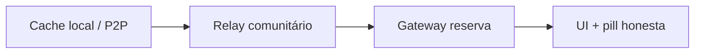

# Direcionamento — crescimento da rede (nov/2026)

> **Status:** consolidação doc-only · horizonte **2026-Q4 → 2027-Q2**  
> **Tese:** malha escala com **infra dos participantes** e piloto relacional — repositório publica cliente e **revisa código**, não opera relay/mod/suporte central.  
> **Não é parecer jurídico** — [COMPLIANCE-BR.md](../COMPLIANCE-BR.md)

Complementa [rede-sustentada-participantes.md](./rede-sustentada-participantes.md), [infra-participativa-blindagem-crescimento.md](./infra-participativa-blindagem-crescimento.md), [brainstorm-proximas-10-tarefas-pos-v82-2026-11.md](./brainstorm-proximas-10-tarefas-pos-v82-2026-11.md), [antigravity-estrategia-mantenedor-revisor-2026.md](./antigravity-estrategia-mantenedor-revisor-2026.md) e [brainstorm-auto-escala-organica-2026-10.md](./brainstorm-auto-escala-organica-2026-10.md).

**Inventário:** evidências do pacote nov/2026 em [inventario-estado-e-tarefas-documentacao-2026-11.md](./inventario-estado-e-tarefas-documentacao-2026-11.md); doc irmão de origens primárias [inventario-origens-rede-2026-11.md](./inventario-origens-rede-2026-11.md) *(link ativo quando publicado)*.

---

## 1. Flywheel e tração

### Preceitos (não negociáveis)

| Preceito | O que significa na prática |
|----------|----------------------------|
| **Transparência radical** | Regras de visibilidade auditáveis no código; painel comunitário com **estimativas locais** (“~N apoiadores online”, “~X% leituras via cache local”); pill honesta quando a leitura cai no gateway de reserva — sem caixa-preta algorítmica nacional. |
| **Sem leaderboard** | Proibido placar público de nós, stewards, IPs ou endereços “top contribuidor”. [ADR-001](./adr/001-contribution-attestation-export.md) permanece export opt-in **privado**; orgulho coletivo, não competição entre pessoas. |
| **Participação em 4 camadas** | Malha sustentada por escada voluntária 0→3 ([infra-participativa-blindagem-crescimento.md](./infra-participativa-blindagem-crescimento.md)): Passivo (opt-out soberano), Ativo (Pacto Vox default-on), Apoiador (`commOnly`), Steward (relay de gaveta / índice comunitário). Crescimento **não** exige subir de camada para postar, vender ou votar. |
| **Tom COMPLIANCE-BR** | Copy e rituais alinhados a [COMPLIANCE-BR.md](../COMPLIANCE-BR.md): espelho ≠ apagar on-chain; steward ≠ operador central do repo; Pix declarativo (não-PSP); moderação nas comunidades; pressão Art. 19 recai em quem opera espelho/relay, não no mantenedor como caixa postal jurídica. |

O flywheel só vale se estas quatro linhas forem visíveis para quem entra pela primeira vez — transparência não é slide de marketing, é comportamento do produto e da documentação.

### Onde crescer primeiro

Prioridade **Brasil, relacional, utilidade no primeiro dia** — não “federação abstrata” nem campanha nacional de awareness.

1. **Nichos BR com utilidade unitária clara** — coletivos de bairro, sindicatos de base, grêmios, bibliotecas comunitárias, ONGs locais, condomínios que já deliberam offline. Critério: existe **motivo concreto** para voltar amanhã (proposta, aviso, lista de presença), não só curiosidade técnica.
2. **Coletivos com trio mínimo** — fundador + pelo menos um mod buddy + um candidato a steward ou segundo apoiador `commOnly`. Sem trio, o piloto vira dependência do mantenedor e quebra o desenho.
3. **Feira comunitária** — classificados cronológicos, fotos de produto, Pix Zap; o comerciante local **ganha** cache perto ao manter nó ativo (egoísmo esclarecido). Porta de entrada para vizinhos que ainda não debatem política nacional.
4. **POSSE soberano** — link canônico no Vox compartilhado no WhatsApp, grupos e blog; leitor externo cai no PWA leve, Cantina em um toque, default Ativo. Tração vem do **criador que se promove**, não de anúncio pago do projeto.

Sequência recomendada: **uma praça fechada que funciona** → feira ou deliberação com cutoff → só então convite “traga três pessoas de confiança” (padrão FediForum/Signal, não MLM de protocolo).

### O que NÃO fazer

- **Ranking, badges públicos de contribuição ou “hall da fama” de relays** — mata apoiador tímido e incentiva gaming; contradiz [GOVERNANCE.md](../GOVERNANCE.md) e COMPLIANCE-BR.
- **Growth hack de Fediverse genérico** — pitch “entre na federação” antes de mostrar grupo, feira ou votação útil.
- **Obrigar steward, VPS ou relay para criar comunidade, postar ou vender** — barreira mortal; gateway de reserva + pill honesta são legítimos no cold start.
- **Prometer P2P total no celular 4G brasileiro** — CGNAT e franquia; Passivo e leitura via gateway são **normais**, não falha moral do usuário.
- **Boost pago, moeda in-app, alcance leiloado ou telemetria central disfarçada de “métricas abertas”** — reproduz Big Tech no client FOSS.
- **Mantenedor como NOC único, mod global, TURN para todos ou suporte WhatsApp oficial** — modelo Mastodon; burnout garantido.
- **Telegram/WhatsApp como backend oculto de timeline** — escala até centralizar moderação e dados.
- **Narrativa “blindagem total” ou “zero provedor absoluto”** — falsa segurança; espelhos e autores mantêm obrigações reais ([COMPLIANCE-BR.md](../COMPLIANCE-BR.md)).

### Cinco alavancas — próximos 90 dias

Cada alavanca abaixo usa **sinais qualitativos** (retrospectiva, observação de facilitador, notas de piloto) — **não** DAU nacional, funil de conversão centralizado nem metas de “viralidade”.

| # | Alavanca | Ação concreta | Sinal qualitativo de sucesso (90 d) |
|---|----------|---------------|-------------------------------------|
| **L1** | **Piloto V-P09 encaminhado** | 1–3 círculos de 10–30 pessoas, ~4 semanas, retrospectiva [piloto-comunidade-retrospectiva-template.md](./piloto-comunidade-retrospectiva-template.md) | Facilitador descreve flywheel “uso → share externo → leitura aceitável → seed” como **fechado ou parcialmente fechado**, com gaps nomeados (não “deu certo” vago) |
| **L2** | **Ritual seed pós-comunidade** | Wizard/checklist 3 min: aba Ativa, 2 convites, 1º tópico; pin na feira se aplicável ([steward-seed-15min.md](./steward-seed-15min.md)) | Fundadores reportam **primeira semana com conteúdo próprio** e pelo menos **um** convite recíproco observado (par convidou par) |
| **L3** | **Nudge `commOnly` + painel honesto** | Copy na comunidade convida Apoiador; header com estimativas locais, sem nomes ([rede-sustentada-participantes.md](./rede-sustentada-participantes.md)) | Mod ou steward relata **menos reclamações de “lento”** e membros citam o painel como motivo para ativar Apoiador — ou pill de gateway aceita sem pânico |
| **L4** | **POSSE + link canônico na rotina** | Criadores habituados a publicar no Vox antes do share externo; bridge/embed conforme [RFC POSSE](./rfc/0001-posse-export.md) quando pronto | Comunicadores dizem que **link permanente e Pix** justificam o passo extra; leitores externos **entram pela Cantina** pelo menos uma vez no piloto (anecdota registrada na retrospectiva) |
| **L5** | **Steward buddy + 2º espelho shell** | Um relay comunitário (V-I08) **ou** buddy documentado; segundo espelho Pages/Cloudflare vivo ([brainstorm-proximas-10-tarefas-pos-v82-2026-11.md](./brainstorm-proximas-10-tarefas-pos-v82-2026-11.md) T2) | Coletivo **sobe ou herda relay sem ticket ao mantenedor**; drill de espelho alternativo **testado uma vez** e descrito em uma frase no [inventario-estado-e-tarefas-documentacao-2026-11.md](./inventario-estado-e-tarefas-documentacao-2026-11.md) |

### Flywheel (referência operacional)

```
Utilidade (post, Pix, feira, deliberação)
        → share externo com link canônico (POSSE)
        → visitante lê (cache │ relay │ gateway + pill)
        → Cantina → camada Ativo (opt-out claro)
        → seed + commOnly opcional + steward opcional
        → praça rápida no território → criador repete share
        → mais pares na malha (sem scoreboard público)
```

Detalhe arquitetural e regulatório: [infra-participativa-blindagem-crescimento.md](./infra-participativa-blindagem-crescimento.md) §2–3. Evidências: [inventario-estado-e-tarefas-documentacao-2026-11.md](./inventario-estado-e-tarefas-documentacao-2026-11.md); [inventario-origens-rede-2026-11.md](./inventario-origens-rede-2026-11.md) *(doc irmão — quando publicado)*.

---

## 2. Infra participante

A sustentação da malha segue a **pirâmide cooperativa em quatro camadas** ([infra-participativa-blindagem-crescimento.md](./infra-participativa-blindagem-crescimento.md)): Passivo (opt-out soberano) → Ativo default-on (Pacto Vox) → Apoiador `commOnly` → Steward (relay de gaveta / índice). **Custo central de VPS obrigatória: zero** — GitHub Pages + gateways públicos como reserva **visível**, não como plano A ([rede-sustentada-participantes.md](./rede-sustentada-participantes.md)).

Heurística de design (não KPI público): comunidade 50+ membros — ≥70% Ativo/Apoiador; **~1 steward por 3–5 comunidades** (voluntário); gateway &lt;30% das leituras recentes quando há steward + ≥5 pares (telemetria local opt-in).

### 2.1 Caminho de adoção steward (escada de contribuição)

| Degrau | Quem | Gatilho no produto | O que muda na malha |
|--------|------|--------------------|---------------------|
| **Passivo** | Leitor ocasional | Opt-out em `#/settings/network` | Só consome; gateway reserva legítimo |
| **Ativo** (default) | Maioria dos membros | Pacto Vox ao abrir PWA | Cache público da sessão; gossip/WebRTC quando possível |
| **Apoiador** | Quem quer “ninho” local | Nudge V-P04 + `commOnly` | ~25 MB focados na comunidade; reciprocidade visível |
| **Steward** | Coletivo (minoría) | Wizard `#/settings/network/steward` + [steward-relay-kit.md](./steward-relay-kit.md) (V-I08) | Relay HTTP, espelho `POST /vox/mirror`, `/health`; steward **≠** moderador ([GOVERNANCE.md](../GOVERNANCE.md)) |

**Loops que não dependem do mantenedor** ([rede-sustentada-participantes.md](./rede-sustentada-participantes.md)):

1. **Uso → espaço digital** — comunidade, handle, feira aumentam valor de cache perto.
2. **Benefício visível** — pill “Leitura reserva” quando o gateway responde (`gateway-telemetry.js`).
3. **Contribuição escalonada** — copy honesta; steward **opcional** para postar (anti-padrão: obrigar relay para publicar).
4. **Governança suave** — feira sugere pin/espelho, não exige.

**Rituais de cold start:** checklist seed pós-comunidade (V-P05) + [steward-seed-15min.md](./steward-seed-15min.md) (Caminho A = só Ativo/Apoiador; Caminho B = relay + espelho em ~15 min). **Brasil:** CGNAT — celular não substitui VPS; Passivo legítimo; sem scoreboard público ([ADR-001](./adr/001-contribution-attestation-export.md) só export opt-in).

**Sucessão (pós-piloto):** V-P08 relay buddy — segundo voluntário antes do burnout; complementa V-I08, não o substitui.

### 2.2 T2 — 2º espelho shell + drill DR

**Escopo:** distribuição **read-only** do cliente PWA — **não** confundir com relay/steward ([ops-shell-mirrors.md](./ops-shell-mirrors.md)).

| Papel | Função |
|-------|--------|
| Espelho **A** | GitHub Pages (CI mantenedor) |
| Espelho **B** | Cloudflare Pages / Gitea / nginx coletivo (voluntário ops FOSS) |

**Objetivo:** eliminar SPOF de **um** domínio de shell; paridade de release (`git_sha`, `CACHE_NAME` em `sw.js`) na mesma tag; **um** drill DR documentado (simular indisponibilidade de A, smoke em B, comunicar URL alternativa ao piloto).

**DoD resumido:**

- Registro público: `mirror_id`, `base_url`, `git_sha`, `cache_name`, `operator`, `read_only: true`
- Smoke em B: PWA, `#/settings/network`, `#/c/demo-aprenda-vox-mirror`; steward **Testar espelho agora** se relay existir
- Docs: relay/VPS **não** migra com espelho estático; espelho reduz dependência de **um host**, não apaga permaweb

**Cadeia:** V-I08 ✓ → **T2** → go-live piloto (V-P09). **Anti-padrão:** iniciar piloto sem plano de 2º espelho; mantenedor subir relay “temporário” na própria VPS.

Detalhe operacional: [brainstorm-proximas-10-tarefas-pos-v82-2026-11.md](./brainstorm-proximas-10-tarefas-pos-v82-2026-11.md) § T2.

### 2.3 V-P09 — piloto operacional

**Escopo:** execução **humana** (1–3 comunidades, 10–30 pessoas, ~4 semanas) — [piloto-comunidade-retrospectiva-template.md](./piloto-comunidade-retrospectiva-template.md).

**Objetivo:** validar flywheel **uso → espaço digital → `commOnly` → leitura mais rápida**; calibrar copy honesta (pill gateway, steward opcional); alimentar V-P04/V-P05/V-I08 com dados **qualitativos** — não DAU nacional.

| Critério | Evidência |
|----------|-----------|
| Roles mínimos | Trio ou Caminho A/B ([steward-seed-15min.md](./steward-seed-15min.md)) |
| Barra mínima 2026 | ≥3 Apoiadores `commOnly` **ou** 1 steward + espelho verificado (V-P06) até semana 4 |
| Retrospectiva | 7–14 dias pós go-live; continuar / pausar / abortar |
| Maintainer | Bugfix/docs only — **não** animar piloto nem hotline 1:1 |

**Dependências:** V-P04/05/06; **ideal:** T2 comunicado ao grupo (URL B no convite). **Feature freeze** nas 4 semanas do piloto ([brainstorm-proximas-10-tarefas-pos-v82-2026-11.md](./brainstorm-proximas-10-tarefas-pos-v82-2026-11.md) § T1).

**Owners:** facilitador local (rituais 0–4); fundador (convites, seed, mod/steward); community-doc (template → backlog).

---

## 3. Confiabilidade

Confiabilidade na malha Vox = **camadas sobrepostas** (cache local → relay vizinho → gateway reserva → honestidade na UI), não uptime de um datacenter único ([brainstorm-auto-escala-organica-2026-10.md](./brainstorm-auto-escala-organica-2026-10.md) §4).



### 3.1 Camadas ops comunitária

| Camada | Foco | Artefatos Vox |
|--------|------|----------------|
| **P0 — Leitura honesta** | Usuário sabe *de onde* veio o post; app não finge malha plena | `gateway-telemetry.js`, `#/status`, copy audit |
| **P1 — Vizinhança rápida** | ≥1 steward + apoiadores `commOnly` | relay `/vox/index`, mirror POST, wizard steward |
| **P2 — Escala federada** | Múltiplos espelhos shell, RFCs, POSSE P2 | registro de espelhos, T8–T10 pós-piloto |

Painel comunitário ([infra-participativa-blindagem-crescimento.md](./infra-participativa-blindagem-crescimento.md) §3.2): estimativas **locais** da praça (“~14 apoiadores online”, “~96% leituras locais”) — **sem** leaderboard global, gamificação ou ranking de nós.

### 3.2 SLOs honestos (metas de desenho, não SLA)

Operadores são voluntários; cliente é estático. **Não** vender estes números como garantia comercial (risco mitigado no piloto V-P09: “SLO como SLA”).

| Métrica | Saudável (alvo) | Degradado (aceitável temporário) |
|---------|-----------------|----------------------------------|
| Primeiro post visível (comunidade seedada) | &lt; 5 s (relay/cache) | &lt; 45 s via gateway reserva |
| % leituras recentes sem gateway (50+ membros, ≥2 stewards, ≥5 pares) | ≥ 70% (heurística opt-in) | &lt; 30% → UI convida apoio, **sem** culpar indivíduos |
| Shell PWA (espelho A/B) | Paridade SHA + `CACHE_NAME`; B vivo | Best-effort A; drill DR semestral |
| Relay steward `/health` | LAN / &lt;200 ms | Fallback gateway + pill “Leitura reserva” |
| DM inbox relay TTL | 72 h expurgo | Copy “tente quando peer online” |
| Release `main` | `npm test` + relay unittest verdes | Merge bloqueado |

**Regra:** em estado `critical`, preferir copy “Leitura reserva” a spinner infinito (V-P02). Stewards debugam com `#/status` + export diagnóstico — **sem** phone-home central (P2: agregação só voluntária por stewards).

**Validação empírica:** retrospectiva V-P09 calibra expectativas reais antes de amplificar copy ou POSSE (T8).

### 3.3 Papel mantenedor → revisor (confiabilidade do **produto**, não da malha)

O mantenedor humano garante **contrato de release** e especificações abertas; **não** garante uptime de relays comunitários ([antigravity-estrategia-mantenedor-revisor-2026.md](./antigravity-estrategia-mantenedor-revisor-2026.md)).

| Faz (revisor) | Não faz |
|---------------|---------|
| CI verde, bump SW, Pages + doc 2º espelho (T2) | Relay/TURN/inbox global do projeto |
| Revisar PRs de protocolo, hardening pré-piloto (V-I08, T2) | VPS de emergência, hotline WhatsApp, “salvar” comunidade lenta |
| Participar no piloto V-P09 **como membro** (chaves pessoais) | Suporte 1:1, animação de engajamento, bots |
| Congelar features na janela V-P09; ler retrospectiva | Arbitrar mod local, ranking público de nós |
| Atualizar COMPLIANCE-BR quando Art. 19 atinge **espelho/steward** | Narrativa de “blindagem total” |

**Transição trimestral (confiabilidade percebida):**

- **2026-Q4:** guardião de contratos — T2 operável por terceiros; zero relay sob responsabilidade do mantenedor.
- **2027-Q1:** observador do piloto — feature freeze T3; dúvidas → docs/rituais do grupo.
- **2027-Q2+:** revisor de protocolo/releases — malha ops 100% nos coletivos; repo = árbitro FOSS.

**Anti-loop:** se steward, mod ou suporte “só o mantenedor resolve”, tratar como **incidente de produto** (atrato no onboarding V-P05, buddy V-P08, copy) — não heroísmo ops.

### 3.4 Anti-padrões de confiabilidade

- Prometer 100% P2P no celular (CGNAT).
- Espelho shell confundido com “nó da rede” ou T&S centralizado no repo.
- Painel honesto virar scoreboard ou moeda in-app.
- Maintainer vira NOC único em cenário de onda local — resposta correta: freeze + auditoria quotas V-I08 + drill T2 ([rede-sustentada-participantes.md](./rede-sustentada-participantes.md) anti-padrões).

---

## 4. Moderação voluntária

Moderação no Vox é **local, eleita e auditável** — não há central T&S no repositório ([GOVERNANCE.md](../GOVERNANCE.md)). Crescer a rede nos preceitos (§1–§3) exige **praças vivas** antes de escala numérica: cada comunidade piloto (V-P09) deve provar que mods voluntários sustentam o tom sem burnout do fundador.

### 4.1 Princípios operacionais

| Princípio | Implicação prática |
|-----------|-------------------|
| **Transparência** | Toda ocultação/ban = TX `Type: mod-action` assinada; hide ≠ apagar on-chain |
| **Escopo limitado** | Mod só na `Community-Id`; sem poder global no client |
| **Steward ≠ mod** | Quem hospeda relay/espelho **não** ganha ban automático (§2.1) |
| **Justiça procedimental** | Mudança de regra → proposta + `Eligibility-Cutoff` (anti-brigading) |
| **Repo fora de disputas** | Mantenedor merge código; **não** arbitra timeline local (§3.3) |

Motivação sustentável ([brainstorm-auto-escala-organica-2026-10.md](./brainstorm-auto-escala-organica-2026-10.md) §5): proteger **o espaço que importa**, prestígio **dentro** da comunidade (sem leaderboard de mods), ferramentas de baixo atrito (`hide`/`unhide` assinados).

### 4.2 Escada do moderador (mod ladder)

```
Membro → Apoiador (commOnly) → Facilitador (feira/tópicos, sem ban)
    → Moderador eleito (mod-action hide/ban)
    → Curador de espelho (opcional: índice JSON honra mod-action — sem poder extra)
    → Ex-mod / pausa (governance-vote ou rotação)
```

**Ritual mínimo no piloto:** **E1 — trio inicial** — 2 co-facilitadores + 1 mod backup antes da semana 2 ([brainstorm-proximas-10-tarefas-pos-v82-2026-11.md](./brainstorm-proximas-10-tarefas-pos-v82-2026-11.md) T6).

### 4.3 Playbook piloto E1–E5 (Q1-2027)

| ID | Experimento | DoD qualitativo (4 sem) |
|----|-------------|-------------------------|
| **E1** | Trio inicial | Fundador não é único mod de plantão |
| **E2** | Carta de mod 1 página (PT) | Regras explícitas na comunidade |
| **E3** | Workshop 30 min “mod-action ao vivo” | Tempo até primeira TX mod ↓ |
| **E4** | Rodízio mensal de plantão | Burnout autorrelatado ↓ |
| **E5** | Appeal comunitário | Contestação → proposta/voto cutoff, não DM ao maintainer |

**Feira + debate:** spam comercial no tópico principal → ocultar; classificados na aba feira. **DMs:** mods **não** leem inbox cifrado ([COMPLIANCE-BR.md](../COMPLIANCE-BR.md)).

### 4.4 Anti-padrões (moderação)

- Central de denúncias no repo ou “mod global” do mantenedor.
- Gamificar mods (badge público nacional, ranking).
- Steward usar índice espelho para política **além** do que mods eleitos assinaram — resposta: espelho alternativo (§5.2).
- Fundador-mod eterno sem rotação — resposta: E1 + mandato ~90 dias + V-P08 buddy para **infra**, não para mod.

---

## 5. Governança e fork

Governança distribui **regras da praça** e **válvulas republicanas** quando a praça trava — sem recorrer ao GitHub como tribunal social.

### 5.1 Deliberação e infra suave

| Mecanismo | Uso | Vinculante? |
|-----------|-----|-------------|
| Proposta + voto com cutoff | Mudar regras, eleger mods, recomendar espelho/pin | Sim, na comunidade |
| Feira + pin leve (V-I07) | Sugerir relay/espelho a apoiadores | **Não** — nunca exigir infra para postar/vender |
| `mod-action` | Ocultar/ban/unhide/unban | Sim, no client que honra lista de mods |
| RFC / PR no repo | Protocolo, tags, client FOSS | Sim, para **código** — não para mod local |

**Pressão regulatória (Brasil):** pedidos Art. 19 e canal de contato recaem sobre **operador de espelho/steward** documentado — não sobre merge do mantenedor ([COMPLIANCE-BR.md](../COMPLIANCE-BR.md), §3.3).

### 5.2 Fork comunitário e espelhos (T9)

Objetivo: **schism civilizado** com histórico preservado — [brainstorm-proximas-10-tarefas-pos-v82-2026-11.md](./brainstorm-proximas-10-tarefas-pos-v82-2026-11.md) § T9, [incubacao-p2-backlog.md](./incubacao-p2-backlog.md).

| Cenário | Resposta republicana |
|---------|----------------------|
| Mod tirânico (hide em massa, sem appeal E5) | Proposta `community-fork` + migrar filiação |
| Steward filtra índice além do mod eleito | Documentar URL; membros apontam espelho alternativo |
| Schism de regras | Fork + cutoff na votação da nova praça |
| Captura do fundador | E1 + mandato + governance-vote |

**Gatilhos objetivos para propor fork (piloto):**

1. ≥3 `mod-action` contestadas + appeal E5 negado sem voto cutoff.
2. Recusa de adotar carta mod (E2) após 14 dias.
3. Política de índice steward incompatível com voto válido da comunidade.
4. Heurística: ≥20 membros ativos e ≥40% assinam proposta fork.

**Alvo protocolo (P2):** TX `Type: community-fork` + `parentCommunityId`; UI «Migrar minha filiação»; **não** apagar parent on-chain. **Mantenedor:** spec + merge — **não** escolhe lado oficial.

**Distinção:** fork **shell** (2º espelho read-only, T2) ≠ fork **comunidade** (governança); confundir os dois é anti-padrão de confiabilidade (§3.4).

### 5.3 Transição mantenedor → revisor (governança de **código**)

| Trimestre | Foco governança FOSS | Malha social |
|-----------|----------------------|--------------|
| **2026-Q4** | T2 doc + CI; freeze tags on-chain sem spec | Coletivos preparam piloto |
| **2027-Q1** | T6 playbook mod arquivado pós-V-P09 | 100% mod/steward local |
| **2027-Q2+** | T8–T10 POSSE/fork/ADR-001 UI opt-in | Múltiplos relays sem contato prévio com maintainer |

Processo externo: RFCs com janela de comentário (P2) — participação majoritária na **malha**, revisão majoritária no **repo** via PR.

---

## 6. Síntese executiva

**Em uma frase:** a rede Vox cresce quando cada coletivo traz **utilidade no primeiro dia** (feira, deliberação, POSSE), **cache perto** (Ativo → Apoiador → steward opcional) e **moderação republicana** (TX públicas + fork como válvula) — enquanto o repositório permanece **cliente estático + contrato de protocolo**, sem relay global, ranking de nós ou tribunal central.

**Encadeamento já acordado (§2–§5):** V-I08 ✓ → **T2** (2º espelho) → **V-P09** (piloto 10–30) → **V-P08** (buddy steward) → **T6** (mod E1–E5) → **T8–T10** (POSSE, fork, atestação opt-in). Pular T2 ou “relay de emergência” do mantenedor quebra o flywheel e reproduz anti-padrões Mastodon.

### Dez ações acionáveis (mantenedor + coletivos)

1. **Mantenedor — fechar T2 antes do go-live:** registrar espelho B (`git_sha`, `CACHE_NAME`), um drill DR documentado; convite do piloto já traz URL A **e** B ([ops-shell-mirrors.md](./ops-shell-mirrors.md)).
2. **Coletivo piloto — executar V-P09 com feature freeze 4 sem:** preencher [piloto-comunidade-retrospectiva-template.md](./piloto-comunidade-retrospectiva-template.md); barra mínima: ≥3 `commOnly` **ou** 1 steward + espelho verificado (V-P06).
3. **Fundador — ritual V-P05 no dia 0:** tópico útil + 2 convites + pin feira se aplicável; Caminho A (só Apoiadores) é válido — steward não é pré-requisito para postar.
4. **Facilitador — montar trio E1 na semana 1:** 2 co-facilitadores + 1 mod backup; carta mod E2 publicada na comunidade antes de polêmica.
5. **Apoiadores — aceitar nudge V-P04:** `commOnly` na praça que frequentam; meta local é reciprocidade visível no painel honesto, não “virar servidor”.
6. **Steward voluntário — V-I08 + buddy V-P08:** um relay por coletivo (ou ~1 steward / 3–5 comunidades); segundo operador documentado antes de férias ou pico de migração.
7. **Mods eleitos — mod-action transparente:** ocultar com confirmação UI; appeals via proposta/voto cutoff (E5), não ticket ao maintainer.
8. **Mantenedor — zero ops heroica:** nenhum relay/VPS/hotline 1:1; bugs → issue/PR; dúvidas de rituais → docs §2.3 e playbook T6.
9. **Coletivo em conflito — fork antes do flame war no GitHub:** acionar gatilhos §5.2; espelho alternativo se só o índice steward divergiu; maintainer não escolhe lado.
10. **Todos — honestidade como feature:** pill “Leitura reserva”, CGNAT no 4G, hide ≠ delete; escala cívica (dezenas–centenas por praça), não promessa de MAU nacional nem P2P total no celular.

**Próximo checkpoint:** retrospectiva V-P09 → atualizar SLOs §3.2 e priorizar T8–T10 só se piloto **continuar** sem loop do mantenedor.

---

**Versão:** 0.3 (§1–§6) · **Dono:** Community-doc · **Baseline código:** `898509c` (V-I08 steward kit)
