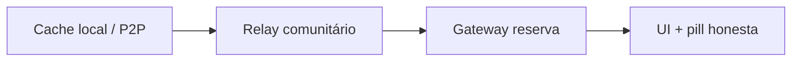

# Direcionamento — crescimento da rede (nov/2026)

> **Status:** consolidação doc-only · horizonte **2026-Q4 → 2027-Q2**  
> **Tese:** malha escala com **infra dos participantes** e piloto relacional — repositório publica cliente e **revisa código**, não opera relay/mod/suporte central.  
> **Não é parecer jurídico** — [COMPLIANCE-BR.md](../COMPLIANCE-BR.md)

Complementa [rede-sustentada-participantes.md](./rede-sustentada-participantes.md), [infra-participativa-blindagem-crescimento.md](./infra-participativa-blindagem-crescimento.md), [brainstorm-proximas-10-tarefas-pos-v82-2026-11.md](./brainstorm-proximas-10-tarefas-pos-v82-2026-11.md), [antigravity-estrategia-mantenedor-revisor-2026.md](./antigravity-estrategia-mantenedor-revisor-2026.md) e [brainstorm-auto-escala-organica-2026-10.md](./brainstorm-auto-escala-organica-2026-10.md).

---

## 2. Infra participante

A sustentação da malha segue a **pirâmide cooperativa em quatro camadas** ([infra-participativa-blindagem-crescimento.md](./infra-participativa-blindagem-crescimento.md)): Passivo (opt-out soberano) → Ativo default-on (Pacto Vox) → Apoiador `commOnly` → Steward (relay de gaveta / índice). **Custo central de VPS obrigatória: zero** — GitHub Pages + gateways públicos como reserva **visível**, não como plano A ([rede-sustentada-participantes.md](./rede-sustentada-participantes.md)).

Heurística de design (não KPI público): comunidade 50+ membros — ≥70% Ativo/Apoiador; **~1 steward por 3–5 comunidades** (voluntário); gateway &lt;30% das leituras recentes quando há steward + ≥5 pares (telemetria local opt-in).

### 2.1 Caminho de adoção steward (escada de contribuição)

| Degrau | Quem | Gatilho no produto | O que muda na malha |
|--------|------|--------------------|---------------------|
| **Passivo** | Leitor ocasional | Opt-out em `#/settings/network` | Só consome; gateway reserva legítimo |
| **Ativo** (default) | Maioria dos membros | Pacto Vox ao abrir PWA | Cache público da sessão; gossip/WebRTC quando possível |
| **Apoiador** | Quem quer “ninho” local | Nudge V-P04 + `commOnly` | ~25 MB focados na comunidade; reciprocidade visível |
| **Steward** | Coletivo (minoría) | Wizard `#/settings/network/steward` + [steward-relay-kit.md](./steward-relay-kit.md) (V-I08) | Relay HTTP, espelho `POST /vox/mirror`, `/health`; steward **≠** moderador ([GOVERNANCE.md](../GOVERNANCE.md)) |

**Loops que não dependem do mantenedor** ([rede-sustentada-participantes.md](./rede-sustentada-participantes.md)):

1. **Uso → espaço digital** — comunidade, handle, feira aumentam valor de cache perto.
2. **Benefício visível** — pill “Leitura reserva” quando o gateway responde (`gateway-telemetry.js`).
3. **Contribuição escalonada** — copy honesta; steward **opcional** para postar (anti-padrão: obrigar relay para publicar).
4. **Governança suave** — feira sugere pin/espelho, não exige.

**Rituais de cold start:** checklist seed pós-comunidade (V-P05) + [steward-seed-15min.md](./steward-seed-15min.md) (Caminho A = só Ativo/Apoiador; Caminho B = relay + espelho em ~15 min). **Brasil:** CGNAT — celular não substitui VPS; Passivo legítimo; sem scoreboard público ([ADR-001](./adr/001-contribution-attestation-export.md) só export opt-in).

**Sucessão (pós-piloto):** V-P08 relay buddy — segundo voluntário antes do burnout; complementa V-I08, não o substitui.

### 2.2 T2 — 2º espelho shell + drill DR

**Escopo:** distribuição **read-only** do cliente PWA — **não** confundir com relay/steward ([ops-shell-mirrors.md](./ops-shell-mirrors.md)).

| Papel | Função |
|-------|--------|
| Espelho **A** | GitHub Pages (CI mantenedor) |
| Espelho **B** | Cloudflare Pages / Gitea / nginx coletivo (voluntário ops FOSS) |

**Objetivo:** eliminar SPOF de **um** domínio de shell; paridade de release (`git_sha`, `CACHE_NAME` em `sw.js`) na mesma tag; **um** drill DR documentado (simular indisponibilidade de A, smoke em B, comunicar URL alternativa ao piloto).

**DoD resumido:**

- Registro público: `mirror_id`, `base_url`, `git_sha`, `cache_name`, `operator`, `read_only: true`
- Smoke em B: PWA, `#/settings/network`, `#/c/demo-aprenda-vox-mirror`; steward **Testar espelho agora** se relay existir
- Docs: relay/VPS **não** migra com espelho estático; espelho reduz dependência de **um host**, não apaga permaweb

**Cadeia:** V-I08 ✓ → **T2** → go-live piloto (V-P09). **Anti-padrão:** iniciar piloto sem plano de 2º espelho; mantenedor subir relay “temporário” na própria VPS.

Detalhe operacional: [brainstorm-proximas-10-tarefas-pos-v82-2026-11.md](./brainstorm-proximas-10-tarefas-pos-v82-2026-11.md) § T2.

### 2.3 V-P09 — piloto operacional

**Escopo:** execução **humana** (1–3 comunidades, 10–30 pessoas, ~4 semanas) — [piloto-comunidade-retrospectiva-template.md](./piloto-comunidade-retrospectiva-template.md).

**Objetivo:** validar flywheel **uso → espaço digital → `commOnly` → leitura mais rápida**; calibrar copy honesta (pill gateway, steward opcional); alimentar V-P04/V-P05/V-I08 com dados **qualitativos** — não DAU nacional.

| Critério | Evidência |
|----------|-----------|
| Roles mínimos | Trio ou Caminho A/B ([steward-seed-15min.md](./steward-seed-15min.md)) |
| Barra mínima 2026 | ≥3 Apoiadores `commOnly` **ou** 1 steward + espelho verificado (V-P06) até semana 4 |
| Retrospectiva | 7–14 dias pós go-live; continuar / pausar / abortar |
| Maintainer | Bugfix/docs only — **não** animar piloto nem hotline 1:1 |

**Dependências:** V-P04/05/06; **ideal:** T2 comunicado ao grupo (URL B no convite). **Feature freeze** nas 4 semanas do piloto ([brainstorm-proximas-10-tarefas-pos-v82-2026-11.md](./brainstorm-proximas-10-tarefas-pos-v82-2026-11.md) § T1).

**Owners:** facilitador local (rituais 0–4); fundador (convites, seed, mod/steward); community-doc (template → backlog).

---

## 3. Confiabilidade

Confiabilidade na malha Vox = **camadas sobrepostas** (cache local → relay vizinho → gateway reserva → honestidade na UI), não uptime de um datacenter único ([brainstorm-auto-escala-organica-2026-10.md](./brainstorm-auto-escala-organica-2026-10.md) §4).

### 3.1 Camadas ops comunitária

| Camada | Foco | Artefatos Vox |
|--------|------|----------------|
| **P0 — Leitura honesta** | Usuário sabe *de onde* veio o post; app não finge malha plena | `gateway-telemetry.js`, `#/status`, copy audit |
| **P1 — Vizinhança rápida** | ≥1 steward + apoiadores `commOnly` | relay `/vox/index`, mirror POST, wizard steward |
| **P2 — Escala federada** | Múltiplos espelhos shell, RFCs, POSSE P2 | registro de espelhos, T8–T10 pós-piloto |

Painel comunitário ([infra-participativa-blindagem-crescimento.md](./infra-participativa-blindagem-crescimento.md) §3.2): estimativas **locais** da praça (“~14 apoiadores online”, “~96% leituras locais”) — **sem** leaderboard global, gamificação ou ranking de nós.

### 3.2 SLOs honestos (metas de desenho, não SLA)

Operadores são voluntários; cliente é estático. **Não** vender estes números como garantia comercial (risco mitigado no piloto V-P09: “SLO como SLA”).

| Métrica | Saudável (alvo) | Degradado (aceitável temporário) |
|---------|-----------------|----------------------------------|
| Primeiro post visível (comunidade seedada) | &lt; 5 s (relay/cache) | &lt; 45 s via gateway reserva |
| % leituras recentes sem gateway (50+ membros, ≥2 stewards, ≥5 pares) | ≥ 70% (heurística opt-in) | &lt; 30% → UI convida apoio, **sem** culpar indivíduos |
| Shell PWA (espelho A/B) | Paridade SHA + `CACHE_NAME`; B vivo | Best-effort A; drill DR semestral |
| Relay steward `/health` | LAN / &lt;200 ms | Fallback gateway + pill “Leitura reserva” |
| DM inbox relay TTL | 72 h expurgo | Copy “tente quando peer online” |
| Release `main` | `npm test` + relay unittest verdes | Merge bloqueado |

**Regra:** em estado `critical`, preferir copy “Leitura reserva” a spinner infinito (V-P02). Stewards debugam com `#/status` + export diagnóstico — **sem** phone-home central (P2: agregação só voluntária por stewards).

**Validação empírica:** retrospectiva V-P09 calibra expectativas reais antes de amplificar copy ou POSSE (T8).

### 3.3 Papel mantenedor → revisor (confiabilidade do **produto**, não da malha)

O mantenedor humano garante **contrato de release** e especificações abertas; **não** garante uptime de relays comunitários ([antigravity-estrategia-mantenedor-revisor-2026.md](./antigravity-estrategia-mantenedor-revisor-2026.md)).

| Faz (revisor) | Não faz |
|---------------|---------|
| CI verde, bump SW, Pages + doc 2º espelho (T2) | Relay/TURN/inbox global do projeto |
| Revisar PRs de protocolo, hardening pré-piloto (V-I08, T2) | VPS de emergência, hotline WhatsApp, “salvar” comunidade lenta |
| Participar no piloto V-P09 **como membro** (chaves pessoais) | Suporte 1:1, animação de engajamento, bots |
| Congelar features na janela V-P09; ler retrospectiva | Arbitrar mod local, ranking público de nós |
| Atualizar COMPLIANCE-BR quando Art. 19 atinge **espelho/steward** | Narrativa de “blindagem total” |

**Transição trimestral (confiabilidade percebida):**

- **2026-Q4:** guardião de contratos — T2 operável por terceiros; zero relay sob responsabilidade do mantenedor.
- **2027-Q1:** observador do piloto — feature freeze T3; dúvidas → docs/rituais do grupo.
- **2027-Q2+:** revisor de protocolo/releases — malha ops 100% nos coletivos; repo = árbitro FOSS.

**Anti-loop:** se steward, mod ou suporte “só o mantenedor resolve”, tratar como **incidente de produto** (atrato no onboarding V-P05, buddy V-P08, copy) — não heroísmo ops.

### 3.4 Anti-padrões de confiabilidade

- Prometer 100% P2P no celular (CGNAT).
- Espelho shell confundido com “nó da rede” ou T&S centralizado no repo.
- Painel honesto virar scoreboard ou moeda in-app.
- Maintainer vira NOC único em cenário de onda local — resposta correta: freeze + auditoria quotas V-I08 + drill T2 ([rede-sustentada-participantes.md](./rede-sustentada-participantes.md) anti-padrões).

---

**Versão:** 0.2 (§2–§3) · **Dono:** Community-doc · **Baseline código:** `898509c` (V-I08 steward kit)
