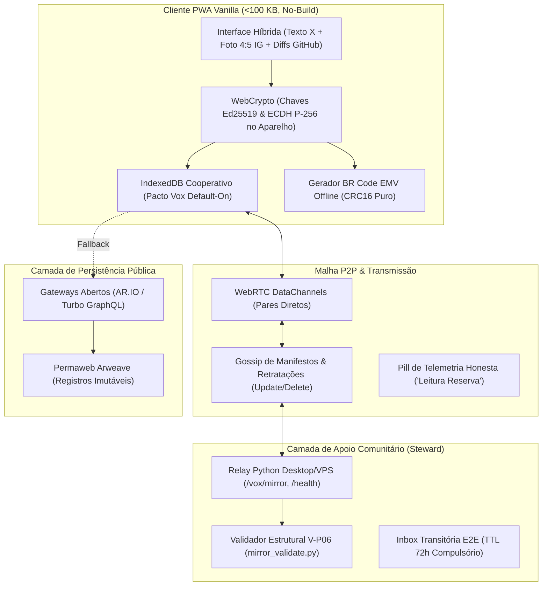
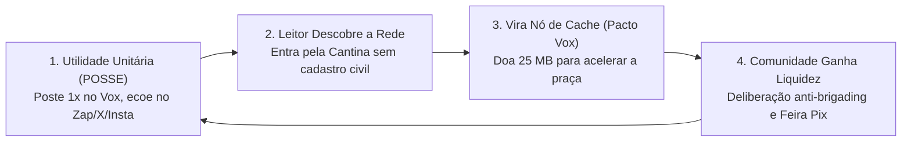
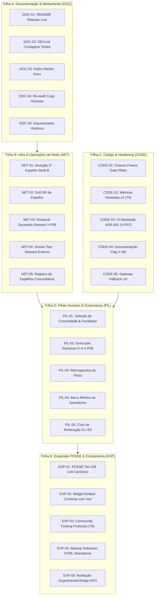

# 🇧🇷 Vox — Dossiê Geral: Inventário do Sistema & Master Breakdown em N=25 Tarefas

> **Status:** canônico (plano mestre N=25) · **Owner:** mantenedor/revisor · **Revisado:** 2026-11 · Release/SHA: [README.md](./README.md)  
> **Documento:** Inventário de Arquitetura, Estado da Arte & Plano Mestre de Execução  
> **Suíte de testes / SHA / SW:** [../README.md](../README.md) (tabela release) · [release-metadata.json](./release-metadata.json) — não repetir contagens neste header.  
> **Arquivos Canônicos Relacionados:** [inventario-estado-e-tarefas-documentacao-2026-11.md](./inventario-estado-e-tarefas-documentacao-2026-11.md), [direcionamento-crescimento-rede-2026-11.md](./direcionamento-crescimento-rede-2026-11.md) e [brainstorm-proximas-10-tarefas-pos-v82-2026-11.md](./brainstorm-proximas-10-tarefas-pos-v82-2026-11.md).

> **Política de agentes:** Composer 2.5 only (lobby politica).

**Documentos irmãos:** [Inventário nov/2026 — tarefas doc/review (N=20 + DOC-06…08)](./inventario-estado-e-tarefas-documentacao-2026-11.md) · [Direcionamento crescimento rede §1–§6](./direcionamento-crescimento-rede-2026-11.md) · [Brainstorm T1–T10 pós-v82](./brainstorm-proximas-10-tarefas-pos-v82-2026-11.md) · [Brainstorm — 10 fraquezas do método nov/2026](./brainstorm-10-pontos-fracos-metodo-implementacao-2026-11.md)

### Escopo: inventário (20) vs dossiê master (25)

| Artefato | IDs | Papel |
|----------|-----|--------|
| **Este dossiê** | **25** — DOC-01…05, NET, CODE, PIL, **EXP-01…05** | Plano mestre de execução (Partes 1–3); **único checklist vivo** §3.6; **única fonte** da trilha **EXP**. |
| [Inventário nov/2026](./inventario-estado-e-tarefas-documentacao-2026-11.md) | **20** núcleo (= 4×5 sem EXP) **+ DOC-06…08** | Mapa produto/docs + DoD detalhado (tabelas §4); **sem** caixas `[ ]` — marcar só §3.6 abaixo. |

**Reconciliação:** marcar progresso **somente** em [§3.6 Checklist master vivo (N=25)](#36-checklist-master-vivo-n25). **DOC-06…08** rastreiam-se nas tabelas §4 do inventário (DoD texto), sem checkbox duplicado. **EXP-01…05** só aqui.

---

## 🏛️ PARTE 1: Inventário Exaustivo de Tudo o Que Temos

O Vox é uma rede social cívica aberta, leve e descentralizada, desenhada especificamente para o contexto brasileiro. Ele combina o espírito nostálgico de comunidades do Orkut com a robustez colaborativa do GitHub e a soberania financeira do Pix.

---

### 1.1 Arquitetura de Módulos do Cliente (`vox/client/js/`)

A base de código do cliente é 100% JavaScript moderno nativo (ES Modules), sem transpiladores, sem Babel, sem Webpack e sem dependências de runtime npm:

| Módulo / Camada | Arquivos Principais | Responsabilidade Técnica |
|---|---|---|
| **Núcleo & Shell** | [`app.js`](../client/js/app.js), [`app/init.js`](../client/js/app/init.js), [`app/route.js`](../client/js/app/route.js), [`app/route-parse.js`](../client/js/app/route-parse.js), [`render/shell.js`](../client/js/render/shell.js) | Inicialização, roteamento SPA por hash, casca responsiva (sidebar, composer slot, nav). |
| **Identidade & Criptografia** | [`wallet.js`](../client/js/wallet.js), [`local-account.js`](../client/js/local-account.js), [`crypto-dm.js`](../client/js/crypto-dm.js), [`handles.js`](../client/js/handles.js) | Geração de chaves locais Ed25519 e ECDH P-256, assinatura de transações, resolução de `@handle`, cifragem ponta a ponta AES-GCM. |
| **Malha P2P & Cache** | [`peers.js`](../client/js/peers.js), [`cache-node.js`](../client/js/cache-node.js), [`webrtc-peer.js`](../client/js/webrtc-peer.js), [`peers-blob-affinity.js`](../client/js/peers-blob-affinity.js), [`cache-manifest.js`](../client/js/cache-manifest.js) | Pacto Vox (cache cooperativo no IndexedDB), prioridade suave V-I09, gossip de manifestos de cache, filtro `commOnly` (V-I02). |
| **Leitura & Telemetria** | [`graphql.js`](../client/js/graphql.js), [`gateway-telemetry.js`](../client/js/gateway-telemetry.js) | Consultas GraphQL a gateways públicos Arweave/AR.IO, medição de latência e pill honesta "Leitura reserva". |
| **Comunidades & Espelhos** | [`community-mirror.js`](../client/js/community-mirror.js), [`community-seed-checklist.js`](../client/js/community-seed-checklist.js), [`render/community.js`](../client/js/render/community.js) | Pré-validação V-P06 e envio de índices (`POST /vox/mirror`), ritual seed V-P05, renderização do painel "Sustentada por vizinhos". |
| **Governança & Deliberação** | [`governance.js`](../client/js/governance.js), [`moderation.js`](../client/js/moderation.js), [`polis.js`](../client/js/polis.js), [`render/tag-polis.js`](../client/js/render/tag-polis.js) | Propostas de governança, voto 1 membro = 1 voto com corte temporal anti-brigading ([`Eligibility-Cutoff`](../GOVERNANCE.md#L109-L117)), moderação client-side ([`mod-action`](../GOVERNANCE.md#L11-L20)), matriz de consenso Pol.is. |
| **Economia Local & Feira** | [`brcode.js`](../client/js/brcode.js), [`pix-key.js`](../client/js/pix-key.js), [`listing.js`](../client/js/listing.js), [`listing-ui.js`](../client/js/listing-ui.js) | Algoritmo BR Code EMV + CRC16-CCITT puro para Pix Zaps 100% offline; aba de Classificados da Feira com ofertas assinadas e retratações. |
| **Open Frames & Composer** | [`frames.js`](../client/js/frames.js), [`open-frames-host.js`](../client/js/open-frames-host.js), [`inline-composer.js`](../client/js/inline-composer.js), [`composer-media.js`](../client/js/composer-media.js) | Mini-aplicações no feed (enquete, abaixo-assinado, simulador CLT), compositor inline com validação estrita de dimensões e tipos de mídia. |
| **Descoberta & Social** | [`people-index.js`](../client/js/people-index.js), [`profile-card.js`](../client/js/profile-card.js), [`oauth-profile.js`](../client/js/oauth-profile.js), [`posse-dispatch.js`](../client/js/posse-dispatch.js) | Descoberta na malha (`#/people`), atestações federadas client-only (Google/Meta/GitHub), despacho POSSE para redes legadas. |
| **Steward Wizard & Ops** | [`steward-wizard.js`](../client/js/steward-wizard.js), [`render/status.js`](../client/js/render/status.js) | Assistente visual de configuração de relay local (`#/settings/network/steward`), diagnóstico de saúde e quotas. |

---

### 1.2 Infraestrutura de Relay & Steward (`vox/relay/`)

Um servidor leve e autônomo em Python puro (sem frameworks pesados), projetado para rodar em computadores domésticos, TV boxes ou VPS:

* [`server.py`](../relay/server.py): Endpoints `/health` (telemetria e inventário de espelhos), `/tx/:id` (cache de dados), `/vox/mirror` (ingestão de índices comunitários) e `/vox/index/:commId.json` (leitura ultra-rápida).
* [`mirror_validate.py`](../relay/mirror_validate.py) (V-P06): Validador estrutural rigoroso (teto de 256 KiB, regex de `communityId`, array de até 500 tópicos, validação opcional de manifesto v0).
* [`inbox.py`](../relay/inbox.py): Repositório cego e transitório de DMs criptografadas com expurgo compulsório em 72h (TTL) e limpeza imediata após coleta.
* [`signaling.py`](../relay/signaling.py): Servidor WebSocket de sinalização WebRTC para troca de SDP e ICE candidates entre clientes locais.
* `deploy/`: Kits de implantação em Docker Compose + Caddyfile com SSL automático e scripts 1-clique para Windows e Linux.

---

### 1.3 Suíte de Testes Automatizados (`vox/tests/`)

Total de **356** testes (`334` JS + `22` Python) na raiz — conferir [README](../README.md) / `npm test`:
* **334 testes JavaScript (Node.js nativo `--test`):** cobrindo roteamento, renderizadores, criptografia WebCrypto, BR Code Pix, governança, algoritmos Pol.is, WebRTC, feeds, Service Worker, temas e heurísticas de cache.
* **22 testes Python (`unittest`):** cobrindo endpoints de relay, validação estrutural V-P06, inboxes cegas de DM, WebSocket de sinalização e tratamento de quotas de disco.

---

## ⚡ PARTE 2: Brainstorm Estratégico — O Flywheel e os Diferenciais Únicos

O Vox não tenta replicar o modelo de engajamento predatório das Big Techs. Ele resolve dores concretas do cidadão e do coletivo brasileiro através de 4 eixos simbióticos:

1. **A Dor do "Primeiro Dia" Resolvida:** Criadores usam o Vox como **cockpit universal de postagem** (*POSSE — Publish on Own Site, Syndicate Elsewhere*). O post canônico permanente é gravado no Vox e despachado com 1 toque para WhatsApp, X, Instagram e Telegram. O criador se promove; o Vox ganha links externos.
2. **Infraestrutura dos Participantes (Custo Zero Central):** O usuário com app aberto é um nó leve de leitura e cache. O vendedor da feira de bairro mantém o relay ativo porque precisa que as fotos dos seus pastéis e artesanatos carreguem na hora para os clientes da vizinhança.
3. **Transparência como Orgulho Cívico:** O painel "Sustentada por vizinhos" exibe estimativas locais agregadas (~14 aparelhos online, ~95% de leituras locais), sem criar rankings individuais de "quem ajuda mais", estimulando a colaboração comunitária.
4. **Redução de Superfície Regulatória:** O Vox não é empresa e não opera servidores centrais de aplicação. O código é FOSS estático. A moderação ocorre no client (`mod-action`). A LGPD é respeitada pela **inexistência de custódia central de dados pessoais**, e o Pix Zap é gerado offline sem intermediação financeira.

---

## 📋 PARTE 3: O Master Breakdown em N=25 Tarefas

Para garantir que o repositório evolua com rigor arquitetural, sem drift de documentação e com blindagem contra sobrecarga do mantenedor, o trabalho é estruturado em **25 tarefas auditadas** divididas em 5 trilhas:

---

### Trilha A: Documentação & Alinhamento de Linha de Base (DOC)

| ID | Título | Objetivo | Definition of Done (DoD) | Owner | Prioridade | Guardrail / Anti-Padrão | Links |
|---|---|---|---|:---:|:---:|---|---|
| **DOC-01** | **README Release Line Update** | Alinhar o cabeçalho e tabela de release do README oficial com o estado real do repositório. | Tabela do `README.md` exibe SHA atual de `main`, `Branch: main`, `Testes: 355 (333 JS + 22 Python)` e `SW: vox-pwa-v6.83-steward-kit-v-i08` (✓ **`5d8c0d6`**). | Cursor | **P0** | Não inventar números de testes; rodar `npm test` para validar. | [`README.md`](../README.md#L18-L25) |
| **DOC-02** | **Saneamento de Contagens em DEV.md** | Eliminar menções legadas a 201 ou 350 testes em `DEV.md` e workflows de CI. | `client/DEV.md` §1.1 e `.github/workflows/ci.yml` registram consistentemente 355 testes e descrevem a matriz Node 22/24 + Python 3.12. | Cursor | **P0** | Não quebrar o guia de desenvolvimento local. | [`client/DEV.md`](../client/DEV.md#L7) |
| **DOC-03** | **Índice Mestre de Navegação Docs** | Criar porta de entrada única para novos colaboradores e revisores técnicos. | Arquivo `vox/docs/README.md` estruturado com 4 trilhas de leitura: Participação, Roadmap, Operações Steward e Desenvolvimento. | Community-doc | **P0** | Não criar documentos duplicados; apenas organizar links canônicos. | [`vox/docs/`](./) |
| **DOC-04** | **Re-auditoria de Copy Honesta** | Auditar todas as telas do PWA para assegurar que não haja termos inflados ou falsas promessas. | Relatório em `honest-copy-audit` atualizado confirmando ausência de "100% P2P no 4G", "imunidade total" e termos de ranking em toda a UI. | Cursor | **P0** | Garantir que o painel de vizinhos use sempre "estimativa local". | [`honest-copy-audit-2026-10-23.md`](./honest-copy-audit-2026-10-23.md) |
| **DOC-05** | **Arquivamento de Brainstorms Superados** | Marcar documentos de exploração já implementados para evitar confusão de quem lê o repositório. | Header `> **Status:** SUPERSEDED por V-I08` adicionado em `steward-wizard-brainstorm.md` com link para o kit canônico. | Community-doc | P1 | Não deletar arquivos históricos; apenas marcar status com clareza. | [`steward-wizard-brainstorm.md`](./steward-wizard-brainstorm.md) |

---

### Trilha B: Infraestrutura & Operações de Rede (NET)

| ID | Título | Objetivo | Definition of Done (DoD) | Owner | Prioridade | Guardrail / Anti-Padrão | Links |
|---|---|---|---|:---:|:---:|---|---|
| **NET-01** | **Ativação do 2º Espelho Shell B (T2)** | Eliminar o SPOF de distribuição do cliente estático hoje restrito ao GitHub Pages. | Espelho alternativo (Cloudflare Pages ou Nginx) ativo, servindo exatamente o mesmo `client/` com mesmo `git_sha` e `CACHE_NAME`. | Voluntário Ops | **P0** | O espelho é estático e read-only; não mistura papel de relay com front-end. | [`ops-shell-mirrors.md`](./ops-shell-mirrors.md) |
| **NET-02** | **Execução de Drill DR de Espelho** | Testar na prática o procedimento de chaveamento de emergência caso a URL primária caia. | Relatório documentando passos 1 a 6 do drill (simulação de queda de Pages, acesso pelo espelho B, aviso à comunidade e restauração). | Voluntário Ops | **P0** | Executar o drill antes do piloto humano ir a público. | [`ops-shell-mirrors.md`](./ops-shell-mirrors.md) |
| **NET-03** | **Runbook de Sucessão V-P08 & Relay Buddy** | Blindar a malha contra o abandono de relays comunitários por cansaço de um único operador. | Documento dedicado em `docs/` com checklist de transferência de credenciais, backup de índices e procedimento de emergência de 72h. | Community-doc | P1 | O buddy deve ser nomeado antes que o steward pioneiro sinta sobrecarga. | [`brainstorm-proximas-10-tarefas-pos-v82-2026-11.md`](./brainstorm-proximas-10-tarefas-pos-v82-2026-11.md#L217) |
| **NET-04** | **Smoke Test do Steward Kit por Terceiro** | Comprovar que um voluntário externo consegue subir o relay em 15 minutos sem ajuda do mantenedor. | Log ou captura de tela anexada ao issue confirmando subida limpa em Linux ou Windows com Docker Compose + Caddy. | Steward Voluntário | P1 | O mantenedor do repo é proibido de intervir ou configurar para o voluntário. | [`steward-relay-kit.md`](./steward-relay-kit.md) |
| **NET-05** | **Registro Público de Espelhos Comunitários** | Dar transparência às opções de leitura de comunidades disponíveis para os cidadãos. | Tabela pública documentando URLs de relays, políticas de moderação local aplicadas e canal de contato para notificações legais. | Community-doc | P2 | Manter aviso expresso de que o projeto Vox não custodia servidores listados. | [`COMPLIANCE-BR.md`](../COMPLIANCE-BR.md) |

---

### Trilha C: Código, Hardening & Protocolo (CODE)

| ID | Título | Objetivo | Definition of Done (DoD) | Owner | Prioridade | Guardrail / Anti-Padrão | Links |
|---|---|---|---|:---:|:---:|---|---|
| **CODE-01** | **Trava de Feature Freeze para o Piloto** | Blindar o cliente e o relay contra quebras acidentais durante as 4 semanas do piloto humano. | Nota em `lobby.md` e `client/DEV.md` estabelecendo congelamento de novos tipos de transação; apenas hotfixes e docs entram em `main`. | Mantenedor | **P0** | Rejeitar refatorações estéticas ou novas features tentadoras durante o freeze. | [`brainstorm-proximas-10-tarefas-pos-v82-2026-11.md`](./brainstorm-proximas-10-tarefas-pos-v82-2026-11.md#L100) |
| **CODE-02** | **Implementação de Métricas Honestas v2 (T5)** | Aprimorar o cálculo de origem das leituras locais sem violar a privacidade do participante. | Métrica `read_origin` local (`mesh`, `relay`, `gateway`, `cache_idb`) registrada na sessão; percentuais só exibidos com amostra $\ge 5$. | Cursor | P1 | Proibida qualquer API de telemetria ou envio de estatísticas de volta ao servidor. | [`brainstorm-dez-tarefas-estrategia-2026-10.md`](./brainstorm-dez-tarefas-estrategia-2026-10.md#L380) |
| **CODE-03** | **UI de Export de Atestação ADR-001 (V-P07)** | Permitir que voluntários exportem atestado criptográfico assinado de contribuição de forma opt-in. | Botão "Baixar Comprovante de Contribuição" em `#/settings/network` gerando JSON assinado localmente com dados de tráfego do aparelho. | Cursor | P2 | Não subir o comprovante para nenhum ranking público; posse exclusiva do usuário. | [`adr/001-contribution-attestation-export.md`](./adr/001-contribution-attestation-export.md) |
| **CODE-04** | **Documentação e Ativação Controlada V-I09** | Formalizar o uso da prioridade suave de gossip (*blob soft priority*) para otimizar conexões WebRTC. | Seção detalhada em `DEV.md` explicando a flag e como os nós que serviram blocos ganham afinidade temporária no gossip. | Antigravity | P1 | Sem scores públicos de reputação de nós; afinidade volátil em memória. | [`antigravity-blob-soft-priority-v0.md`](./antigravity-blob-soft-priority-v0.md) |
| **CODE-05** | **Fechamento de Decisão sobre Fallback de Gateway** | Concluir o brainstorm de UX para momentos em que gateways públicos sofrem degradação severa. | ADR arquivado no repositório decidindo por manter a pill "Leitura reserva" honesta sem injetar proxies centrais proprietários. | Cursor | P2 | Jamais mascarar falhas de rede fingindo que a conexão é perfeita. | [`gateway-honest-fallback-brainstorm.md`](./gateway-honest-fallback-brainstorm.md) |

---

### Trilha D: Piloto Humano & Validação Comunitária (PIL)

| ID | Título | Objetivo | Definition of Done (DoD) | Owner | Prioridade | Guardrail / Anti-Padrão | Links |
|---|---|---|---|:---:|:---:|---|---|
| **PIL-01** | **Seleção de Comunidade & Facilitador Local** | Identificar o primeiro grupo real (10–30 pessoas) para testar a convivência cívica e deliberação. | Coletivo, sindicato ou grupo comunitário escolhido com facilitador nomeado e canal paralelo no WhatsApp/Telegram acordado. | Facilitador | **P0** | Não iniciar com "usuários genéricos da internet"; escolher grupo com laços prévios. | [`piloto-comunidade-retrospectiva-template.md`](./piloto-comunidade-retrospectiva-template.md) |
| **PIL-02** | **Execução das 4 Semanas do Piloto V-P09** | Rodar o ciclo de vida completo da comunidade na prática (ritual seed, 1ª proposta, feira e debates). | Calendário de 4 semanas concluído com rituais de auto-semeadura executados e conversas registradas on-chain. | Facilitador | **P0** | O mantenedor do repo atua apenas como membro comum; proibido atuar como suporte 1:1. | [`brainstorm-proximas-10-tarefas-pos-v82-2026-11.md`](./brainstorm-proximas-10-tarefas-pos-v82-2026-11.md#L174) |
| **PIL-03** | **Retrospectiva Qualitativa do Piloto** | Documentar honestamente o que funcionou, os atritos encontrados e os pontos de abandono. | Template de retrospectiva preenchido e publicado no repo entre 7 e 14 dias após o término das 4 semanas. | Community-doc | **P0** | Honestidade absoluta: se o app travou ou foi confuso, registrar sem amenizar. | [`piloto-comunidade-retrospectiva-template.md`](./piloto-comunidade-retrospectiva-template.md) |
| **PIL-04** | **Validação da Barra Mínima de Autonomia** | Comprovar que a comunidade alcançou sustentação local de cache sem depender de intervenção externa. | Pelo menos 3 membros com `commOnly` ativo OU 1 steward verificado servindo o índice espelhado na semana 4. | Fundador Local | P1 | Se a barra não for atingida, documentar o motivo antes de abrir novas praças. | [`rede-sustentada-participantes.md`](./rede-sustentada-participantes.md) |
| **PIL-05** | **Execução do Ciclo de Moderação E1–E5 (90 Dias)** | Validar a moderação comunitária eleita sem comitê central (carta de moderação, plantão e apelação). | Pelo menos 1 ação de moderação (`mod-action hide`) simulada ou real e 1 ciclo de apelação documentados no piloto. | Mods Eleitos | P1 | Moderadores devem seguir estritamente a carta acordada, sem abusos de poder. | [`brainstorm-auto-escala-organica-2026-10.md`](./brainstorm-auto-escala-organica-2026-10.md) |

---

### Trilha E: Expansão POSSE & Ecossistema P2 (EXP)

| ID | Título | Objetivo | Definition of Done (DoD) | Owner | Prioridade | Guardrail / Anti-Padrão | Links |
|---|---|---|---|:---:|:---:|---|---|
| **EXP-01** | **Consolidação POSSE Tier A/B** | Tornar o fluxo de postagem única e replicação para redes externas estável e sem atrito. | Compartilhamento via Web Share e intents nativos operando perfeitamente; CLI leve para exportação de webhook. | Cursor | P1 | Não prometer postagem automática em redes fechadas (Meta) sem avisar limitações. | [`rfc/0001-posse-export.md`](./rfc/0001-posse-export.md) |
| **EXP-02** | **Widget Embed "Comente com Vox" / "Apoie com Pix"** | Permitir que blogs e portais independentes incorporem caixas de comentários e Pix Zap do Vox. | Script estático de 3 KB testado e documentado com página de demonstração para veículos de imprensa independente. | Cursor | P1 | O widget deve ser leve, sem rastreamento de cookies e carregar de forma assíncrona. | [`embed-integration.md`](./embed-integration.md) |
| **EXP-03** | **Especificação de Community Forking (T9)** | Criar o mecanismo protocolar de bifurcação civilizada de comunidades em conflito. | Tag `Type: community-fork` especificada em `GOVERNANCE.md`, permitindo clonagem de histórico e regras sem apagar dados anteriores. | Antigravity | P2 | O mantenedor do repo jamais toma partido em um fork comunitário. | [`brainstorm-proximas-10-tarefas-pos-v82-2026-11.md`](./brainstorm-proximas-10-tarefas-pos-v82-2026-11.md#L361) |
| **EXP-04** | **Exportador de Backup Soberano em HTML Standalone** | Garantir que o usuário possa baixar toda a sua vida digital em um arquivo único offline. | Botão que empacota todos os posts, tópicos, fotos e contatos em um arquivo `.html` interativo que abre sem internet para sempre. | Cursor | P2 | Os dados pertencem ao usuário; nenhum arquivo deve exigir servidor para abrir. | [`brainstorm-tracao-escalabilidade-incubacao.md`](./brainstorm-tracao-escalabilidade-incubacao.md) |
| **EXP-05** | **Avaliação da Extensão Vox Bridge MV3** | Analisar se a extensão de navegador para automação de postagem deve avançar ou permanecer em pausa. | Decisão formal registrada após o piloto humano avaliando riscos de quebra de ToS de Big Techs versus ganho real para criadores. | Antigravity | P2 | Se o risco à conta do usuário for alto, suspender a extensão em favor de webhooks abertos. | [`vox-bridge-spike.md`](./vox-bridge-spike.md) |

---

### 3.6 Checklist master vivo (N=25)

**Única fonte de caixas `[ ]` / `[x]`** para DOC/NET/CODE/PIL/EXP. Coluna **Tipo DoD:** `doc` · `code` · `ops-humano` ([CONTRIBUTING-DOCS](./CONTRIBUTING-DOCS.md) §3). Detalhe de DoD: tabelas acima e [inventário §4](./inventario-estado-e-tarefas-documentacao-2026-11.md).

| ✓ | ID | Tipo DoD | Nota |
|---|-----|----------|------|
| [ ] | **DOC-01** | doc | Release line README ↔ [release-metadata.json](./release-metadata.json) |
| [ ] | **DOC-02** | doc | Contagem única **356** em DEV §1.1 + CI |
| [x] | **DOC-03** | doc | Porta [docs/README.md](./README.md) + 4 trilhas (out/2026 revisão) |
| [ ] | **DOC-04** | doc | Re-audit [honest-copy-audit](./honest-copy-audit-2026-10-23.md) |
| [x] | **DOC-05** | doc | [steward-wizard-brainstorm](./steward-wizard-brainstorm.md) banner SUPERSEDED |
| [ ] | **NET-01** | ops-humano | Espelho **B** live — [ops-shell-mirrors](./ops-shell-mirrors.md) T2 (**não** marcar só por doc) |
| [ ] | **NET-02** | ops-humano | Drill DR datado — [ops-dr-drill-checklist](./ops-dr-drill-checklist.md) |
| [ ] | **NET-03** | doc | Runbook V-P08 dedicado |
| [ ] | **NET-04** | ops-humano | Smoke steward por não-maintainer |
| [ ] | **NET-05** | doc | Registro espelhos comunidade |
| [ ] | **CODE-01** | code | Gate `PILOT_FREEZE` / go-no-go piloto ativo ([DEV §0.1](../client/DEV.md)) |
| [ ] | **CODE-02** | code | Métricas honestas v2 (T5) |
| [ ] | **CODE-03** | code | V-P07 UI atestação |
| [ ] | **CODE-04** | doc | Flag V-I09 documentada em DEV |
| [ ] | **CODE-05** | doc | ADR gateway fallback |
| [ ] | **PIL-01** | ops-humano | Comunidade + facilitador nomeados |
| [ ] | **PIL-02** | ops-humano | **V-P09** semanas 0–4 (**blocked-human**) |
| [ ] | **PIL-03** | ops-humano | Retrospectiva preenchida |
| [ ] | **PIL-04** | ops-humano | Barra Apoiadores/steward semana 4 |
| [ ] | **PIL-05** | ops-humano | Ciclo mod E1–E5 evidenciado |
| [ ] | **EXP-01** | code | POSSE Tier A/B |
| [ ] | **EXP-02** | code | Embed widget |
| [ ] | **EXP-03** | doc | Spec community fork |
| [ ] | **EXP-04** | code | Backup HTML standalone |
| [ ] | **EXP-05** | doc | Decisão Bridge MV3 pós-piloto |

*(DOC-06…08 — rebaseline metrics, cross-link T1–T10, POSITIONING — DoD só no [inventário §4](./inventario-estado-e-tarefas-documentacao-2026-11.md), sem checkbox aqui.)*

---

## 🎯 Conclusão e Próximo Ciclo de Execução

Com este inventário exaustivo e a divisão nas 25 tarefas master, a governança do Vox está completamente mapeada.

A prioridade executiva imediata do projeto é a **Cadeia Crítica P0**:
1. **Sanear a documentação de release (DOC-01 e DOC-02)** para zerar o drift de contagem de testes e SHAs;
2. **Ativar o 2º Espelho Shell B e executar o drill de DR (NET-01 e NET-02)** para eliminar o SPOF de distribuição;
3. **Acionar o Feature Freeze e abrir o Piloto Humano V-P09 (CODE-01 e PIL-01)** para validar a convivência e a moderação local no mundo real.
