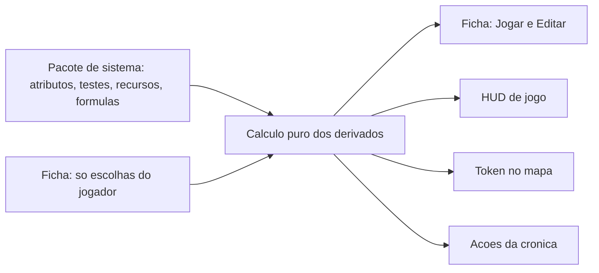

# Subversus VTT — Ficha de personagem multi-sistema e HUD de jogo (brainstorm v0)

> **Status:** brainstorm · **Owner:** mantenedor · **Revisado:** 2026-11-24
> **Relacionados:** [subversus-vtt-v0.md](./subversus-vtt-v0.md) · [mesa-ui-brainstorm-v0.md](./mesa-ui-brainstorm-v0.md) · [ai-social-dungeon-v0.md](./ai-social-dungeon-v0.md) · [STITCH-MESA-GUIA.md](../design/stitch-captures/STITCH-MESA-GUIA.md) · `client/js/dungeon/vtt-schema.js` · `client/js/dungeon/screen-sheet-levelup.js`

Ideias para a ficha de personagem do **Subversus VTT** (rótulo na barra do Vox: **Subversus**) — criar, salvar, editar, compartilhar e usar na partida em **D&D 2024**, **GURPS 4e** e **Tormenta20 (Jogo do Ano)** — e para a tela de jogo com HUD no estilo Diablo II. A ficha vem primeiro porque é a fonte dos números, dos rótulos e do vocabulário que o HUD, o token e a crônica exibem. É brainstorm, não contrato: o que já foi decidido e o que segue em aberto está na §9.

---

## 1. Ponto de partida

- A ficha atual é presa a D&D: seis atributos fixos (`str`…`cha`), `pools_base` com `hp_max`, `gold_initial` e `spell_slots_max`, e rolagens `1d20+@for+@prof` (`vtt-schema.js`, `dungeon-state.js`).
- Tormenta20 só existe como preset de subida de nível (`LEVELUP_PRESETS.tormenta20` em `screen-sheet-levelup.js`).
- GURPS não cabe nesse modelo: não usa d20, as perícias são roladas com 3d6 contra o nível de habilidade (NH) e a evolução é por pontos.
- Os rascunhos do Stitch têm a base certa, mas vêm cheios de ruído técnico (§2).

## 2. Rascunhos do Stitch: o que fica e o que sai

São 20 rascunhos (`code.html` e `screen.png`), guardados fora do repo. Este doc cita o que eles mostram, sem copiar as imagens.

**Fica — Grimório (ficha):**

- Atributo como cartão tocável: valor, modificador e "Rolar d20 + 3".
- Perícias treinadas com o bônus final ("Atletismo +5").
- Cartão de ataque com "Ataque +5 · Dano 1d8+3" e o botão "Rolar Ataque".
- Usos limitados com contador ("Canalizar Divindade · 1/1 Diário").
- Reação como ação própria ("Bloqueio com Escudo · Ativar Reação").
- Mochila com peso e carga, e o botão "Usar" no consumível.
- Subida de nível com escolha explícita (por exemplo, Estilo de Luta).

**Fica — Mesa:**

- Mapa ocupando a tela, com o token mostrando retrato, PV e "Sua vez".
- Barra de ferramentas flutuante (Mover, Régua, Anotar, Moldes de área) com atalho para a ficha.
- Ações da crônica geradas a partir da ficha: "Atacar com Espada Longa (+5)", "Bloquear com Escudo (Reação)".
- Resultado do dado legível ("18 · Total 21") com Normal / Vantagem / Desvantagem.
- No mobile, a faixa "LYRA · HP 28/32 · CA 17": é a semente do HUD.

**Sai:**

- Jargão técnico na frente do jogador: Hash do Nó, Quórum 4/4, Vector Clock, 0 Conflitos, Assinatura Local, CRDT, IndexedDB, "Auditado P2P", "Entropia CS-PRNG", "Hash SHA-256 verificado por quórum".
- Rodapé "Protocolo Soberano… Arquitetura Lítica Imutável" e títulos inflados como "Rolar D20 Monumental" e "Sucesso Cívico".
- Crônica @Tag com "Bloco #41" dentro da ficha.
- Formulário "Inscrever Novo Item" e assistente de nível abertos na tela principal: vão para o modo Editar ou para um fluxo próprio.
- Compositor de fórmula de dados à vista: vai para "avançado".
- Navegação repetida (abas no topo, dock, "Grimório completo" e "Ficha de Lyra" ao mesmo tempo).
- Três selos de status de rede no cabeçalho: no máximo um, e só quando algo está errado.

**Lição:** a mesma Lyra aparece com PV 24/24 e CA 16 numa tela e com PV 28/32 e CA 17 em outra. Mesa, HUD e token leem os números da ficha; nenhum deles guarda cópia própria.

## 3. Princípios (pensados para o usuário leigo)

1. A ficha responde cinco perguntas, nesta ordem: **quem eu sou**, **quanto eu aguento**, **o que eu faço bem**, **o que eu posso usar**, **o que eu carrego**.
2. Dois modos. **Jogar** é o padrão (ler e rolar). **Editar** só entra pelo botão de lápis, para nada mudar sem querer no meio da partida.
3. A ficha mostra o número final. A conta aparece só ao tocar: "+5 = DES +3, proficiência +2".
4. Tocar num teste rola o teste. O resultado aparece ali mesmo e vai para a crônica.
5. Busca "Rolar…": três letras encontram qualquer teste, ataque ou magia.
6. Favoritos: o jogador fixa até 6 itens em "Mais usados". Essa mesma lista vira a barra de habilidades do HUD (§7).
7. O que é técnico (sincronização, `delta_ledger`, cofres, `@tag`, auditoria) sai da frente: vai para "Detalhes técnicos", recolhido, ou deixa de aparecer.
8. Uma palavra por conceito, a do sistema: "CA" no D&D, "Defesa" no Tormenta20, "Esquiva" no GURPS. Nada de rótulo genérico inventado.

## 4. Modelo multi-sistema

A ficha guarda só o que o jogador escolheu. Um **pacote de sistema** (dados, não telas próprias) define atributos, testes, recursos e fórmulas; funções puras calculam os derivados.



- **Teste** é o conceito único, com dois tipos de resolução:
  - `d20_vs_cd`: d20 + bônus contra uma CD (D&D, Tormenta20), com vantagem/desvantagem onde o sistema prevê.
  - `3d6_sob_nh`: 3d6, passa se tirar até o NH; crítico e falha crítica dependem do NH (GURPS).
- **Recurso** é tudo que tem máximo e atual: PV, PM, PF, espaços de magia, usos por descanso. O HUD desenha recursos sem saber de qual sistema vêm.
- Derivados nunca são gravados. Assim, edições simultâneas na ficha compartilhada conflitam menos e subir de nível atualiza tudo sozinho.
- A ficha atual (Lyra) migra para o pacote `dnd5e-2024`.

| Sistema | Atributos | Testes | Recursos | Evolução |
| :--- | :--- | :--- | :--- | :--- |
| D&D 2024 | 6, com resistência | 18 perícias, ataques | PV, Dados de Vida, espaços de magia, Inspiração Heroica | nível |
| GURPS 4e | ST, DX, IQ, HT | perícias com NH e dificuldade F/M/D/MD | PV, PF | pontos |
| Tormenta20 | 6 | cerca de 29 perícias (Fortitude, Reflexos, Vontade, Luta, Pontaria e Iniciativa incluídas) | PV, PM | nível |

Detalhes por sistema:

- **D&D 2024:** CA, Iniciativa, Deslocamento, testes contra a morte, maestria de arma.
- **GURPS 4e:** secundários (Vontade, Percepção, Velocidade e Deslocamento Básicos, Esquiva); vantagens e desvantagens com custo; pontos totais e não gastos; níveis de carga; dano GdP/GeB.
- **Tormenta20:** a edição atual do livro básico (Jogo do Ano). Defesa; poderes; magias por círculo com custo em PM. Resistência, ataque e iniciativa são perícias, então a lista de testes é a mesma para tudo. O cartão de atributo mostra um número só, o modificador que entra nas rolagens; a forma exata de gerar atributos segue o livro e é conferida quando o pacote for escrito.

## 5. Layout da ficha

### 5.1 Mobile (390 px, primeiro)

```
+------------------------------------+
| [retrato] Lyra      D&D 2024 [lapis]|
|           Guerreira 3              |
| PV ########---- 18/24      [-] [+] |
| Condicoes: (Envenenada x)          |
+------------------------------------+
| Jogar | Habilidades | Itens | Sobre |
+------------------------------------+
| [ Rolar...                       ] |
| MAIS USADOS                        |
| [Espada +5] [Percepcao +4] [ ... ] |
| ATRIBUTOS                          |
| FOR +3  DES +1  CON +2  ...        |
| DEFESA  CA 16 | Iniciativa +1      |
| TODOS OS TESTES        [filtro v]  |
| Acrobacia +1     Arcanismo +0      |
| Atletismo +5     ...               |
+------------------------------------+
```

- **Jogar:** favoritos, atributos, defesas e resistências, lista completa de testes.
- **Habilidades:** magias, poderes e vantagens em grupos, com o custo à vista (espaço, PM ou PF) e o botão **Usar**, que gasta o recurso e rola.
- **Itens:** inventário em grade como no Diablo II (§5.4) e dinheiro.
- **Sobre:** identidade, história, notas e **Compartilhar**.

### 5.2 Desktop

Duas colunas: cabeçalho, PV, condições e atributos fixos à esquerda; as quatro abas à direita. Nada de três colunas.

```
+----------------------+-------------------------------------+
| [retrato] Lyra [lapis]| Jogar | Habilidades | Itens | Sobre |
| Guerreira 3          |-------------------------------------|
| PV 18/24  [-] [+]    | [ Rolar...                        ] |
| Condicoes            | MAIS USADOS  [Espada +5] [...]      |
| FOR +3  DES +1       | TODOS OS TESTES                     |
| CON +2  INT +0  ...  | Acrobacia +1   Arcanismo +0   ...   |
| CA 16 | Inic. +1     |                                     |
+----------------------+-------------------------------------+
```

### 5.3 Rolar a partir da ficha

1. Toque em "Atletismo +5": rola `d20 + 5` com o modo atual (Normal / Vantagem / Desvantagem).
2. O resultado aparece sobre o item ("18 · Total 23") e entra na crônica como "Lyra · Atletismo · 23".
3. Toque longo (ou o "i"): mostra a conta e o botão de fixar nos favoritos.

### 5.4 Inventário em grade (estilo Diablo II)

```
+---------------------------------------+
| EQUIPADO                              |
|        [cabeca]                       |
| [mao D] [corpo] [mao E]   [amuleto]   |
|        [pes]              [anel][anel]|
+---------------------------------------+
| MOCHILA  10 x 4         carga 5/24 kg |
| [Espada ][Espada ][Pocao][  ][  ]...  |
| [Escudo ][Escudo ][Corda][  ][  ]...  |
| [Escudo ][Escudo ][     ][  ][  ]...  |
| CINTO  [Pocao][Pocao][    ][    ]     |
| Dinheiro: 50 PO          [Organizar]  |
+---------------------------------------+
```

- Cada item ocupa células conforme o tamanho na grade `10×4` (mochila) e `4×1` (cinto). O tamanho vem da tabela padrão por categoria do pacote de sistema e pode ser ajustado no modo Editar:

| Dimensão (`w×h`) | Categorias de item padrão |
| :--- | :--- |
| `1×1` | poção, elixir, anel, amuleto, pergaminho, munição (feixe), foco pequeno, chave/insígnia |
| `1×2` | adaga, varinha, tocha, algibeira, instrumento curto, ferramenta leve |
| `1×3` | espada de 1 mão, maça, machado de batalha, cajado curto, arco curto |
| `1×4` | arma de haste (lança/alabarda), espada montante (2 mãos), arco longo, cajado longo |
| `2×2` | escudo leve/médio, elmo, botas, manoplas, grimório/tomo, kit de aventura |
| `2×3` | armadura (leve/média/pesada), escudo de corpo/torre, besta pesada |

- A grade é a forma de ver e arrumar; o limite de carga continua sendo a regra do sistema (peso no D&D e no GURPS, espaços no Tormenta20). Se a carga estoura, o indicador fica vermelho e o motivo aparece por escrito.
- Arrastar um item para o boneco equipa; arrastar para o cinto (`4×1`) põe no atalho rápido do HUD. No mobile, tocar no item abre Equipar / Cinto / Usar / Descartar, sem precisar arrastar.
- **Posição guardada:** cada item solto pode ter `x`, `y` (inteiros, célula de cima à esquerda) e `rot` (booleano; troca `w`↔`h`, só em item não quadrado). Sem `x`/`y` o item entra por `first-fit`; `x`/`y` fora da grade caem na leitura; item equipado não tem posição. O desenho da mochila usa `layoutBackpack`: primeiro os itens com posição válida (por `id` crescente; quem colide com um já posto perde a posição só no cálculo), depois os sem posição por `first-fit`; o que não cabe vai para "Não coube na mochila". Mesma entrada, mesma saída em qualquer aparelho. Ficha antiga, sem `x`/`y`, desenha como antes. `x`, `y` e `rot` viajam no `.voxchar`.
- **Mutações** (mesma op assinada `INVENTORY_MUTATE`, sem op nova): `place {itemId, x, y, rot?}` só grava se o item cabe na grade e não toca o layout atual dos outros; senão não muda nada (a op é revalidada ao aplicar, então o resultado é o mesmo em todos). `organize` grava o `first-fit` abaixo em todos os itens soltos e tira a posição de quem não coube.
- **Organizar** (`organize`) reacomoda a mochila e grava a posição de cada item, por ordenação determinística (maior área `w×h` primeiro, desempate por maior altura `h` e ordem alfabética do nome), preenchendo a grade `10×4` da esquerda para a direita, de cima para baixo (`first-fit`).
- O mesmo componente aparece na ficha e no painel Itens (I) do HUD.

## 6. Ciclo de vida

- **Criar:** assistente por sistema com três entradas: **Rápido** (personagem pronto), **Guiado** (5 a 7 passos) e **Importar**.
- **Salvar:** automático e local; sem botão Salvar.
- **Editar:** modo lápis com validação que explica o que falta ("faltam 12 pontos" no GURPS, "escolha 2 perícias" no D&D).
- **Compartilhar:** com o Mestre na mesa, por link só de leitura, por arquivo `.voxchar` dentro do `.voxrpg.zip` ou como cópia que serve de modelo.
- **Usar na partida:** rolar, gastar recurso, marcar condição e descansar (curto e longo onde o sistema prevê).

## 7. HUD de jogo (estrutura do Diablo II)

```
+--------------------------------------------------------------+
| [retrato] Lyra (Envenenada)                    [Cronica] [=] |
| [g1] [g2] [g3]   (retratos do grupo)                         |
|                                                              |
|                MAPA (grade quadrada, vista de cima)          |
|                          [token]                             |
|                                                              |
| PV ######-- 18/24  [cinto 1][2][3][4]  [fav1]...[fav6]       |
| PM ####---- 4/8    (PM so aparece se o personagem tem magia) |
|           [C] Ficha [I] Itens [S] Habilidades [Tab] Mapa      |
+--------------------------------------------------------------+
```

- Canto superior esquerdo: retrato, nome e condições. Logo abaixo, os retratos do grupo com PV resumido.
- Base da tela: indicador de PV, indicador de magia, cinto com 4 consumíveis e a barra com os 6 "Mais usados" da ficha.
- O formato do indicador é livre (barra, orbe, contador); o que importa é ler PV de relance. Orbes literais são opcionais e ficam para a direção de arte.
- O indicador de magia só aparece se o personagem tem um recurso de magia com máximo acima de zero, e usa o rótulo do sistema: PM no Tormenta20, espaços de magia no D&D (pontos por nível de círculo), PF no GURPS quando o personagem tem magias. Guerreiro sem magia vê só PV.
- Ficha (C), Itens (I), Habilidades (S), Mapa (Tab) e Crônica abrem painéis que cobrem metade do mapa, como no Diablo II, sem modais. O painel Ficha é a própria ficha da §5 em largura reduzida, e o painel Itens é a grade da §5.4, não versões paralelas.
- Todos os rótulos vêm do pacote de sistema, então o HUD fala a mesma língua da ficha.
- **Direção de arte do HUD:** base de tokens Sovereign Agora (`--sa-*`, garantindo contraste WCAG AA e zero requisição externa ou bitmap pesado) com superfície escura de pedra ("Sovereign Sanctum") aplicada aos painéis de meio-ecrã (Ficha `C`, Itens `I`, Habilidades `S`, Crônica) e à barra inferior do HUD, sem molduras góticas ornamentais que roubem área útil no mobile 390 px.
- No mobile, o HUD encolhe para a faixa "Lyra · PV 18/24 · CA 16" (mais PM se houver) e a barra de favoritos.

## 8. Mapa: grade simples, vista de cima

- O mapa é uma imagem com grade quadrada por cima, vista de cima, como a Mesa já faz hoje. Névoa, régua, área de efeito, portas e andares continuam como estão.
- O token é o retrato da ficha num círculo, com PV e "Sua vez". Tocar no chão mostra o caminho e o alcance do deslocamento do personagem, calculado pela ficha.
- Não é tempo real. Mover só posiciona; atacar é rolar o teste e registrar na crônica; quem aplica o dano é o Mestre.
- **Isométrico fica fora por enquanto:** não há arte isométrica, e um mapa de cima apenas inclinado vira um tabuleiro em losango sem ganho. Para não fechar a porta, as posições continuam guardadas em coordenadas de grade, e não em pixels da tela.

## 9. Licença, decisões e fases

**Licença de conteúdo:**

- **D&D 2024:** SRD 5.2 sob **CC-BY-4.0** (atribuição canônica no pacote `dnd5e-2024`; zero conteúdo fora do SRD).
- **Tormenta20 (Jogo do Ano):** confirmada a ausência de licença aberta para texto editorial e Product Identity da Jambô (Arton, divindades, textos de poderes e magias). O pacote `t20` embute **apenas estrutura, matemática (`d20_vs_cd`), nomes das perícias básicas e campos de recursos (PV/PM)**; descrições de poderes e magias entram pelo usuário ou por importação local (`.md`/`.voxchar`).
- **GURPS 4e (Steve Jackson Games):** confirmada a ausência de licença aberta (a SJ Games Online Policy veda redistribuir catálogos e tabelas do Basic Set). O pacote `gurps4e` embute **apenas matemática pura (`3d6_sob_nh`, ST/DX/IQ/HT, PV/PF/Vontade/Percepção/Vel/Desl/Esquiva, níveis de carga e curva de pontos F/M/D/MD)**; vantagens, desvantagens e perícias entram como estrutura editável/importada pelo jogador.

**Decididas (2026-11-20):**

- **Tormenta20:** a edição atual do livro básico, sem regra caseira; o cartão de atributo mostra só o modificador (§4).
- **Indicadores do HUD:** PV sempre; magia só se o personagem tem magia. Não precisa ser orbe (§7).
- **Inventário e tamanhos na grade (`10×4` + cinto `4×1`):** grade como no Diablo II com tabela padrão por categoria (`1×1` a `2×3`), botão **Organizar** determinístico (`first-fit` por maior área `w×h`, altura `h` e nome) e limite de carga do sistema (§5.4).
- **Mapa:** grade quadrada vista de cima; isométrico fora até existir arte isométrica (§8).
- **Direção de arte do HUD:** tokens Sovereign Agora (`--sa-*`, WCAG AA, zero requisição externa/bitmap pesado) com superfície escura de pedra ("Sovereign Sanctum") nos painéis de meio-ecrã (`C`, `I`, `S`, Crônica) e barra inferior, sem molduras góticas ornamentais no mobile 390 px (§7).
- **Licença de conteúdo (D&D 2024, Tormenta20 e GURPS 4e):** SRD 5.2 sob CC-BY-4.0 no `dnd5e-2024`; apenas estrutura e matemática pura nos pacotes `t20` e `gurps4e`, com textos e catálogos fornecidos/importados localmente pelo jogador (§9).

**Em aberto:**

- Nenhum bloqueador aberto para a v0.

**Fases sugeridas:**

1. Pacote de sistema e ficha D&D 2024 (migração da Lyra), já com o inventário em grade.
2. Tormenta20.
3. GURPS 4e.
4. HUD de jogo sobre o mapa atual.
