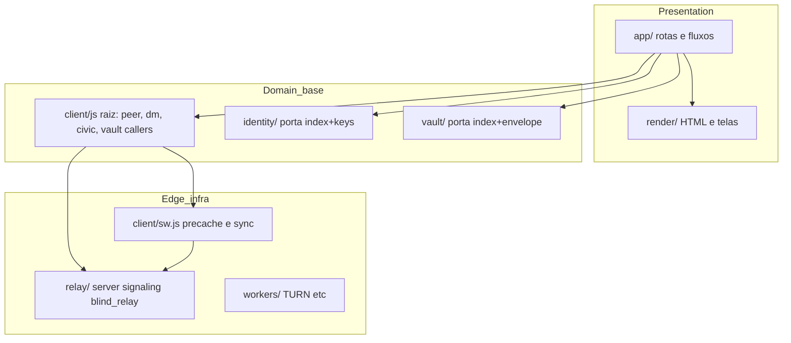
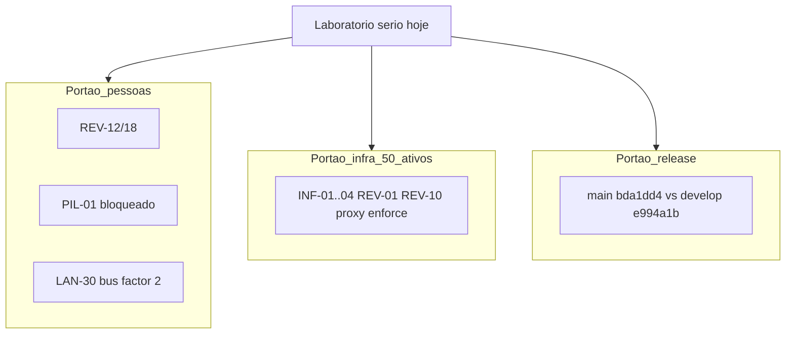
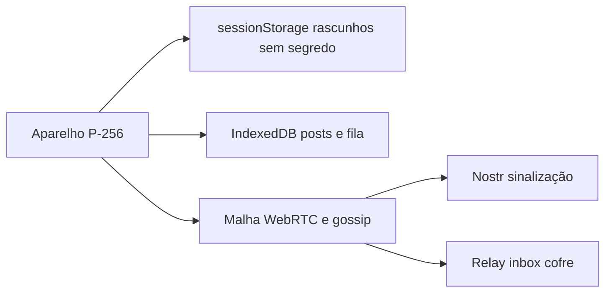

# Análise do repositório Vox (nov/2026)

> **Status:** auditoria (retrato nov/2026; não substitui o [ROADMAP](../ROADMAP.md)) · **Owner:** mantenedor · **Revisado:** 2026-11-19

Espelho versionado do retrato do repo: arquitetura, portões (pessoas / infra >50 / release) e estado Git. Plano canônico de prioridade continua só no ROADMAP.

## Proposta (o que o projeto é)

**Vox** é um **PWA local-first** de participação cívica: identidade e chaves no aparelho, feed/comunidades/governança/DM cifrada, Feira, POSSE — com compromisso de **código aberto (AGPL)**, transparência e **sem vender alcance**.

Decisões de produto recentes (alinhadas ao handoff `lobby.md` na raiz do workspace `politica/` e ao [ROADMAP](../ROADMAP.md)):

| Decisão | Implicação |
|--------|------------|
| **Sem escrita no Arweave por agora (REV-07)** | Preservação e circulação via **rede de seguidores** + malha P2P/gossip — não permanência on-chain no dia a dia |
| **Entrada soberana (ADR-032/037)** | E-mail como canal de autocofre; **sem Google/Meta na entrada**; cofre na malha, frase, guardiões |
| **Uso por pessoas adiado (nov/2026)** | **Sem piloto V-P09**, convite aberto ou divulgação; validação = CI + testes + uso local |
| **Infra de relays adiada até >50 ativos (19/11/2026)** | Cloudflare (TURN, 2º signaling), Render (trust proxy, pinger), snapshot `enforce` no cliente — **preparar no código/docs**, **ops só após gatilho**; INF-01…INF-04 em [`ROADMAP.md`](../ROADMAP.md) via [#283](https://github.com/yurikayel/vox/pull/283) mergeado em `develop` |
| **Uma pessoa no controle do repo** | Código público, mas **bus factor 1** até LAN-30 / segundo revisor |

Tese de tração (não é roadmap): [direcionamento-crescimento-rede-2026-11.md](./direcionamento-crescimento-rede-2026-11.md) — Brasil, nicho relacional, **uma praça que funciona** antes de “viralizar protocolo”; 4 camadas (Passivo → Steward); **sem leaderboard**.

Tripé de produtos ([ADR-011](../adr/011-taxonomia-tripartite-produtos-vox.md)): **cliente** (`vox`), **nó apoio** (`vox populi`), **memória central dev** (ZeroMemory / `central_memory.py`).

---

## Arquitetura técnica

### Cliente (`client/`)

- **Sem bundler:** HTML + CSS + **ES modules**; roteamento em [client/js/app/route-parse.js](../../client/js/app/route-parse.js) + telas em `app/screens-*.js`.
- **~300 módulos** em `client/js/`: domínio na raiz (`peers.js`, `crypto-dm.js`, `governance.js`, …), UI em `render/`, laboratório em `labs/` e `dungeon/`.
- **Camadas (ADR-035, accepted):** regra em [scripts/layers-lib.mjs](../../scripts/layers-lib.mjs) — `app` → tudo; `render` → render+base; `base` → base; `labs` → labs+base. Contextos **`identity/`** e **`vault/`** com **portas** (`index.js`, `keys.js`, `envelope.js`) para quebrar ciclos.
- **Service Worker** [client/sw.js](../../client/sw.js): precache do shell, `CACHE_NAME` **v7.143**; lista `UNPLUGGED_MODULES` tira ~21 módulos mortos do cache ([labs/parado/](../../client/js/labs/parado/README.md)).
- **Rede:** WebRTC/gossip ([peers.js](../../client/js/peers.js), [peer-sync.js](../../client/js/peer-sync.js)), sinalização WebSocket **e** Nostr efêmero (REV-09), opcional memória central local, upload Arweave **desligado por flag**.

### Relay (`relay/`)

- **Signaling** ([signaling.py](../../relay/signaling.py)): ICE/SDP; limite de conexões, rate limit (#203).
- **Relay completo** ([server.py](../../relay/server.py)): cache de txs, inbox DM, OAuth exchange, cofre central, genesis guard — CORS endurecido (#265), paths via [safe_path.py](../../relay/safe_path.py) e [vault_store.py](../../relay/vault_store.py).
- **Blind relay / P2P seed / mirror:** módulos separados; specs em [docs/specs/relay-api.md](../specs/relay-api.md).
- **Deploy:** Render (sinalização), espelhos GitHub Pages / Cloudflare; **não** há relay completo público operado por terceiro (REV-04).
- **Snapshot cego pós-#281 (`develop`):** [`relay/snapshot_auth.py`](../../relay/snapshot_auth.py) + [`blind_relay.py`](../../relay/blind_relay.py); `POST /relay/snapshot/<canal>` via [`server.py`](../../relay/server.py) (`_handle_blind_snapshot_post`) lê `X-Vox-Snapshot-Proof`; padrão `VOX_RELAY_SNAPSHOT_AUTH=compat` (sem prova → aceito como legado, sem podar); `enforce` → `403`. Só snapshot autenticado poda; cliente ainda não manda prova (D2 do RFC) → **INF-04** (>50).
- **Política vigente (gatilho >50 ativos):** manter Render + cron [`sentinel-keepalive.yml`](../../.github/workflows/sentinel-keepalive.yml) endurecido (#282: 3×60 s, issue só se as 3 falharem); **não** deploy TURN, 2º nó, `VOX_RELAY_TRUST_PROXY_HOPS` nem relay `enforce` até **>50 ativos** (pico de `peers` em `/health` como indicador inicial; contagem ainda manual).

### Tooling e qualidade

- **`npm run validate`:** lint, pylint, `audit:complexity`, `audit:docs`, **`audit:layers`**, testes ([package.json](../../package.json)).
- **CI:** Node 22/24, Python 3.11–3.15, PM-99 malha 2 browsers, PM-111 red-on-base, CodeQL, hardening.
- **Docs canônicas:** [docs/README.md](../README.md) como índice; [FEATURES.md](../FEATURES.md) como verdade de “o que está no ar”; **só** [ROADMAP.md](../ROADMAP.md) tem checklist `[ ]`.

---

## Organização do repositório

| Área | Função |
|------|--------|
| [`client/js/app/`](../../client/js/app) | Orquestração de telas e fluxos (onboarding, compose, DM, comunidade) |
| [`client/js/render/`](../../client/js/render) | Geração de HTML (sem DOM pesado no domínio) |
| [`client/js/identity/`](../../client/js/identity) | Conta local, frase, guardiões, cofre relacionado |
| [`client/js/vault/`](../../client/js/vault) | Criptografia de cofre, mesh vault (ADR-037) |
| [`client/js/labs/parado/`](../../client/js/labs/parado) | Código testado mas **não plugado** (webxdc, kit-genesis, polis, …) |
| [`relay/`](../../relay) | Backend Python + testes espelhando API |
| [`docs/adr/`](../adr) | Decisões (032 identidade, 035 camadas, 037 malha, 038 subrede proposta, …) |
| [`docs/specs/`](../specs) | Protocolos e APIs |
| [`tests/`](../../tests) | Suíte Node (`node:test`) espelhando módulos |
| [`workers/`](../../workers) | Cloudflare Workers (ex. TURN credentials) |
| [`packaging/`](../../packaging) | Vox.exe, APK, Linux/macOS guides |

Governança de código: **hardening** (LLOC, CC, nesting) em [docs/HARDENING.md](../HARDENING.md); dívida em `docs/metrics/baseline-*` (não commitar).

---

## Roadmap (onde o projeto *diz* que vai)

Fonte única de prioridade: [docs/ROADMAP.md](../ROADMAP.md) + calendário [brainstorm-roadmap-2027.md](../brainstorms/brainstorm-roadmap-2027.md).

**Autoavaliação do próprio roadmap (“Onde estamos”, nov/2026):**

- Cliente **maduro** (feed, comunidades, governança, DM, POSSE, flags).
- Para a rede **se sustentar sem o mantenedor**, falta quase tudo de **infra e gente**: 2º signaling, TURN em produção, relay público, piloto humano, parecer jurídico, bus factor ≥2.

**P0 atual (resumo):** REV-12/18 (jurídico/associação), PIL-01/02 (piloto, bloqueado por política “sem pessoas”), PM-01 (dieta do shell), REV-14 (recuperação iOS/QR), PM-112 (mutação Tier A), REV-09 (Nostr — código no ar, aposentar keepalive só com evidência de campo).

**Rebaixados ao gatilho >50 ativos (INF-01…04, #283 em `develop`):** TURN (INF-01 ≈ REV-10), 2º signaling (INF-02 ≈ REV-01), trust-proxy + pinger (INF-03), cliente + `enforce` (INF-04). REV-01/REV-10 **continuam** como IDs técnicos no calendário 2027; a **execução ops** abaixo de 50 ativos fica nas linhas INF-* com 📅 >50.

**Dupla leitura (pós-#283):**

| Fonte | Infra substituível |
|--------|-------------------|
| Calendário Dez/2026–T1 (texto antigo) | Ainda cita REV-01, REV-10, NET-02 em marcos de trimestre |
| Seção INF + decisão 19/11 | Ops de relay **só** após >50 ativos; preparação em código já feita (#281, runbook) |
| `lobby.md` (workspace `politica/`, fora de `vox/`) | Handoff fechado em `develop` `e994a1b` |

**Nota de leitura:** dez/2026–T1 **não** devem iniciar deploy TURN/2º nó abaixo do gatilho; datas de **desistência jurídica** (associação, parecer) seguem válidas e **independentes** do gatilho de infra.

**Observabilidade pré-gatilho:** [#282](https://github.com/yurikayel/vox/pull/282) mergeado — keepalive resiliente à partida a frio da Render; não substitui pinger externo (INF-03, >50).

**Horizonte 2027:** G1 piloto (T1) → G2 beta convite (T2) → decisão LAN-29 go/no-go (T4); com **datas de desistência** explícitas se faltar associação, parecer ou plantão — **piloto não** fica bloqueado por “fechar segundo nó” no curto prazo (isso é portão de infra >50).

---

## Onde estamos — avaliação honesta

### O que está forte

1. **Profundidade de produto no cliente:** o [FEATURES.md](../FEATURES.md) descreve dezenas de fluxos **no ar** com testes — incomum para projeto com uma pessoa no GitHub.
2. **Disciplina de engenharia recente:** release #262 integrou fila S30 + auditoria R (#267–#277): camadas, Nostr, CORS, `safe_path`, genesis sem PII em storage, triagem CodeQL, testes adversariais.
3. **CI como contrato:** malha E2E, red-on-base, catracas de docs/camadas/complexidade — alinhado ao perfil canônico v3.2.
4. **Honestidade documental:** Arweave pausado, piloto bloqueado, espelho B ainda sob mesmo operador — dizido no ROADMAP, não escondido.
5. **Segurança preparatória sem ops extra:** snapshot autenticado no relay (#281, `compat`) + ROADMAP INF (#283) deixam o próximo passo de infra **documentado e testado**, sem Cloudflare/Render novos hoje.

### O que está frágil ou incompleto

1. **Rede real:** dependência de **um** nó Render — **por escolha de fase** (<50 ativos), não por esquecimento; TURN/2º nó/trust-proxy em INF-*; risco residual (sleep, falso alarme keepalive) **mitigado** por #282, não eliminado; DM offline depende de relay; **sem** stewards públicos.
2. **Governaça humana:** bus factor 1; sem piloto; sem segunda pessoa no plantão (LAN-04).
3. **Dívida de superfície:** ~**45 alertas CodeQL** abertos (maioria JS legado); gate do release foi fechado no delta, não “zero dívida”.
4. **Código vs documentação de release:** [README.md](../../README.md) ainda cita SHA/testes antigos; [release-metadata.json](../release-metadata.json) desatualizado (17/11) — **a fonte viva após #262 é CI + `CACHE_NAME` v7.143 na `main`**.
5. **Funcionalidade “escrita, não plugada”:** 21+ módulos em `labs/parado/` — capacidade futura (webxdc, bridging, kits) sem impacto no uso atual.
6. **Mochila DM, subrede manifesto (ADR-038), lápide de conta (PM-101):** planejados ou parciais; identidade Ed25519 “cintura fina” ainda não plugada.
7. **Operação local:** dezenas de worktrees `claude/*` e artefatos fora do git — sinal de alta velocidade de IA, custo de higiene para o mantenedor.
8. **Métrica de “ativo”:** proposta = pico de `peers` em `/health`; **sem** automação nem definição fina no repo — cegueira operacional honesta até o dono fixar o critério.

### Três portões (decisões independentes)

### Em uma frase

**Cliente cívico denso em `main` (S30) e relay blind com auth `compat` em `develop`; rede pública não validada em campo; infra de substituição conscientemente congelada até >50 ativos; abertura a pessoas segue portão à parte (jurídico, piloto, bus factor) — não exige segundo nó no curto prazo.**

**Fonte operacional viva:** CI no SHA da branch em uso + `CACHE_NAME` (v7.143 em `main`; idem em `develop` até próximo bump de SW).

### Estado Git e fila (atualizado 19/11, pós-merge)

| Ref | SHA | Conteúdo relevante |
|-----|-----|-------------------|
| **`main`** | `bda1dd4` | Release #262 (S30); **não** inclui #281–#283 |
| **`develop`** | `e994a1b` | **~10 commits** à frente de `main` (`origin/main..origin/develop`) |

**Fechados em `develop` (19/11, CI 15/15 + CodeQL no head de cada PR):**

- [#281](https://github.com/yurikayel/vox/pull/281) — snapshot relay `compat` (RFC 0002)
- [#283](https://github.com/yurikayel/vox/pull/283) — ROADMAP INF-01…04, gatilho >50
- [#282](https://github.com/yurikayel/vox/pull/282) — keepalive 3 tentativas × 60 s

**Auditoria R (#267–#277):** integrada antes/durante o release #262; não confundir com fila aberta.

**Drift intencional:** `main` pública até próximo release; quem testa relay/ROADMAP novo deve rastrear `develop`.

---

## Diagrama: modelo de dados / confiança (simplificado)

---

## Leituras recomendadas (ordem)

1. [FEATURES.md](../FEATURES.md) — o que existe de verdade  
2. [ROADMAP.md](../ROADMAP.md) § “Onde estamos” e P0  
3. [ADR-035 camadas](../adr/035-camadas-e-contextos.md) + [identity/index](../../client/js/identity/index.js)  
4. [relay/README.md](../../relay/README.md) + [relay-api.md](../specs/relay-api.md)  
5. [docs/security/codeql-pr262-triagem.md](../security/codeql-pr262-triagem.md) — o que foi tratado no release  

---

## Próximos passos (política pós #281–#283 — sem ops de relay)

**Já feito em `develop`:** INF no ROADMAP, keepalive resiliente, relay snapshot `compat`.

**Abaixo de 50 ativos (produto/código, inalterados pelo gatilho):** PM-01, REV-14, dívida CodeQL gradual, `audit:docs`, LAN-18 antes de crypto nova; piloto V-P09 **continua bloqueado** por política “sem pessoas”.

**Só após >50 usuários ativos (ops — INF-*):**

- INF-01: TURN produção ([runbook](../operations/turn-e-segundo-no.md))
- INF-02: 2º signaling (REV-01)
- INF-03: `VOX_RELAY_TRUST_PROXY_HOPS` + pinger externo (~5 min)
- INF-04: cliente com prova + relay `enforce`

**Release / higiene (decisão humana):** `develop` → `main` quando fechar lote; limpeza worktrees `claude/*`; README / `release-metadata.json` ainda atrasados vs `main` #262.

**Proibido até gatilho ou OK explícito:** deploy TURN, 2º nó, trust-proxy Render, `enforce`, piloto aberto.