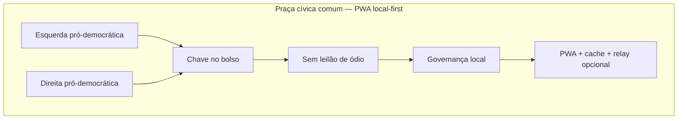

# Tese — praça cívica para militância pró-democrática (E+D institucional)

> **Status:** canônico (tese / mapa; **não** DoD, **não** sprint) · **Owner:** voluntário doc · **Revisado:** 2026-10  
> **Não substitui** o [dossiê N=25 §3.6](./dossie-geral-inventario-master-breakdown-2026-11.md#36-checklist-master-vivo-n25) (único checklist vivo) nem o [direcionamento de tração](./direcionamento-crescimento-rede-2026-11.md).  
> Gates vivos, piloto e caixas `[ ]` **só** no dossiê. Este arquivo **não** abre tabela `N=`.

Insumo de campo (out/2026): manifesto *Como o Vox pode ser uma Ferramenta Hoje para a Militância Pró-Democrática (Esquerda e Direita)*. Aqui vira **mapa de tese** cruzado com código e docs já existentes.

---

## O que isto é

Uma **estrada cívica** — praça comum para esquerda pró-democrática (base popular, sindicatos, direitos sociais) e direita pró-democrática (institucionalistas, liberais, legalistas). Não é partido, não é comitê editorial, não é tribunal da plataforma.

Quem usa a praça continua discordando de programa. O que é comum: recusar leilão de ódio, desplataformização opaca e guerra híbrida como método.

## Três lógicas (fazenda / pensão / movimento)

| Lógica | O que é | O que o Vox **não** promete |
|--------|---------|-----------------------------|
| **Big Tech = fazenda** | Terra de outro. Seguidor é aluguel; o dono leiloa atenção e pode despejar a conta. | “Migrar a fazenda para o Brasil” (Modelo A). |
| **Fediverso clássico = pensão / serviço** | Instância com síndico. Alguém paga VPS, não falir e não queimar. | Empurrar custo de pensão para o voluntário (Modelo B). |
| **Vox = movimento / bem comum** | Cliente no aparelho + protocolo. **Inalienável = chave no bolso**, não slogan de rede indestrutível. | 100% P2P no 4G, imunidade judicial, “calar a rede = confiscar cada celular”. |

Gateways e relays são **leitura reserva** e vizinhos voluntários. Apagar um URL não zera todos os aparelhos; o inverso também é falso — aparelho, backup e índice ainda importam. Modelos A–D: [POSITIONING.md](../POSITIONING.md) · [campo-debate-aberto-ndp-2026-10.md](./campo-debate-aberto-ndp-2026-10.md).

## Seis pilares (leitura honesta)

1. **Isonomia (1 pessoa ≈ 1 chave local).** Alcance não se compra; voto comunitário é 1× ([GOVERNANCE.md](../GOVERNANCE.md)). Identidade viva: `vx_…` com **ECDSA P-256** (`local-account.js`) + carteira **RSA/JWK Arweave** para permaweb. Ed25519 é tag auxiliar reservada ([IDENTITY.md](../IDENTITY.md)) — não é o algoritmo corrente.
2. **Neutralidade de infra.** O Vox não arbitra programa. É calçada / microfone da praça.
3. **Sem isca de retenção.** Feed cronológico, sem ranking e sem boost. Conteúdo anda se alguém **escolhe** ecoar (POSSE), não se um leilão de raiva o empurra.
4. **Soberania da base.** Catálogo e chaves no aparelho; exportar identidade é higiene, não “o servidor Vox guarda seus seguidores”.
5. **Resiliência relativa.** PWA + IndexedDB + mesh WebRTC quando há par + relay doméstico **opcional**. Offline de mutirão não é Wi-Fi Direct mágico no browser.
6. **Deliberação, não linchamento.** Proposta + diff + `Eligibility-Cutoff`. Escopo: **comunidade**, não federação nacional.

---

## Legenda do cruzamento (T01–T20)

Status **não** é checkbox. Não marcar progresso aqui.

| Status | Significa |
|--------|-----------|
| `já existe` | Comportamento no produto, com os limites ditos na linha. |
| `parcial` | Há módulo/UI, mas o manifesto pede mais do que o código entrega. |
| `tese` | Visão; sem implementação. Não entra no dossiê só por estar nesta lista. |
| `depois do piloto (V-P09)` | Modelo D / mesa humana — [go/no-go](./piloto-comunidade-go-no-go.md) ainda `blocked-human`. |
| `não agora / risco` | Não implementar neste ciclo (liability, falso “oficial”, ToS). |

**Contagem:** 3 `já existe` · 4 `parcial` · 10 `tese` · 2 `depois do piloto (V-P09)` · 1 `não agora / risco`.

---

## Bloco I — identidade e proteção da base

| ID | Pedido (manifesto) | Status | O que há / o que não há |
|----|--------------------|--------|-------------------------|
| **T01** | Export/import `.voxid` cifrado (chaves + contatos + histórico) | `parcial` | Há: `#/perfil` → *Arquivo de soberania* (`exportAccountBundle` / `importAccountBundle` em [`local-account.js`](../client/js/local-account.js), [`tests/account-backup.test.js`](../tests/account-backup.test.js)). JSON `kind: vox-account-backup`, arquivo `vox-soberania-….json`. Não há: extensão `.voxid`, senha no arquivo, dump de IndexedDB nem lista completa de “seguidores”. |
| **T02** | Perfil coletivo multi-assinado (M-de-N) | `tese` | Conta é 1 chave local. Sem cofre M-de-N para diretório/conselho. |
| **T03** | Crachá de militância assinado pelo movimento | `parcial` | Há: OAuth client-only Google/Meta ([ADR-002](./adr/002-oauth-profile-enrich-client.md)), badge GitHub informado, cartão de malha ([ADR-003](./adr/003-profile-card-gossip.md)). Atestação de contribuição é spec ([ADR-001](./adr/001-contribution-attestation-export.md); CODE-03 aberto no dossiê). Não há: selo “Delegado Eleito” emitido por entidade sem PII. |
| **T04** | Backup WebDAV / Drive / Nextcloud | `tese` | Sem cliente WebDAV. Backup = arquivo JSON local (T01). |
| **T05** | Botão de pânico (apaga chaves do browser) | `tese` | Higiene legítima: limpar JWK / conta local **neste** navegador. Sem UI de pânico. Este doc **não** descreve evasão de busca ou ocultação de crime. |

## Bloco II — anti-guerra híbrida

| ID | Pedido (manifesto) | Status | O que há / o que não há |
|----|--------------------|--------|-------------------------|
| **T06** | Quarentena colaborativa de isca | `tese` | Próximo, distinto: `mod-action` hide/ban ([`moderation.js`](../client/js/moderation.js), [GOVERNANCE.md](../GOVERNANCE.md)) e bloqueio local. Não há envelope comunitário “deepfake / violência forjada” nem trava de reenvio. |
| **T07** | Pacote pericial 1-clique MPF / PF / CGU | `não agora / risco` | **Não** gerar kit “oficial”, print forjado nem empacotamento que simule cadeia de custódia. Denúncia é ato **humano** nos canais das ouvidorias. O produto não vira cartório. |
| **T08** | Filtro zero rage-bait | `já existe` | Feed cronológico, **sem ranking, sem boost** ([`voxpedia.js`](../client/js/render/voxpedia.js), `#/ajuda/teste`). Aba *Para você* pode misturar descoberta recente — ainda sem leilão. Ponderação por teia de confiança = T10, não T08. |
| **T09** | Alerta de retenção (30 s) | `tese` | Sem medidor de tempo de tela nem copy “você está alimentando a isca”. |
| **T10** | Listas WoT pluggable | `tese` | Visão em [brainstorm-tração](./brainstorm-tracao-escalabilidade-incubacao.md) e P2 de [rede-sustentada](./rede-sustentada-participantes.md). Sem listas ABI/observatório importáveis. |

## Bloco III — rua e mobilização

| ID | Pedido (manifesto) | Status | O que há / o que não há |
|----|--------------------|--------|-------------------------|
| **T11** | Panfleto QR / Wi-Fi Direct sem internet | `tese` | QR Pix existe ([`brcode.js`](../client/js/brcode.js)) — pagamento, não página. WebRTC precisa de sinalização e par alcançável; o browser **não** oferece Wi-Fi Direct genérico. Sem internet, o PWA serve o **shell em cache**, não um cartão mágico para qualquer transeunte. |
| **T12** | Módulo Rua & território (atos / panfletagem) | `tese` | Feira tem badge de bairro em listing — comércio, não mapa de carreata. Sem agenda de rua nem GPS de militante. |
| **T13** | POSSE (escreva no Vox, ecoe fora) | `já existe` | [`share.js`](../client/js/share.js) + [`posse-dispatch.js`](../client/js/posse-dispatch.js) + [RFC 0001](./rfc/0001-posse-export.md). Web Share, intents, clipboard, webhook opt-in. **Não** post automático silencioso em Meta/X. EXP-01 no dossiê. |
| **T14** | Mutirão / mesh em sinal fraco | `parcial` | Há: SW offline, IndexedDB, mesh WebRTC, inbox relay TTL 72 h. Não há: rádio ad-hoc entre celulares sem rede, nem “o PWA vira repetidor de rua”. CGNAT/4G: leitura via gateway é **normal** ([direcionamento §1](./direcionamento-crescimento-rede-2026-11.md)). |
| **T15** | Galeria de artes reutilizáveis | `tese` | Nome de facção (“Meme Depot Antifascista”) **não** entra no produto: a praça é **cívica / pró-democracia**, não marca de corrente. Open Frames (poll/petition) não é galeria. Artes de campanha ficam no acervo humano fora deste repo. |

## Bloco IV — deliberação

| ID | Pedido (manifesto) | Status | O que há / o que não há |
|----|--------------------|--------|-------------------------|
| **T16** | Pull request cívico (diffs / propostas) | `parcial` | Há: `governance-proposal`, diff unificado, voto yes/no/abstain ([`governance.js`](../client/js/governance.js), aba Governança). Escopo: **regras da comunidade**, não programa municipal nem carta de federação. |
| **T17** | Quórum territorial (bairro → cidade → federação) | `tese` | Há `minQuorum` local na proposta. Sem grafo de núcleos territoriais nem consulta nacional. |
| **T18** | `Eligibility-Cutoff` anti-brigading | `já existe` | `Eligibility-Cutoff = Proposal-Created-At` ([GOVERNANCE.md](../GOVERNANCE.md) · [`isEligibleToVote`](../client/js/governance.js) · [`tests/governance.test.js`](../tests/governance.test.js)). Voto posterior ao corte aparece e **não** entra no tally. |
| **T19** | Mesa redonda bipartidária (assentos paritários) | `depois do piloto (V-P09)` | Ritual humano, não feature. A praça já admite correntes distintas; paridade, tempo de fala e `[FONTE]` são **facilitação** pós-piloto — não inventar nomes no go/no-go. |
| **T20** | Prestação de mandato / verba | `depois do piloto (V-P09)` | Modelo D ([POSITIONING.md](../POSITIONING.md)): pontes com dados públicos só depois do piloto humano. Embed (EXP-02) e Frames não são painel de gabinete. |

---

## O que este texto recusa canonizar

- Rede **100% P2P** no celular brasileiro.
- **Imunidade** judicial / Art. 19 / “bytes inapreensíveis”.
- **Calar a rede = confiscate cada celular** (e o inverso).
- **Ranking, boost, leilão** de alcance — inclusive “top militante”.
- **Ed25519 no bolso** como fato do PWA atual.
- **POSSE = postar sozinho** no Facebook/Instagram.
- Kit **pericial oficial** (T07) ou tutorial de pânico para ocultar evidência (T05).
- Marca de facção no T15; mesa T19/T20 como produto antes de V-P09.

## Relacionados

- Checklist vivo: [dossiê §3.6](./dossie-geral-inventario-master-breakdown-2026-11.md#36-checklist-master-vivo-n25)
- Tração: [direcionamento-crescimento-rede-2026-11.md](./direcionamento-crescimento-rede-2026-11.md)
- Campo: [campo-debate-aberto-ndp-2026-10.md](./campo-debate-aberto-ndp-2026-10.md)
- Copy: [honest-copy-audit-2026-10-23.md](./honest-copy-audit-2026-10-23.md) · [COMPLIANCE-BR.md](../COMPLIANCE-BR.md)
